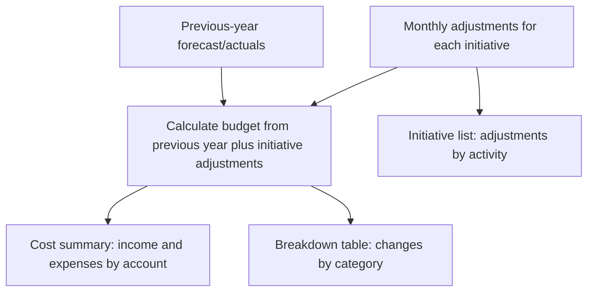
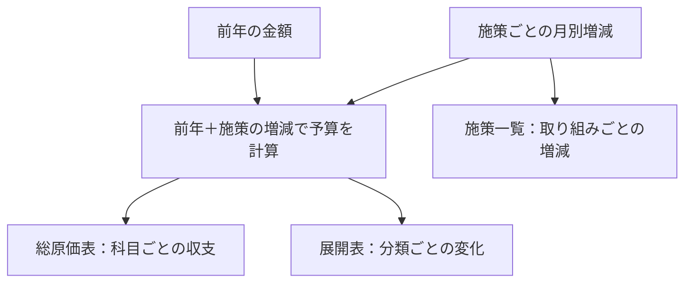

<p align="center">
  
</p>

# Triadic

[English](#english) · [日本語](#日本語)

<a id="english"></a>

## Previous-year forecast and actuals

Previous-year forecast and actuals are independent inputs. Cost and expansion screens use three independent columns: previous year, initial budget and final budget. Other comparison screens retain their two budget columns. Each budget allows one baseline; selecting the other replaces it. At least one budget stays selected. Each budget uses its own baseline in tables, dashboard graphs, Excel exports, and history comparison. On-screen tables use the independently selected previous-year value alongside the separately selected budgets; changing any one leaves the other two selections and amounts unchanged. Previous-year columns name forecast or actuals; budget headings use only initial/final budget on one line. Cost tables also show change for one budget or final-minus-initial for two. Cost and expansion tables save the previous-year display and both budget selections atomically. Storage format 33 rejects older or unknown formats without migration or rewriting. No new permissions or external transmission are introduced.

## English

**A Chrome extension for building budgets from initiatives and checking them in three tables.**

Enter what each initiative will do, which accounts will change, in which months, and by how much compared with the previous year to build a company's annual budget. The initiative list, cost summary, and breakdown table all use the same previous-year forecast/actuals and initiative adjustments, so you do not need to copy figures between tables.

This app is for people who want to prepare budgets currently handled in Excel in the order they think through initiatives. Plans are managed in local `.triadic` files; calculations and saving take place on your device. Plan data is not sent to external servers.

[Getting started](#getting-started) · [Main features](#main-features) · [Detailed operations](#screens-and-operations-in-detail) · [Excel import and export](#excel-import-and-export) · [Development](#development)

## One budget, three perspectives

The budget formula is **previous-year forecast/actuals + total initiative adjustments = budget**. Enter changes from the previous year for each initiative, rather than the total budget. The same data can be checked in three views.

| Table | What it shows | When to use it |
|---|---|---|
| Initiative list (施策一覧) | Monthly changes in revenue, expenses, and profit for each initiative | Review individual activities and edit them through their names |
| Cost summary (総原価表) | Previous year, budget, differences, and profit margins by account and aggregation | Filter by industry and department to review overall income and expenses |
| Breakdown table (展開表) | Revenue and profit changes by categories such as cost, rate revision, and sales expansion | Check which activities caused budget changes |



For example, if an expense was 1,000 thousand yen in a month last year, entering −100 thousand yen for “Review contracts” and +50 thousand yen for “Operate new equipment” gives an account budget of 950 thousand yen. The cost summary compares this with the previous year, the initiative list shows each initiative's adjustment, and the breakdown table shows the impact by category. For this expense account, reducing expenses increases profit and adding expenses reduces it.

## Main features

| Capability | What it enables |
|---|---|
| Enter all 12 months from April through the following March | Edit an initiative's name, notes, classifications, and monthly amounts on one screen |
| Manage initial and final budgets | The final budget inherits the initial budget, with manual overrides only for changed months |
| Select, copy, and paste table ranges | Enter multiple months, paste from Excel, and fill a range with one value |
| Configure accounts, aggregations, and classifications per file | Adapt account order, aggregation signs, industries, departments, breakdown categories, and periods to your plan |
| Compare months, quarters, half-years, and the full year | Check period amounts and budget differences in the cost summary and breakdown table |
| Export the three tables to Excel and import a previous-year template | Work with budget tables in Excel and update previous-year forecast/actuals in bulk from a dedicated template |
| Autosave and undo/redo the latest 100 operations | Save edits to registered data and undo successful changes one at a time |
| Record, view, and restore past states | Keep snapshots in the same file and restore all business data to a selected point |
| Inspect data and calculation rules in the app | Check the basis of displayed values through “Screens and data,” “How calculations work,” and “Processing flow” on Home |

Enter amounts in **thousands of yen with up to three decimal places**. `120` means 120,000 yen, and `0.001` means 1 yen. Calculations and storage use whole yen; only table displays round to whole thousands of yen. Rounded display values are never used as calculation inputs.

## Getting started

See [Load in Chrome](#load-in-chrome) for installation steps. The repository's `dist/extension/` contains the loadable distribution. To build from source, follow [Development](#development).

1. **Create or open a file.** Open the entry screen through the extension icon and choose a fiscal year and save location with “New” (新規作成). Open existing files with “Open file” (ファイルを開く) or drag and drop, and reopen the last file with “Continue” (続きから). Each file has one fiscal year, which cannot be changed after creation.
2. **Prepare accounts and classifications.** New files include 57 accounts and 15 aggregations. Review accounts, aggregations, breakdown categories, departments, and industries under “Masters” (マスタ), adding or editing as needed. Set the industries assigned to each department.
3. **Enter previous-year forecast/actuals.** In “Previous-year input” (前年入力), select one industry and one department and enter 12 months of amounts by account. You can also view totals for all departments and industries. To use Excel, export the previous-year template from “Import/export” (入出力), edit amounts, and import it.
4. **Build up initiatives.** Choose “Add initiative” (施策を追加) in the initiative list, enter its name, breakdown category, department, industry, and monthly adjustments, then register it. Period is optional. Open registered initiatives by name to edit them; changes save automatically.
5. **Review the three tables and export to Excel if needed.** Choose the initial or final budget and review income and expenses in the cost summary, category changes in the breakdown table, and individual activities in the initiative list. Select tables to export under “Import/export.”
6. **Finish work.** Use “Close file” (ファイルを閉じる) in the sidebar. Unrecorded changes are added to snapshot history. If saving fails, retry while the input remains on screen. Forcibly closing or reloading a tab may lose unsaved input.

To try the app before editing a real file, generate and open the [test .triadic file](#test-triadic-file). The company budget and dedicated fixtures cover implemented features; they are not included in the distribution.

### Initial and final budgets

Entering initiative adjustments in the initial budget also supplies the final budget. Overriding a month in the final budget makes that month use the override while other months continue to follow the initial budget. **An explicit override of 0 is also an override.**

Previous-year forecast and actuals are separate inputs. Each table selects one shared baseline for its displayed budgets.

### Saving and history essentials

Plans, masters, and snapshots are saved in the same `.triadic` file. Text and number edits to existing data autosave after 600 milliseconds without input. Registration and deletion are committed by their respective operations. If save permissions or external file updates prevent saving, the app explains why and offers recovery actions.

“Undo operation” (操作を取り消す) reverses the latest 100 operations during the current file session. “History” (履歴) views and restores saved past states, including after reopening the file. Snapshots are recorded five minutes after the first successful save of an unrecorded change, on normal file closure, and before viewing past states. There is no retention expiry; delete snapshots as needed. See [Data history](#data-history).

Edit requests include only the affected reconciliation baseline. Completion replies reuse ordered shared-state notifications with a bounded patch; initial synchronization and broad changes can still send a full snapshot.

A rejoining window rejects a group being released and checks its connection again after coordination waits; reopen the file normally after release. Joining or duplicating the same file is blocked throughout history consolidation, including save and confirmation waits. Cancellation or failure releases this restriction. During Save As and undo/redo coordination, joining the same file waits internally until the checked operation finishes; other files remain available. Success or failure releases the wait.

History consolidation waits for every window to prepare discarding and closing before committing either action. A missing response or disconnect during preparation keeps input in the remaining windows; retry starts a separate decision.

Save As and conflict recovery capture the destination contents immediately after selection, before identity checks or shared-operation waits, and reject later external changes.

Save As and conflict recovery both reject destinations used by another open/loading file or pending save. A recovery destination stays reserved until the new file reference is shared; cancellation or failure releases the reservation.

The existing header search finds saved initiatives by name, notes, and selected breakdown category, subcategory, department, industry, and period names. Space-separated terms must all match across those fields. Results show only classifications matching at least one term; an empty query shows no classification details. Historical viewing uses names from that checkpoint. No buttons or input fields are added.

Input grids support cut-and-paste moves within the same table: cutting keeps source values visible until a valid paste commits the move. Read-only cost, breakdown, and initiative tables support rectangular copying of displayed amounts to Excel or editable input grids; they do not accept pastes. No buttons, fields, permissions, storage-format changes, or network transmission are added.

### Current scope and limitations

- The app runs as a Chrome extension and handles local files for which you grant read/write permission. It does not transmit data externally or synchronize across browsers.
- The storage format is 33. All files in format 32 or earlier are rejected, whether or not they contain details. Unknown formats are also rejected without migration or overwriting. When a file changes externally, independent changes to other rows are automatically merged with your edits. Overlapping row changes or inconsistent changes are not overwritten; you can save all entered data to another file and continue. Cancellation or failure preserves input and the original file. Applying external changes clears earlier undo history, leaving only your current edit undoable. Save As copies the saved business data and history to another .triadic file and continues editing there. It preserves undo/redo and switches the filename and Continue reference only after a successful write. Category assignments and initiative category references also compare the category contents when merging. An ID reused after undo or history restoration cannot silently receive old references. Concurrent renaming and a new assignment/reference are rejected; ordinary renaming preserves existing references.
- After successfully saving a conflict to another file, the displayed filename and “Continue” reference point to that file for normal editing, undo, history, and recording on closure. Cancellation or write failure leaves references unchanged. Failure to remember the reference on the device is reported; the current screen can still resume from the successful destination.
- Excel export covers the three tables and calculation inputs; import accepts the previous-year template exported by the app. Arbitrary Excel workbooks and edits to exported three-table workbooks cannot be imported into the file. Recalculation in an actual Excel installation has not been verified.
- Input that fails to save remains on screen, but recovery after tab closure, reload, or forced termination is not guaranteed. Changes to the same file from multiple screens or external apps are detected to stop overwriting.

See [Product policy and requirements](REQUIREMENTS.md) for goals and design decisions and [Data model](DATA_MODEL.md) for storage structure. This README describes implemented features, limitations, usage, and development. Source code is published under [AGPLv3](LICENSE).

## Screens and operations in detail

### Editing initiatives, navigation, and undo

Select an initiative's name in the list to open its full-screen input directly. Edit its name, notes, classifications, and monthly amounts by budget kind with autosave, then use “Back to initiative list” (施策一覧へ戻る). There is no right-side input panel. Opening a name from the initiative list keeps its displayed budget kind; the breakdown table opens comparison target 1, including when two kinds are displayed. Search continues to open the initial budget. Returning to the list or navigating waits for normal autosave to finish, then continues. Invalid input, unfinished IME composition, or a failed save prevents navigation and preserves input for correction, retry, or discard.

Once a file is open, the fiscal year appears beside the logo and app name in the shared header. Fiscal-year display is centralized there. The left/right arrows beside it navigate backward and forward through screens visited during this file session. They are disabled without a destination, on save failure, or while an operation or confirmation is pending. Normal autosave finishes within navigation before the destination opens. Visiting a different screen after going back replaces forward history. Details of initiatives that no longer exist, such as after undoing registration, are removed from history, so back/forward visits valid destinations. Navigation history is not saved in the file.

The neighboring curved arrows are “Undo operation” and “Redo operation.” Up to the latest 100 successfully saved edits, registrations, and deletions of initiatives, previous-year amounts, masters, order, aggregations, and budget display settings can be undone one at a time. Each autosave is one operation; range input is reversed as the unit saved together. Undo results are also saved to the file; a new edit after undo replaces redo history. Saves with unchanged content do not enter history.

Undo waits for normal pending edits and autosave to finish, then reverses the latest successful operation. Invalid input, unfinished IME composition, failed saves, unregistered initiative input, confirmation dialogs, and past-state viewing prevent the operation and preserve input. Failed saves preserve data and undo history for retry with the same button. Undo history exists only in memory and clears when closing/reopening a file or restoring a snapshot. Snapshot recording and deletion are excluded, and undo preserves snapshots. Outside input fields, Ctrl/Command+Z undoes, and Ctrl/Command+Shift+Z or Ctrl+Y redoes. Input fields use the browser's normal text editing.

The entry screen and shared header display the version beside the app name. It is read from the root `package.json` and follows version updates.

### File entry and sidebar

Implemented screens include the `.triadic` entry screen, Home, previous-year input, initiative input/list/details, cost summary, breakdown table, masters, and account, aggregation, breakdown-category, industry, department, period, and budget-kind masters. Entry supports “Continue,” “Open file,” “New,” and file drops. The previous file is above separate open/new areas. The open-file area says “Drop a .triadic file here”; dragging a file highlights the whole area with a pale accent background, matching dashed border, and “Drop here to open.” Choose the new file's year in a vertical slot, defaulting to the current April-based fiscal year with its date range shown. Numbers flow vertically, spin with wheel/drag momentum, then decelerate to a year position. Focus at drag start does not shift the page. Up/down keys and clicks on adjacent years move one year at a time; OS reduced-motion settings suppress inertia.

The sidebar normally forms a 64px icon rail. Hovering shows item names and the filename; leaving collapses it. Keyboard focus within the rail also expands it. Opening with the top-left hamburger keeps it open after the pointer leaves or the screen changes. The hamburger, close button, or Esc returns to the rail. Expansion smoothly pushes the main panel aside; even on narrow screens it is limited to 280px and half the viewport width. Rail icons also open Home, Initiative list, Cost summary, Breakdown table, Previous-year input, Import/export, Masters, History, and Close file. Touch uses buttons rather than hover. Opening a file starts on Home with the rail collapsed.

Period and optional aggregation deletions compare the confirmed business fields again when saving. Reusing an ID or changing the target makes the old confirmation fail without writing; select the current target and confirm again. Unrelated master changes do not invalidate it.

New file creation reserves the selected destination in the shared session before writing. A file already open, loading, or reserved for another save/create is rejected without changing its contents. Opens arriving during creation wait and read the newly saved data. An unused existing file can still be replaced explicitly. Failed creation releases the reservation and permits retry.

### Home and disclosure of calculations and data

“Screens and data,” “How calculations work,” and “Processing flow” list their topics vertically on the left and display the selected explanation on the right. The topic list and explanation scroll independently.

The explanation uses one reading column. “Screens and data” starts with used fields, storage sources, and purposes, followed by full calculation/display explanations and expandable tables containing every stored field and reference. Calculation and processing views start with an outline of the steps, followed by inputs, full step descriptions, conditions, results, and retention. Supporting source files remain expandable at the end. No explanatory content is abridged; narrow screens scroll wide correspondence tables within the table area.

The Home diagram gives the initiative list, cost summary, and breakdown table equal circular destinations on a triangle, with Triadic at its center. Masters and previous-year input start evenly distributed around the outside. Selecting an item smoothly rearranges all destinations, including unrelated ones, and shows only its direct relationships and descriptions. Selecting a table moves it to the top vertex; clearing selection restores the initial arrangement. The first click or Enter/Space selects an item, and activating the same selected item again opens its screen. Click the background or press Escape to clear selection. Reference, structure, amount, and alternative-view relationships retain dashed, dotted, solid, and double lines, with a permanent legend. Dragged destinations and visible descriptions track their lines and return to the current selection's layout on release. Dragging does not open a screen. Transitions use every display frame, preserve position and velocity when selecting another item, and ease gently into a stop. Pressing a moving item leaves its animation running until an actual drag starts. Reduced motion shortens the transition. Background panning, wheel/pinch/button/keyboard zoom, fit-all, and camera retention on returning to Home remain available. Colors come from the product theme: monochrome backgrounds, labels, and lines, with blue/light or gold/dark accents only on the active icon. These operations do not write data.

In “Screens and data” (画面とデータ), select a screen to inspect how storage tables map to displayed items. Opening a table shows all stored fields and references and allows navigation to references used on the same screen. Previous-year input also shows storage sources for aggregation display names, membership, and signs, distinguishing subtotals, totals, and profit margins from stored actuals. Calculated tables and fixed budget-kind definitions are distinguished. This view only exposes structure, not actual data, editing, or SQL execution. “Relationship graph” (関連図) returns to the original navigation graph.

“How calculations work” (計算の仕組み) and “Processing flow” (処理の流れ) show source information, processing order, conditions/exceptions, results, and storage locations for a selected topic. They cover amount precision, inheritance, three-table calculations, loading, autosave, conflicts, history, undo, and temporary state. They show neither actual data values nor processing logs and do not change the data. “Implementation corresponding to this explanation” (説明に対応する実装) lists supporting filenames.

### Managing and selecting breakdown subcategories

Deletion checks the confirmed subcategory name and parent breakdown immediately before saving. Changed targets, including different replacements after undo, are rejected without writing; select the target again. Unrelated changes do not block deletion. Re-creation with the same ID, name, and parent cannot be distinguished. The file format is unchanged.

In Masters, “Breakdown subcategory master” (展開区分マスタ) supports registration, editing, and deletion. New files contain six subcategories—“下払いUP,” “ベースアップ,” “設備投資,” “燃料費UP,” “電気料金UP,” and “その他”—all assigned to “コスト” (Cost). When registering a subcategory, select exactly one parent breakdown category. Each subcategory belongs exclusively to that category. Edit its name and parent in the subcategory master; the breakdown-category master only displays its subcategories.

When entering or editing an initiative, the “Breakdown subcategory” field beside the category name offers only assigned subcategories. It is optional, is not auto-selected, and may remain empty. Changing the category clears the selected subcategory. The field is disabled without a category or assigned subcategories. Subcategories selected by saved or unsaved initiatives cannot change parent or be deleted. Unused subcategories can change parent or be deleted. A category with subcategories cannot be deleted. Name edits and selection changes on registered initiatives autosave; failures preserve input and saved content. Subcategories, assignments, and selections are included in the same `.triadic` file, snapshots, and undo. They do not alter amounts or calculation methods.

### Registering initiatives and entering monthly amounts

The existing account field accepts text to filter account names by partial match. Opening it shows all choices; click a choice or use arrow keys and Enter to confirm. Typing alone does not change the account or amounts. Esc, Tab, or leaving the field restores the selected name. Japanese input composition does not confirm a choice. Search stays in memory with no storage-format, permission, or network changes.

Existing amount cells in initiative entry/details and previous-year input accept arithmetic beginning with `=` (numbers, +, -, *, /, parentheses). Enter, Tab, or leaving the cell replaces the expression with its numeric result; only that result is saved. Invalid expressions, division by zero, sub-yen results, and out-of-range amounts remain unsaved with the input preserved. Expressions support up to 512 characters and 32 parentheses levels, without cell references or functions. Range paste/fill validates and converts every cell before applying.

Select monthly ranges by dragging or Shift+arrows. Copy uses tabs and line breaks; paste supports multiple rows/months, and one value fills the selected range. Ctrl/Command+Enter fills it with the value being edited; Delete/Backspace sets it to 0. Arrows, Enter, and Tab move between cells; F2 or double-click edits within a cell. Bulk input containing rows without accounts, cells outside the table, or invalid amounts is rejected entirely, preserving amounts. Input outside the initial budget creates overrides for each month in the range. Incomplete numeric input such as “-” or “1e” retains its invalid state and starting value by kind, account row, and month. Switching kinds, editing another cell, pasting, or clearing elsewhere does not release the save block. Only correcting that cell, explicitly clearing it, or canceling with Esc clears its invalid state. Cancellation restores its original amount, inheritance, and explicit override of 0. This temporary state is not saved to the file. Ordinary blank cells mean 0.

“Add initiative” in the list opens full-screen input and returns to the list after successful registration. Sidebar and Home lead to the list. Returning through the input back button, sidebar, or navigation history asks to discard entered input. Cancel or Esc preserves it; adding after discarding starts empty. Empty input returns without confirmation. Moving to master settings and canceling/failing a save preserve input.

The input screen places initiative name, notes, and registration button in that order on the top row. Beneath them, dropdowns start at the left in this order: breakdown category, subcategory, department, period, industry. Name and notes are equally wide single-line inputs, each at most 20rem. Narrow screens wrap the top row in order and use two columns for selections. Dropdowns are 36px tall and use their opened candidate lists. New-input fields and registration button are also 36px tall. Category, department, and industry are required; period is optional.

Account changes and row deletion are available even when current or saved amounts are nonzero. Changing an account preserves initial amounts and final-budget overrides, including explicit zero and inheritance. Deleting a row removes its amounts for both budget kinds. These actions wait only during autosave; continuous amount entry remains available.

The trash icon opens a compact confirmation with only “削除しますか？” (Delete?), Cancel, and Delete. Cancel or Esc keeps the input. Drag the handle to the left of the account, or use its up/down keys, to reorder rows. The order is shared by both budgets and preserves row identity, amounts, explicit zero, manual overrides, and inheritance. New input stays in the draft until registration; registered changes use autosave and undo.

Notifications stack vertically in a shared bottom-right area, so simultaneous total errors and save failures do not cover recovery buttons. They do not shift fields or tables.

Blank rows without selected accounts are not saved. An existing all-kinds/all-months-zero row is also deleted when all months are blank and its account is deselected. Unselected rows with entered amounts or overrides remain as input errors.

The period master manages only period names, initially “期間差” (carryover period) and “新規” (new). It rejects whitespace-only and duplicate names and supports registration, inline autosave editing, and confirmed deletion. Period selection is optional beside department in initiative input and autosaves after registration. Periods used by current input or registered initiatives cannot be deleted; renaming preserves references. Selecting a period does not change the fiscal year, monthly amounts, or calculations.

The initiative list places breakdown category, period, initiative name, and start year/month to the left of numeric columns, fixing their headers and cells during horizontal scrolling when the table viewport exceeds 650px. At 650px or less, only the initiative name stays fixed; classifications and start month scroll horizontally so amounts remain readable beside the name. Category/period names reflect the current master names; unselected values are blank. Narrow screens shrink fixed columns to leave room for amounts. Long initiative names wrap at 200 or fewer initiatives; at 201 or more, both wide and narrow screens use 28px rows and single-line truncation. Open an initiative to read its full name in the detail view; its button retains the full accessible name regardless of notes.

Start year/month is automatically derived from the period classification and monthly amounts, separately for initial/final budgets at load time. The list shows the selected kind's result. “New” uses the first nonzero month in the current fiscal year. “Carryover period” treats April through the last nonzero month as continuous and uses the following month in the previous fiscal year as the start. Intermediate zero months count as continuous. The check occurs before positive and negative account rows cancel, and respects final-budget overrides of 0. It is blank for all-zero months, no period, custom classifications, or a carryover period starting after April or continuing through March. Renaming preserves classification rules, and saving amounts/periods derives it from the new source data. The start date cannot be edited directly.

Amount areas do not permanently display unit, precision, or comparison-formula notes. See this document and Home's calculation explanation. Initiative input/detail cells display numbers only. Storage format, units, and precision are unchanged.

Initiative input and details place Back, the heading, and Duplicate on one row, wrapping on narrow screens. Compact vertical gaps provide more room for monthly rows while preserving field widths and font sizes. Selection totals retain their space so selecting cells does not shift the table.

Monthly initiative input uses shaded month headers and light row/column borders. Account selection and deletion share each row, with compact amount padding. Initiative input and detail show account names without codes in both the field and its choices. All account dropdowns and deletion buttons align within the column, which retains enough width for complete names on narrow screens; monthly amounts scroll horizontally within the table. Three monthly total rows—revenue, expenses, profit—always appear at the bottom in the order and composition defined by the amount-item master. Rows without accounts or attributes are excluded, and no rows still displays 0. Effective amounts for the selected budget are added/subtracted in yen according to the composition signs and rounded to whole thousands only for display. Totals follow input, account changes, row addition/deletion, kind changes, and applying the initial budget; totals themselves are not saved. Invalid amounts or out-of-range totals leave affected totals blank and report why. Input the browser cannot interpret numerically leaves totals blank.

### Entering previous-year forecast/actuals

Previous-year input places heading, department, and industry in that order, with the industry dropdown directly beside department. Narrow screens wrap controls and the table uses remaining height. Initially it shows totals for all departments/industries. Selecting a department restricts industries to its memberships and auto-selects a sole candidate. Valid selections remain; an invalid selection returns to all-industry totals. If either selection is “all,” totals are read-only; selecting both individually enables monthly entry. Selections are not saved to the file. Read-only first-half (April–September), second-half (October–March), and full-year totals follow April–March. Unrounded monthly yen amounts are summed; period profit margin is ordinary profit divided by revenue aggregation. Period columns are excluded from editing, range paste, and saving; overflow leaves affected period cells blank with a notification and preserves monthly input. During vertical scrolling, account/aggregation and month headers through the revenue aggregation row (initial display name “社内控除後売上”) stay at the top; account/aggregation names stay left during horizontal scrolling. If the frozen section plus one data row cannot fit, only column headers stay fixed and all data rows scroll; resizing restores full freezing when space permits. Account cells are editable; subtotals, totals, and profit margins calculate automatically. Drag/Shift+arrows selects ranges; copy, multirow/column Excel paste, Delete/Backspace to 0, and Ctrl/Command+Enter filling are supported. Single-value paste also fills selected account cells. Arrows/Enter/Tab move among account cells; F2/double-click edits text; Esc restores the value at edit start. Paste containing invalid values, cells outside the table, or aggregation rows is rejected entirely with a notification. Classification-total overflow leaves amount/aggregation cells blank and reports it; narrow classifications to inspect and correct source amounts. Save failure preserves input with “Retry saving” (保存を再試行) and “Discard input” (入力を取り消す) in the notification.

### Cost summary and breakdown comparisons and period totals

The cost-summary amount-detail dialog sorts by all six column headers: source, account, department, industry, aggregation sign, and contribution. A new column starts ascending; subsequent activations alternate ascending ▲ and descending ▼. Display names use Japanese ordering with numeric digit sequences; blanks appear first in ascending order and last in descending order. Signs and unrounded yen amounts sort numerically, with ties retaining original order. Sorting covers all detail rows, returns to the first row, and resets when the dialog closes. Sorting keeps totals unchanged; filtering totals only visible detail rows. Stored data does not change.

Hovering over the horizontal scrollbar reveals Q1–Q4, first-half, second-half, and annual labels inside the scrollbar itself. Click a label to scroll to its columns, bounded by the right edge. Table height and bottom spacing stay unchanged. Dragging and normal scrolling remain available. Narrow views show labels near the pointer when all labels cannot fit. Keyboard focus also reveals the labels; Esc dismisses them. Navigation does not save or change amounts, filters, undo, or history. Quarterly headings in both tables and Excel use Q1–Q4.

The expansion table shows names in its vertical scrollbar, using the actual expansion ID only where names are too close. Hover or keyboard focus stretches that ID vertically into its name while neighbouring IDs move aside. The hovered target remains stable, and a press retains its expansion ID until release before scrolling its first row below the fixed headers. Name space is reserved before expansion; very crowded bars show nearby IDs. Reduced motion makes expansion and movement immediate. Offscreen virtual rows and empty groups remain reachable. The gutter contains every label; dragging, wheel scrolling, and the cost summary are unchanged.

The cost summary shows previous year and one or two budget kinds saved in file display settings for each month. Budget amounts equal previous-year forecast/actuals plus that kind's initiative adjustments. With only initial budget, columns are previous year, initial budget, year-on-year difference; with only final budget, previous year, final budget, year-on-year difference; with both, previous year, initial budget, final budget, year-on-year difference, initial-budget difference, regardless of selection order. Year-on-year difference is displayed budget minus previous year (final minus previous with both); initial-budget difference is final minus initial. Differences use unrounded amounts; profit-margin differences use percentage points (pt). Unconfigured aggregations and incalculable margin differences are blank. Missing previous-year and initiative input means 0. Both tables leave displayed amounts/differences blank when rounded to 0; the cost summary does so for zero margins and margin differences too. Storage and calculations are unchanged. Names stay left while months scroll horizontally. Heading and comparison targets 1/2 share a row, labels beside selectors, wrapping narrowly. Rows, columns, and padding are compact; only the table scrolls both ways, with its horizontal scrollbar at the visible bottom. Vertical scrolling fixes month/kind headers through the revenue aggregation row (initially “社内控除後売上”), scrolling expense rows below. If the frozen section plus one data row cannot fit, only column headers stay fixed and all data rows scroll; resizing restores full freezing when space permits.

Both tables add quarters 1–4 after June, September, December, and March; first-half total follows September's quarter, and second-half/full-year totals follow March's. First half is April–September, second half October–following March, full year April–following March. Each period uses the same kind/difference columns as months and sums unrounded whole-yen monthly amounts. Cost-summary margins are recalculated as period ordinary profit / period revenue aggregation ×100, with differences in points. Existing rules for unconfigured values/attributes and zero revenue remain; period totals are not saved. Period-column backgrounds extend from headers through amounts: light gray and a left border for quarters, darker gray and bold for halves, darkest gray and stronger bold for annual totals.

If the table viewport is shorter than the full fixed header block, scrolling to the bottom can hide the top of fixed headers. Screen tests check narrow-width operations and test fixed positions at heights that fit the headers.

The breakdown table fixes category, period, subcategory, and initiative-name columns at the left when its viewport exceeds 650px; otherwise only the initiative name stays fixed. Within each category it groups by period-master order, puts unselected periods last as blanks, and vertically merges identical period names. Within each period, subcategories follow master order and equal subcategory cells merge vertically. Blank subcategories appear last; initiatives within a subcategory retain registration order. Category subtotals and calculations remain. Title is left and comparison checkboxes right on the same row; the checkboxes wrap on narrow screens.

### Masters, aggregations, and amount precision

The master entry keeps the existing text and icon sizes, with compact vertical row padding.

New files contain the 57 accounts and 15 aggregations in the [agreed defaults](REQUIREMENTS.md#新規ファイルのデフォルト科目集計). Existing masters are not supplemented or overwritten. Cost-summary subtotals/totals may share display names on multiple rows; profit margin follows ordinary profit. Amount input keeps up to three decimal places in thousands of yen (one yen). Saving, initiative/previous-year aggregation, differences, and period totals use whole-yen integers without converting to fractional thousands before display. Both signs are exact up to 9,007,199,254,740,991 yen; sums/differences exceeding this range are errors. These tables display reasons in the table area while sidebar, back, kind, and classification controls remain usable. Correcting amounts or conditions recalculates; display failure does not rewrite the data. Tables, charts, and breakdowns round to whole thousands, including negative absolute values, with negative zero shown as 0; editing preserves original precision. Margins round to one decimal place; division by zero is blank.

All masters share headings, counts, compact registration fields, and bordered tables. Headers remain fixed while scrolling; light alternating backgrounds and borders separate rows. Monochrome is the base, with pale gray for editing rows. Narrow screens wrap registration fields and keep horizontal scrolling inside the table.

The account master lists order, account code, name, display name, account attribute, and actions. Register accounts there with one of four attributes: revenue, cost of sales, expenses, or profit. Aggregations are registered in the separate “Aggregation master” (集計マスタ), without an account code. Its L-shaped layout edits membership and addition/subtraction signs, and order handles move accounts or aggregation blocks together with their descendants. Required revenue/expense aggregations, operating profit, and ordinary profit cannot be deleted or renamed.

In the aggregation master, +/− buttons show the selected sign with a background that slides over 0.4 seconds. Selection appears immediately; further changes wait during saving. Failure/cancellation restores the saved sign. Sign-only changes preserve membership order and do not rewrite unchanged shared order. Aggregation changes share a working database to prepare undo before/after states, snapshots, and display data together, avoiding duplicate full reads/validation. Full validation of before/after data and undo states and external-update checks immediately before writing remain. Reduced motion switches the background instantly.

Drag accounts or aggregations, or use up/down keys on order buttons, to reorder. Saved order applies to cost summary, previous-year input, and cost-summary Excel export. Reordering changes neither membership/signs nor amounts. Profit margin follows ordinary profit. Display name normally equals name; initial aggregations use subtotal/total names. Equality is checked after trimming leading/trailing whitespace, matching save normalization. While equal, they update together even during continuous editing; distinct display names and meaningful interior spaces remain. Duplicates are permitted, whitespace-only display names rejected.

Membership is limited to one parent; self-membership, membership beneath descendants, and cycles are prevented. Unassigned removes membership only, and moving an aggregation preserves descendants. Accounts in use and required, assigned, or nonempty aggregations cannot be deleted. Aggregations with no members or unconfigured child aggregations have unconfigured amounts. Failure preserves saved order/membership/signs and offers retry/discard for text edits.

Shared order is stored as consecutive `master_order` positions referencing accounts/aggregations by foreign keys; custom account display names use `accounts.display_name`. Existing identifiers, amounts, and memberships remain and are included in snapshots and undo. Display names equal to official names are omitted as NULL; only custom names are stored on account rows. Information stays in the same `.triadic` without external transmission. Account deletion removes its display-name and shared-order rows.

The cost summary also shows unassigned accounts. Department precedes industry dropdowns, offering individual classifications or all totals. Selecting a department limits industries to memberships and auto-selects a sole candidate. Valid selections remain; invalid ones return to all-industry totals. Classifications without amounts/initiatives are still offered. Initially all departments/industries are totaled; narrow screens wrap selectors. Selection is not saved in the file.

### Autosave and recovery

Initiatives and masters belong to each file and save to `.triadic` when registration/change/deletion succeeds, persisting after reopening without external transmission. Registration/deletion asks for a destination if none exists. When autosave needs a destination or write permission, follow “Retry saving” to select/grant it. Cancellation/failure preserves saved data, the original file, and editing fields. Screen changes and in-app file closure wait for normal autosave to finish and then continue; invalid input, unfinished IME composition, and failed saves prevent them and preserve input. Unregistered initiative input requires a discard decision before closure, and pending confirmation must be resolved. Reload/tab closure requests browser confirmation regardless of unsaved input. External updates trigger validation and merging of independent row changes; overlapping changes protect original content and offer saving the entered data to another file.

Except registration/deletion, edits to existing initiatives, accounts, aggregations, categories, industries, departments, and periods autosave. Text, numbers, and selections wait 600ms without input, then validate and save the entire editing target; Japanese IME composition delays saving. Account reordering, and reordering, membership, and addition/subtraction changes in the aggregation master save when operated. Input continues during saving, with later input saved in order. Normal saving shows no status/recovery controls; only failures show reasons, retry, and discard in notifications. Notifications persist until recovery without shifting fields/tables. Discard restores the last successfully saved state; it does not undo saved changes. Unsaved input exists only in memory and is lost on forced reload/closure. Independent external row changes merge automatically. Overlapping/inconsistent changes do not overwrite; save all entered data to another file to continue. Cancellation/failure preserves input/original file. Applying external changes resets old undo history, leaving your current edit undoable. Save As copies the saved business data and history to another .triadic file and continues editing there. It preserves undo/redo and switches the filename and Continue reference only after a successful write.

Closing/reloading app tabs/windows, including entry, or leaving for another page requests standard browser confirmation, whose wording is browser-controlled. It may not appear without prior interaction or on browser/OS forced termination. The [browser unload specification](https://html.spec.whatwg.org/multipage/nav-history-apis.html#prompt-to-unload-a-document) means not all exits can be prevented.

Delete confirmation appears in a centered dialog independent of list size/scroll position and blocks background interaction. Cancel is initially focused; Esc also cancels. Cancellation returns focus to the original delete button and preserves list position. If deletion of a common master is rejected or fails, the confirmation closes and an accessible notification explains the reason; the master and retained initiative input remain available for retry.

### Three-table display and budget selection

The initiative-list heading, kind selector, and “Add initiative” share one row, wrapping on narrow screens. Monthly revenue/expenses/profit are shown; expenses total expense-attribute accounts and reductions are negative. Only the table scrolls both ways inside the viewport, retaining its bottom scrollbar, top month/item headers, and left initiative names.

The breakdown table shows monthly revenue/profit for one or two budgets chosen with checkboxes. Only with two kinds does it show final-minus-initial comparison, independent of selection order. Previous year appears in top rows, not kind columns. Top rows are previous year, total, and breakdown total; total is previous year plus breakdown total. Initiatives group by category, including zero subtotals for categories without initiatives, then by period-master order and subcategory-master order within a period, merging equal subcategory names and placing blank subcategories last; registration order is retained within a subcategory. Unselected periods are blank and last. Initiative names open editing and allow return to the original table. Category/period/subcategory/name columns remain fixed at the left. Subcategories show the current master name for each initiative; unselected ones are blank. This does not change period ordering or subtotals. Only the table scrolls; its three header tiers (month/kind/revenue-profit) through previous year/total/breakdown total stay at the top, while initiatives and category subtotals below scroll. Header, amount, and subtotal boundaries align; long names wrap and narrow screens shrink name columns.

The initiative list selects one budget. Cost and expansion screens use independent previous-year, initial-budget and final-budget columns; forecast/actual is chosen separately in each. Other comparison screens use the two budget columns. Each column permits one baseline and at least one budget remains selected. Defaults are final budget for the initiative list and initial budget based on previous forecast for cost and breakdown tables. Selections save per screen. Cost summary retains its independently selected previous-year column: previous/budget/year-on-year for one budget, or previous/initial/final/difference for both. Each budget uses its own selected baseline, with final minus initial as the difference. Failed saves preserve the saved display; historical viewing changes selections temporarily. Initiative list and breakdown table include all industries/departments; cost summary filters by department and industry. Sorting and filtering remain available in initiative and breakdown tables and cost amount details.

Monthly revenue/expense/profit totals sit at the initiative table's bottom, at the visible bottom even for short lists and fixed there during long-list scrolling. Rows do not stretch; extra height becomes space above totals. All initiatives for the displayed kind are summed in yen before rounding to thousands. Sorting never moves totals. Empty months total 0; months with unset attributes have unconfigured revenue/profit totals. Totals are not saved. Table-wide overflow displays reasons in totals while names remain editable; overflow within one initiative displays a reason in that row, preserves valid initiative amounts and all edit links, and hides totals. List calculations run only when displaying the list and do not block Home, editing, kind changes, undo, reload, or history viewing. Reading data/history and preparing saved contents do not calculate initiative totals. For both budget kinds, valid cell amounts remain readable, saveable, and correctable when only the initiative total overflows. The preview offers separate initial-budget and final-budget initiative-overflow cases.

In the cost summary, “all departments” offers every industry in the master, including industries without assignments or amounts. Selecting one department restricts candidates to its industries and auto-selects a sole candidate. Returning to all departments restores all candidates and keeps a valid industry selection. These display changes do not save the file.

Data-column headers in the initiative list, expansion table, amount details, editable naming/account masters, history and comparison tables, and Excel import preview toggle ascending/descending order through their labels and open filters through the right-hand mark. Filter marks appear on hover/focus or while applied (always on touch). Choices support multiple values; text matching normalizes width and case; numeric filters compare unrounded yen with sign, zero, unresolved, and range conditions. Multiple columns combine with AND. Empty results keep headers available. Filters preserve sorting and vice versa. Esc closes only the filter editor; its original-order action clears sorting. Display choices never save data. Account drag reorder is available after clearing display filters and sorting. Right-clicking a name/classification cell reveals only a filter icon; activating it matches that cell value exactly while retaining other column filters and sorting. Editable fields, numeric and operation cells are excluded. See the Japanese operation details below.

## Excel import and export

Industry and department choices for cost-summary export keep their full names and wrap onto additional rows. Names longer than the available width wrap within their buttons.

In Import/export, the breakdown table and initiative list place the table name and budget selection on one row, wrapping on narrow screens. Text sizes and export settings behavior are unchanged.

In sidebar “Import/export,” select the cost summary, breakdown table, and/or initiative list. Only selected tables and “Calculation inputs” (計算元) are exported to `yyyy年度予算.xlsx` using the file's fiscal year (for example, `2026年度予算.xlsx`). Original headers, borders, backgrounds, column widths, and body merges of category names remain. The breakdown table exports the same period and subcategory columns, ordering, vertical merges, and four fixed left columns. The initiative list fixes category, period, initiative name, and start year/month at the left, as on screen.

Calculation inputs arrange source classifications, initiatives, kinds, accounts, and monthly amounts. They include all stored previous-year forecast/actuals and initial/final amounts; table display conditions retain export-time choices. Editing source amounts recalculates and keeps up to three decimal places. Initial/final amounts are independent inputs. There are no master or override-only sheets; displayed rows/names/start dates/memberships remain as exported.

Account/initiative sums use `SUMIFS`, period totals use `SUMIF` over contiguous ranges and `SUM` of existing subtotals, and differences/margins use arithmetic and `IF`. Account signs use addition/subtraction groups of `SUM`. Even with many nonadjacent subtotals, each `SUM` has at most 255 arguments and sums only the intended subtotals. There are no Microsoft 365-only functions, named functions, array formulas, macros, or external links. Hidden identification columns distinguish identically named initiatives/accounts. Amounts in existing calculation-input rows copied to the end are included in calculations. Display rows for new initiatives/accounts are not added automatically.

For previous-year input, select multiple needed industry/department combinations and export a template, with one sheet per combination containing current amounts. Cell, row, and item counts are checked before generation; actual compressed/uncompressed sizes and structure are then checked using shared import validation. Exceeding limits prevents download and advises splitting fewer combinations across files. With no accounts, the app directs you to register accounts in Masters. Amounts that cannot retain yen precision within Excel's 15 significant digits or numeric conversion are exported as text cells; edit them as text. Ordinary amounts are numeric. Sheet names stay within 31 characters; invalid symbols and trailing apostrophes after truncation are replaced, preserving master names and displayed sheet content. Keep account/month placement and edit amounts only. Use “Import template” (フォーマットを取り込む) or drop one `.xlsx` onto the previous-year input area, review changes, and confirm. Blank cells preserve current values; 0 sets 0.

Industry/department identifiers are stored as each row's `identity`, removed with deletion, preserved by renaming, and included in undo/snapshots. Old storage formats are rejected without migration. Excel import compares these identities on load and save, rejecting recreated classifications even with the same number/name; renaming is permitted. Re-export old Excel templates without identities. Formula cells, invalid amounts, wrong fiscal years, changed row/column/sheet structure, and conflicts since export reject the entire file. Successful import is one undoable operation; failed import keeps review content for retry. Past viewing permits export only.

The import review retains each target account’s code, name, and attribute. Saving checks all three again and rejects the entire import if any target changed, including a reused account number after undo. Unrelated master changes, display-name changes, and reordering do not invalidate it. Review data stays in memory only; the Excel and .triadic formats are unchanged.

Import files are limited to 20MB. Before reading, ZIP checks enforce 2,048 entries, 8MiB per expanded entry, 32MiB total, 100,000 rows, 20 columns, 200,000 cells, and 1,000,000 XML tags; unnecessary merged cells in previous-year templates are rejected. Only canonical internal paths are accepted for ZIP entries parsed as sheets; extra prefix paths, extensions, or trailing paths are rejected before Excel parsing. Structure metadata uses exact XML attribute-name matching, avoiding confusion from similar names or quoted text when checking columns/cell positions. Parsing runs in a dedicated processing context and stops after 30 seconds. Rejection/timeout does not change the data, and a normal file can be retried.

ExcelJS 4.4.0 (MIT) and its existing XML parser saxes 5.0.1 (ISC) are bundled in the browser. saxes is pinned as a direct dependency for structural prechecks. Generation/reading remain on-device, adding no communication, Chrome permissions, or `.triadic` storage format. ExcelJS's indirect uuid dependency is pinned to patched 11.1.1. Export stores current calculated results and requests automatic recalculation when opened in Excel. Tests read generated files directly, independently evaluate formulas from source data without cached results, and compare app amounts. Actual Excel recalculation remains unverified. See [Import/export design](docs/spreadsheet-io-design.md) for design and validation scope.

## Amount-item and account-attribute masters

Open the amount-item master from Masters or Home's graph to view three fixed items (revenue, expenses, profit), their order, and signed account-attribute composition. Revenue = revenue − cost of sales; expenses = expenses; profit = revenue − cost of sales − expenses + profit, where right-hand terms are totals by account attribute. Addition/editing/deletion is unavailable. Display and calculations share definitions without changing storage format, calculation rules, or existing data; nothing is transmitted externally.

The account-attribute master, also reached from Masters or Home, shows revenue, cost of sales, expenses, and profit in fixed names/order. It cannot be added to, edited, or deleted. It shares definitions with account-master choices and excludes aggregations. There are no new tables, migrations, or external transmission; viewing does not rewrite data/results.

## Colors

At table viewport widths of 650px or less, initiative and breakdown tables freeze only the initiative name, sizing it to leave room for amounts. Wider tables keep four fixed columns. Selected month headers use gray with dark text in light mode, and dark gray with light text in dark mode. Both aggregation-creation inputs use the app border colors and theme accent focus outline.

The file name sits immediately to the left of the theme toggle; they remain together at the right edge when the header wraps. The sun/moon toggle at the right end of the header switches the whole app, including entry, tables, masters, and dialogs, between light and dark. The first launch uses light. The choice is retained in browser localStorage (`triadic.theme`) until changed or browser storage is cleared, and shared with other windows in the same browser. It does not follow the OS theme. If preference storage fails, switching still works in the current screen. Tab and Space support keyboard operation; reduced-motion settings shorten the transition. No file, data-history, undo, Excel-output, permission, or external-transmission changes are made. Dark mode uses gold `#D6B86C`; light mode retains blue `#0033FF`.


Ivory and ink are the base; the theme accent (light blue `#0033FF`, dark gold `#D6B86C`) marks the selected sidebar icon, active input/selection borders and text caret, and the active Home icon with directly connected lines. It applies to initiative input/details, classification choices, previous-year amounts, master registration/editing, and aggregation editing. There is no selection bar. Normal buttons, kind tabs, tables, graph names/backgrounds/descriptions, and notifications remain monochrome. Entry file-drop targets use the required pale accent background and matching dashed border with monochrome text. Import/export drop instructions use gray backgrounds/black dashed borders; history-selection checkboxes remain monochrome.

[The screen palette](docs/color-palette.md) in `styles/palette.css` manages backgrounds, text, borders and accent via `--accent`, separate from keyboard-focus `--focus` for buttons/graphs/tables. `npm run test:ui:colors` checks application/removal, navigation, monochrome elements, drop instructions, and history selection on wide/narrow screens. See [Browser checks and automated screen tests](#browser-checks-and-automated-screen-tests) for Chrome and test environments.

## Screen motion

In the Home relation graph, Tab/Shift+Tab brings focused destinations and relationship descriptions fully into view, including their focus outline. Oversized items reduce the zoom only as needed. Relationship descriptions also accept arrows, +/−, and Home for graph movement; destination buttons keep their normal activation keys. Pointer dragging does not trigger focus-driven camera movement.

The initiative list selects its budget by click or arrow keys. Comparison checkboxes support click and Space, replacing the other baseline within the same budget column. Breakdown-table comparisons sit right of its heading. Previous-year department/industry dropdowns choose individuals or all totals. Initiative category/subcategory/department/period/industry use dropdown lists.

UI positions change only with intended user actions. Save/error notifications use a fixed bottom-right area independent of body layout, so showing/updating/removing them does not shift fields/tables. Notifications change opacity only, without focus/scroll changes. Normal result notifications disappear after four seconds; errors persist until closed or the next operation.

User-operated sidebar/body widths change over 320ms. Screens, drop instructions, and notifications fade out over 160ms, then new content fades in over 160ms. Button hover/press/focus/disabled states and navigation selection colors use the same timing/deceleration.

Repeated operations continue from current width/opacity toward the newest state. Disappearing content remains until invisible but immediately stops accepting interaction. Reduced motion suppresses movement/press displacement and shortens width changes to 140ms and fades/button responses to 100ms, without instant switches. OS dialogs such as file pickers are outside this animation control.

New screens/states also use common variables in `ExtensionPage.css` and `FadeSwap`; notifications use `StatusNotice`, confirmations `ConfirmationDialog`. Height changes are limited to areas intentionally expanded/collapsed by users.

## Resume the previous file

When different tabs open different files, every successful save remembers its destination for the next entry page. Unchanged operations, failed saves, and cancellation preserve the shared entry. Failure to remember a handle preserves the successful file save and the local resume handle, and shows a notice.

“Continue” opens the last successfully opened or saved file, showing its filename and disabled if none is remembered. It works after closing/reopening the extension, requesting read/write permission on click, then validating/loading latest contents. Startup neither reads the file nor requests permission. Moved/deleted files or denied permission produce guidance to select again with “Open file.” Cancellation/invalid files do not update memory.

Because the browser does not expose absolute paths, one reopening reference (`FileSystemFileHandle`) is retained in the extension's IndexedDB with no expiry, replaced by the next successfully opened/saved reference. “Clear history” (履歴を消す), uninstalling the extension, or clearing browser storage removes it. Clear history does not delete the file. Neither file contents nor absolute paths are copied into browser storage, sent externally, or synchronized across browsers. No extra extension permissions are needed. This follows [Chrome's file reference/permission documentation](https://developer.chrome.com/docs/capabilities/web-apis/file-system-access).

Chrome file selection, creation, and drops yielding file references are supported. Read/write permission is checked and granted before editing opens. A drop without a reference does not start editing and directs you to “Open file.” Permission denial/canceled selection preserves the original file and last memory. Failure to remember a reference does not invalidate opening/saving; entry explains reselecting after restart. Storage compatibility follows [Storage-format policy](#storage-format-policy).

## Data history

The history heading and deletion controls share one row and wrap on narrow screens, preserving text sizes and the deletion confirmation flow.

Use “View differences” beside a timestamp to compare that checkpoint with the currently saved data. The read-only comparison includes initiatives, classifications, monthly amounts, previous-year forecast/actuals, masters, memberships, aggregation signs, ordering, and saved display settings. Search, category filters, and 50-item pages help inspect additions, deletions, and changes. Monetary differences retain one-yen precision, and final-budget inheritance is distinguished from explicit overrides, including zero and same-value overrides. The comparison does not save checkpoints or modify the file, undo history, selection, permissions, or storage format. Unsaved input and unseen external file updates are excluded. Failed comparisons can be retried.

“History” below Masters in the sidebar lets you select a recorded time and view past state. Screens become read-only; “Return to present” (現在に戻る) restores the current data and its pre-preview screen navigation history, allowing retained unregistered input to be resumed with Back. Past viewing has separate navigation history; canceling or failing restoration preserves current drafts, while successful restoration clears drafts and resets navigation. Confirming “Restore this point” (この時点に戻す) restores initiatives, all-kind amounts, previous-year forecast/actuals, masters, aggregations, and saved settings together. The pre-restore state and a new snapshot remain, allowing another selection to reverse restoration.

History stays in the same `.triadic`. It records five minutes after the first successful save of an unrecorded change; further saves do not extend the deadline. Normal closure and entering past viewing also record unrecorded changes. Unregistered or failed-save input is excluded. New files in the current format include history-management state and record the state before the first change on first saving. Viewing alone never rewrites files.

There is no automatic deletion or expiry. Select multiple records with checkboxes to delete, or enter a device-local date/time to bulk-delete earlier records. Confirmed deletion cannot be undone and does not change the current data. Full snapshots increase file size; deletion compacts unused space.

Recording/restoring/deleting uses the current file's destination, permissions, and conflict checks. Failures protect the original file and show guidance/retry. If recording on normal closure fails, the file remains open. Asynchronous writes during browser closure are not guaranteed; tab closure/reload/forced termination keeps only the latest successfully recorded history. No extra permissions or external transmission are added. See [Design and implementation boundaries](docs/data-history-design.md) and [Test-data coverage](samples/README.md).

## Department and industry combinations

When published current data changes while an unregistered initiative is retained, selected departments/industries are checked against their creation identities and memberships. Deleted or recreated targets become unselected; name, note, monthly amounts and overrides remain. Other selected masters without creation identities are checked by business fields; external changes require reselection, while a matching local master update preserves selection. An unselected industry remains selectable even with one candidate; an unregistered row with its account cleared can reselect the account without discarding retained amounts. Restrictions on changing selected or saved rows remain. A failed or canceled save does not change these references. Identical recreation of an identity-less master cannot be distinguished without changing the storage format.

Department masters assign one or more industries with checkboxes; industries may belong to multiple departments. Initial departments A/B have nine industries; new departments start unselected. Initiative candidates and previous-year input are limited to memberships; a sole industry auto-selects on department selection. Removing a combination in use or deleting an industry assigned to a department is rejected. Previous-year template import/export uses the same constraints. Memberships are stored in `department_industries`, snapshots, and undo/redo. Save failure preserves saved memberships/amounts, without transmission or automatic deletion. Format 17 and earlier are not migrated; loading rejects them without changing the original file.

## Storage-format policy

There is no standalone detail screen. Monthly amounts are viewed/edited in initiative details and previous-year input, including final-budget overrides, results, and snapshots.

Data is stored in dedicated `.triadic` files, initially named `Untitled.triadic`. Each file holds one fiscal year of business data and history in a standard SQLite database. Loading/saving checks canonical storage definitions, rejecting unknown/modified tables, triggers, views, and indexes while retaining the canonical fiscal-year lock. Data in history pass the same checks before viewing/restoration. Rejected files are not rewritten. JSON, CSV, and Excel are not storage formats.

Initiatives, accounts, months, and monthly amounts are shared data represented differently in the three tables. Aggregation results are not duplicated as a separate authority. Implemented features include creation, validated loading, viewing account/aggregation/category/industry/department/period/fixed-kind/fixed-attribute masters, and saving initiatives/previous-year input.

The file identifier is `triadic`, with MIME type `application/vnd.triadic+sqlite`; storage format remains 30. Files with the former app identifier are rejected without conversion or rewriting, even if their format number is 30. Create new files. Previous-year Excel templates use the hidden `_triadic` sheet and `Triadic previous v3` identifier; templates bearing the former identifiers are rejected. Export a new template before importing. Device preferences use localStorage `triadic.theme` and IndexedDB `triadic-recent-file`. Previous namespaces are not read, migrated, or deleted; choose the theme and reopen a file to remember it in the new namespaces. Compatibility with 29 and earlier has been removed; start from new files. Unsupported old or unknown formats are rejected without migration/overwriting. New-format files cannot open in older apps.

“Basic information” (`document_info`) stores fiscal year and creation/update timestamps, covering the entire saved document. Format metadata uses `triadic_metadata`. Initial/final budgets are fixed business definitions; kind tables and per-initiative years are not stored. Start year/month derives on loading from fiscal year, period rules, and effective monthly amounts by kind/account row, with no saved column. Common attributes use `initiatives`, common account rows `initiative_rows`, using the same string identifiers from addition onward. `initiative_amounts` stores whole-yen integers by row/kind ID/month. Kind 1 (initial) retains 12 months; kind 2 (final) only overridden months. Explicit 0 and overrides equal to initial values remain records; only unspecified months inherit. Shared resolution computes inheritance without duplicating stored values. Previous-year forecast/actuals use `previous_amounts` by account/industry/department/month. Screen-specific ordered kind choices use `kind_selections`. See [Monthly amounts and storage](DATA_MODEL.md) and [Implementation design](docs/single-year-plan-design.md). Nothing is transmitted externally.

Master IDs are separate from names, preserving references across name/code changes. Unique constraints apply to accounts/child aggregations; required aggregations, references, duplicates, and cycles are checked on load/save. Changes and format validation complete on a copy before writing. The destination is exclusively locked against concurrent writes, latest content compared, and the lock held through commit. Concurrent saves/external updates preserve input and stop writing.

## Development

Use Node.js 22.12 or later and npm.

For comprehensive internal restructuring, use the [Triadic refactoring skill](.agents/skills/refactor-triadic/SKILL.md). It surveys the entire repository every time and proposes an overall design preserving features, operations, and stored data. Migration/validation follows design approval; existing defects are plainly reported for a decision on fixing them.

```sh
npm ci
npm run setup:hooks
npm run dev
npm run typecheck
npm run build
```

The stack is TypeScript, React, Vite, the official SQLite WebAssembly distribution (`@sqlite.org/sqlite-wasm` 3.53.4-build2, SQLite 3.53.4), and Chrome Extension Manifest V3.

The development/build tool Vite is pinned to 7.3.7 (MIT), and its indirect source-map-js dependency resolves to 1.2.2 (BSD-3-Clause). These incorporate the published [Vite security fix](https://github.com/vitejs/vite/security/advisories/GHSA-rq7h-c2jc-7f22) and [source-map-js fix](https://github.com/7rulnik/source-map-js/releases/tag/v1.2.2). Reproduce with `npm ci`; the preview server remains bound to 127.0.0.1.

SQLite is bundled and works in memory without external communication or extra permissions. Storage/history structures remain. The official npm distribution is Apache-2.0, SQLite itself is public domain, and supporting code is MIT/NCSA. Keep bundled license notices when distributing.

`npm run build` typechecks, builds/validates in temporary storage, and generates loadable `dist/extension/` and distributable `dist/Triadic-<version>.zip`. ZIPs remain local and are excluded from Git/commit/push. Manifest is at ZIP root; source, test data, and temporary files are excluded. Tracked Manifest, standalone pages, assets, icons, and service worker continue to synchronize to `Triadic-extension/`. ZIP generation and runtime Excel ZIP inspection use runtime JSZip with the MIT license selected. Build then regenerates the [test .triadic file](#test-triadic-file).

The development server excludes `dist/`, generated extension files, and replacement folders from watching while retaining source updates. If Windows still reports `EPERM` during replacement, stop the development server and retry the build; the build retains its rollback and ZIP validation. Windows machine validation of concurrent development/build is still pending.

## Verification and Git hooks

[AGENTS.md](AGENTS.md) defines scope, safety, dependency, commit/version, and Issue rules. Normally run `npm run verify`. Excel export/import tests run only for changes affecting Excel output, its calculations/layout, or import, using `npm run test:excel`. They are excluded from `npm test`, `verify`, and push hooks. Ordinary Playwright runs also exclude Excel download/import tests; use `npm run test:ui:excel` only for related changes. Regular tests compare all masters in the master entry and Home graph, detecting omissions, duplicates, and extras. No dedicated browser installation is needed. See the browser section below for screen-impacting changes.

| Command | Purpose |
|---|---|
| `npm run setup:hooks` | Enable repository Git hooks |
| `npm run verify` | Check hooks, build including typechecks, regular tests, and matching versions |
| `npm run test:excel` | Excel export/import and screen-to-workbook parity tests; run only for related changes |
| `npm run test:ui:excel` | Excel download/import screen tests; run only for related changes |
| `npm run verify:full` | Optional additional verification: add Playwright screen tests to verify |
| `npm run verify:release` | Add uncommitted-change and same-name local-tag checks to verify |
| `npm run version:next -- patch` | Show next version candidate; accept multiple classifications such as `patch patch minor patch` in oldest-commit order; change no files |
| `npm run version:check-staged` | Check matching staged package/lockfile/Manifest versions; unchanged-version commits are allowed |
| `npm run samples:generate` | Generate/update the test `.triadic` file; also run during build |
| `npm run samples:check` | Check saved test file against current generator; also run during tests |

Normal commits record changes without version numbers, increment classifications, or future update plans. Numbers belong only in dedicated version-update commits. Follow [AGENTS.md version rules](AGENTS.md#versioncommitrelease) to classify each historical change. For a combined update, inspect `git log --reverse <last-applied-commit>..HEAD` excluding already-applied commits, and pass classifications in order, for example `npm run version:next -- patch patch minor patch`. This computes a candidate without changing files; set it in package, lockfile, and Manifest template, build, and commit separately with the covered range recorded.

After cloning, run `npm run setup:hooks`. `pre-commit` checks staged whitespace/version and runs the table contract checks against a disposable copy of staged sources/tests; `pre-push` runs `npm run verify` for build, regular tests, versions, etc. After regeneration, pre-push also compares both distributions with each outgoing commit and stops on missing generated files. It never stages or commits files automatically. Staged version checks include dist/extension/manifest.json. Screen tests do not run on push. Normal verification also stops without configured hooks. If setup detects other existing hooks, inspect their settings.

## Display and processing of large datasets

Normal cost-summary rows use 24px; initiative-list/breakdown rows use 28px with compact vertical padding. Long names wrap with enough height in normal display.

Above 200 rows, initiative/breakdown tables render only rows near the viewport. Scrolling accesses all rows; totals, sorting, and Excel export still use all data. Large displays fix row heights and truncate long strings. Initiative names wrap at 200 or fewer initiatives; at 201 or more, both wide and narrow screens use 28px rows and single-line truncation. Open an initiative to read its full name in the detail view; its button also retains the full accessible name, with or without a note.

Database validation, updates, history, and pre-save file comparison run on-device in a Web Worker separate from screen interaction. Permission acquisition, exclusive writing, and post-commit screen publication retain their order. Saving takes time according to data size. SQLite initialization and canonical schema preparation share concurrent requests and discard failed preparation. A later explicit file selection retries preparation; incomplete schema allowlists are never published. Invalid files retain successful initialization. Aggregation membership rows are grouped by parent once on load, preserving membership order and signs. Account-master destination checks share a group-ID index while group definitions remain unchanged. Self and descendant groups stay unavailable.

`npm run perf:sample` loads the managed sample and measures loading, detail generation, change detection, one-initiative updates, and initiative-list HTML generation three times each. It does not write the sample; HTML-generation time excludes browser rendering. Use `large-plan.spec.ts` for company-budget screen checks and dedicated synthetic fixtures for large-data behavior.

## Updating screen-to-data mappings

Dependency identifiers use repository-relative paths with forward slashes, so identical source contents produce the same screen/mechanism review hashes on Windows and POSIX systems. Regular tests compare both path conventions using TypeScript dependency analysis; they do not replace running the commands on a Windows machine.

Mapping table names, fields, and references are generated from the authoritative storage schema using an empty in-memory database into `Triadic-extension/src/core/storage/dataMapSchema.generated.ts`. Japanese names, per-screen mappings, and calculation explanations live in `Triadic-extension/src/extension/screenDataModel.ts`. New items show storage names before Japanese labels are registered. User files are neither read nor written.

`dev`, `dev:ui`, typechecks, and build generate mappings; regular tests check matching results. Changes to screen routing, screen components and their statically referenced TypeScript logic, calculation/loading logic, or mapping explanations since review stop processing with the affected screen ID. CSS-only changes are excluded, as are Home/master entry because they do not show business data in their body.

After screen/field/calculation changes, reconcile mappings and explanations against implementation. Only then record review with `npm run data-map:review -- <screen-ID>` and pass `npm run verify`. Separate multiple IDs with spaces; omit IDs only after reviewing every screen. Records use `screenDataReview.json` and belong in the same commit as relevant changes/generated results. This does not automatically judge the meaning of explanations.

| Command | Purpose |
|---|---|
| `npm run data-map:generate` | Generate storage structure and check mapping review status |
| `npm run data-map:check` | Read-only check of generated file and review records |
| `npm run data-map:review -- initiative-list` | Mark reconciled initiative-list implementation and mapping explanation reviewed |

Calculation/processing explanations live in `mechanismModel.ts`, reviews in `mechanismReview.json`. Changes in supporting implementation/static references, descriptions, or display components are detected; unreviewed changes stop the same development/build/test paths. After reconciling inputs, order, conditions, results, and storage scope, record with `npm run mechanism-map:review -- <target-ID>`. Omit IDs only after reviewing all targets. IDs/evidence appear in explanation definitions. Adding references and reviewing also prevents omissions of new files. See [Disclosure design](docs/user-openness-design.md).

## Test .triadic file

Generate `samples/2027年度サンプル予算.triadic` with `npm run samples:generate` and open it in the app. This is the second year of a five-year plan for the fictional logistics company 三面運輸, with prior annual sales of JPY 12 billion: route delivery 40%, charter transport 10%, and apparel warehousing 50%. Seven regions and headquarters have meaningful business assignments. The budget includes gradual launches in Nagoya and Kanto, non-apparel customers, mechanization, AI, cost increases, and delayed benefits. Amounts are thousands of yen (0.001 is one yen). There are no initiative-count or file-size targets. [Budget design](docs/sample-budget-design.md) is the authority for assumptions and future feature-driven updates; [company generation](tests/ui/sample-business.ts) and [initiative definitions](tests/ui/sample-portfolio.ts) implement it. Three snapshots preserve the same annual budget through negotiations.

`npm run samples:generate` alone updates the file; `npm run build` and `npm run verify` also regenerate, and `npm test` checks source agreement. The sample is fixed to fiscal year 2027 (April 2027–March 2028), matching the preview name “2027年度サンプル予算”. Identical year/content does not rewrite the file. Regeneration replaces this sample, so copy it elsewhere first to preserve edits. Generated samples stay local, outside Git/GitHub and extension distribution; sources/check instructions are tracked. All `.triadic` files, including samples, are excluded regardless of extension case or Git settings; pre-commit and verify reject tracked ones. Feature-addition updates follow [AGENTS.md](AGENTS.md#検証と完了条件).

## Browser checks and automated screen tests

For screen-impacting changes, run `npm run dev:ui` and open the [screen-test entry](http://127.0.0.1:4173/tests/ui/preview.html) in the Codex browser to check modified display/operations. Open file loads the all-feature test data; New creates an in-memory dataset with default accounts/aggregations and no initiatives. No real file selection/writing occurs. Top selectors switch to default new files or old-format empty files and reproduce cancellation, invalid files, save failures, and save conflicts from external updates. “Reset to entry” (入口に戻す) or reload resets test data.

Regular screen fixtures retain 14 initiatives and boundary cases for editing, zero values, account deletion, and empty aggregations. The delivered company budget preserves all default masters except departments, including 57 accounts, 15 aggregations and nine industries; departments represent seven regions and headquarters. Business descriptions map to existing industry codes without renaming them. Open `?data=large` for the actual generated company file; it is business data rather than a large-data benchmark. Dedicated synthetic fixtures cover large datasets and failure conditions. See [Test-data coverage](samples/README.md). `?data=overflow-monthly`, `overflow-period`, `overflow-previous`, and `overflow-difference` test aggregation overflow with savable artificial data; `overflow-previous-input` tests classification-total overflow and return to one combination; `overflow-initiative` tests final-only within-initiative overflow and edit access; `overflow-normal` is a normal-amount control.

`?data=legacy` tests old-format rejection, `?data=empty` empty masters, and `?data=defaults` new defaults.

The display loads the normal app entry unchanged. Components, CSS, and SQLite creation/validation are shared with the product; only file-selection/save boundaries are replaced in `tests/ui/memory-files.ts`. App changes arrive through the development server; test code is not included in distribution build entry points. Preview references exist only in memory, so Continue can be tested after closing a file within the same screen. Persistence across reload is checked by automated tests below.

The following is only for optionally running existing automated screen tests. It is not required for routine development, commit, push, or release verification.

```sh
# Optional: after building, test wide/narrow screens with installed Chrome
npm run test:ui

# Inspect operation results, screenshots, and failure traces
npm run test:ui:report
```

Screen tests launch installed Chrome headlessly (`channel: "chrome"`), without downloading a Playwright-specific browser. They use a temporary test environment rather than your normal Chrome profile/tabs. Without Chrome, these optional tests cannot run.

Tests cover entry-to-Home navigation, creation/reload, sidebar toggle/keyboard interaction, screen changes with it open, selected items, cancellation, and load/save failures. Initiative tests cover single-line notes, independent amounts for repeated accounts, editing, blank-to-zero completion, input preservation across navigation, and reset after file closure. Dimensions verify sidebar/body do not overlap and body width recovers on collapse at widths 320px, 600px, and 1280px. Narrow tables remain within the body and allow editing the last month through horizontal scrolling. Preview and built distribution screens are operated at identical dimensions/data to compare entry, Home, sidebar, and initiative input targets/images. Excluding tiny rendering color/edge differences, compared differing pixels must be zero. This checks two screens generated from the same implementation rather than historical screenshots; judge design quality from saved images.

Previous-file tests create actual file references in browser-specific temporary storage, checking IndexedDB memory, resume after reload, latest-content loading, replacement with one reference, clearing, creation/drop, permission denial, deletion, and invalid files. User files are not operated on.

Results/images go to `playwright-report/`; failure images/traces to `test-results/ui/`, excluded from Git. Tests start/stop a dedicated port-4174 server, allowing manual port-4173 checks alongside. Extension-icon startup, permissions, service worker, and real-file saving are outside these screen tests. Startup uses [Playwright web-server configuration](https://playwright.dev/docs/test-webserver).

Regular screen tests keep animations enabled and wait for completion before comparing dimensions/images. `tests/ui/motion.spec.ts` measures width, opacity, and position during rendering under normal/reduced-motion settings, checking intermediate states, no jumps on reversal, body tracking, and destinations under rapid navigation. Entry errors and master save results/errors are checked for stable field/table positions and dimensions during appearance/update/removal.

Regular autosave tests check continuous input and serialized writes, IME waiting, retry, initiative updates, common-row identity, and override/inheritance protection. Screen tests verify updates without a save button, retained input/retry on failure, and persistence after reload on wide/narrow screens.

Regular registration tests check four-attribute aggregation, fiscal/next-year months, repeated accounts, blanks/zero/negative/fractional amounts, old-format rejection, and protection during save cancellation/failure/external updates. Wide/narrow screen tests check return to list after registration, kind switching, recalculation after master attribute changes, reload persistence, fixed name columns, and input retention on failure.

Regular cost-summary/aggregation-master tests check required aggregations, signed child aggregation, rejection of duplicate membership/cycles, bulk membership moves and descendant preservation, previous-year-plus-initiative calculation, sums by kind, reorder, old-format rejection, and failure/conflict/cancellation. Screen tests cover master setup through initiative registration, cost-summary display, membership/sign controls in the table, account order, reload persistence, and failed saves.

## Load in Chrome

1. Run `npm run build`.
2. Enable Developer mode on Chrome's extensions page.
3. Use “Load unpacked” and select `dist/extension/`.
4. Click the extension icon to open file entry.

After changes, rebuild and reload on the extensions page. Distribute `dist/Triadic-<version>.zip`; earlier ZIPs remain local. Distribution and same-version ZIP are copied/written/validated on the same filesystem before switching. Failed updates restore old distribution. If restoration also fails, the backup location is shown and old files remain undeleted. Automatic recovery across forced process termination/power loss is not guaranteed.

## Store images

`store-listing/` is the single folder for Chrome Web Store listing text, privacy disclosures, icons, two promotional images, and five current screenshots. See the [Store listing guide](store-listing/README.md) for placement and regeneration. The authoritative logo is `branding/logo.png`: three white geometric shapes on a dark-gray rounded background, no text, transparent outside the corners. Extension PNGs synchronize from `branding/icons/` during build. Entry/Home headers show the same 512px logo and browser tabs have icons. `node scripts/render-branding-icons.mjs` exports logos/icons without changing promotional images/screenshots.

## Structure

- `Triadic-extension/src/core/domain/`: Types/rules for amounts, fiscal year, kinds, classifications, initiatives; independent of SQL/Chrome APIs. `aggregationOrder.ts` manages child-to-parent traversal shared by cost-summary calculations and initial master order, prioritizing saved order.
- `Triadic-extension/src/core/tables/`: Display calculations for cost summary, breakdown, aggregation graph, and bulk input-table operations.
- `Triadic-extension/src/core/storage/`: Direct SQLite creation, validation, loading, updates, history. `transaction.ts` handles updates on copies and connection cleanup.
- `Triadic-extension/src/core/autoSave.ts`: Input waiting, Japanese composition, additional input during saving, retries.
- `Triadic-extension/src/extension/PlanSession.ts`: Prepares history display information before file commit, then updates save baseline/undo history. Owns saved-data authority and serializes saving, permission preparation, history, and closing; publishes to the screen only after successful file commit.
- `Triadic-extension/src/core/domain/planCommands.ts`: Typed update commands, autosave decisions, input validation before destination selection. `core/storage/planCommands.ts` connects them to SQLite updates and is directly used by the calculation worker.
- `Triadic-extension/src/extension/preparePlanCommand.ts`: Prepares save data/undo states from commands. `PlanSession.ts` owns destination choice, save ordering, and publication. `planFile.ts` checks external changes; `triadicFile.ts` commits to real files.
- `Triadic-extension/src/core/storage/prepareOrdinarySave.ts`: Applies ordinary updates once in a dedicated connection; `commandComparison.ts` compares stored fields for target initiatives, previous-year classifications, related masters/order. Revision-only changes are not content changes; override addition/removal and explicit 0 remain distinct. Avoids full-data reconstruction solely for change detection and screen-side string comparisons.
- `Triadic-extension/src/extension/ExtensionPage.tsx`: File-operation entry. `filePicker.ts` chooses destinations; `usePlanSession.ts` subscribes to saved state and five-minute recording deadlines. If a backward clock shift ends recording before its deadline, it reschedules with the latest deadline.
- `Triadic-extension/src/extension/HomePage.tsx`: Connects common screens. `useHomeWorkspace.tsx` composes the separate draft, navigation, history, save-command and undo controllers in `extension/workspace/`; `WorkspacePage.tsx` renders screens; `WorkspaceChrome.tsx` displays header/sidebar. `useScreenHistory.ts` holds navigation history.
- `Triadic-extension/src/extension/useFileEntry.ts`: Controls selection/loading/last reference. `EntryPage.tsx` renders entry.
- `Triadic-extension/src/core/storage/prepareSave.ts`: Shares final undo snapshots, history preparation, validated export and projection across ordinary, aggregation and kind-selection updates. Unchanged ordinary input returns its original bytes without projection; selection changes reuse existing calculation inputs.
- `Triadic-extension/src/core/tables/grid.ts`: Input ranges, amount normalization, pasted-text parsing; initiative/previous-year-specific constraints live in their table logic.
- JSZip used directly for Excel ZIP inspection is a runtime dependency. Version/distributed contents remain; it uses MIT.
- `Triadic-extension/src/extension/*Page.tsx`: Initiative, previous-year, three-table, master, and history screens. Name masters share `NamedMasterPage.tsx`, manual-save notices `useMasterOperation.ts`, monthly input selection/focus `useGridInteraction.ts`.
- `Triadic-extension/src/extension/ExtensionPage.css`: Imports base, entry, form, navigation, master, graph, table, and editor styles from `styles/` in the original application order.
- `Triadic-extension/src/extension/main.tsx` and `background.ts`: React startup and extension-icon entry.
- `Triadic-extension/manifest.template.json`: Authoritative Manifest source.
- `scripts/build.mjs`: Generates/synchronizes distribution. `node-bundle.mjs` shares temporary bundling/Wasm resolution for regular tests and sample generation.
- `Triadic-extension/src/extension/home/`: Home relation definitions and pointer/camera interactions. Master CSS has one owner in `styles/masters.css`; common Excel sheet formatting lives in `core/spreadsheets/workbookLayout.ts`. `core/storage/rebaseLayout.ts` resolves merge column positions from the validated SQLite schema.
- `tests/core-api.ts` and `tests/sample-api.ts`: Explicit entries for regular tests and sample generation. `tests/api/` separates domain, SQLite, session/file, rendering and fixture boundaries while retaining one shared test bundle.
- `dist/`: Loadable `extension/` is tracked so clones can immediately load the extension. ZIPs are generated locally by build and excluded from Git along with temporary build/verification files. When tracked artifacts change, update through build and include them in the same commit.

See [AGENTS.md](AGENTS.md) for development, verification, and commit rules.

The Excel initiative list includes monthly revenue/expense/profit total rows at the bottom. Totals cover all initiatives for the selected kind and recalculate from edits/copy-added input rows. Zero initiatives total 0.

Excel recalculation uses hidden split-integer columns to preserve one-yen precision. Large source amounts are strings, split into upper integer thousands, lower six digits of integer thousands, and the yen remainder. Parts sum with SUMIFS/SUMIF/SUM; period totals, differences, and margins reference unrounded parts. Only display cells round to whole thousands. Edit source strings as thousands with up to three decimals, and copy whole rows including hidden columns when adding rows. Each source amount uses three component formulas; standard shared formulas reduce the stored expression size. Additional functions are IF, ISNUMBER, ABS, LEFT, MID, FIND, VALUE, INT, and MOD. Do not enter scientific notation/invalid strings or edit hidden calculation columns.

Previous-year Excel export/import indexes amounts once by industry/department/account/month IDs. `node --expose-gc scripts/measure-previous-workbook.mjs` measures equal-condition construction/validation time and memory allocation for 100/300/600 accounts, excluding compression, parsing, and screen rendering.

Kind/comparison switching uses one working database to prepare saving, before/after undo data, and snapshots without rereading amounts/initiatives/masters. Full before/after validation and external comparison remain; selection applies only after successful saving. Cost summary reuses comparisons while inputs/classifications are unchanged and recalculates when they change.

Breakdown tables reuse monthly amounts, subtotals, and period row structures within the screen per comparison combination/order while inputs remain unchanged. Initiative/account/previous-year/category/period/year changes rebuild them. Comparison direction, unset attributes, and range validation remain; results are not saved.

The initiative list reuses monthly amounts, calculation errors, and all-initiative totals for initial/final budgets against current source data. Amount/account/year changes rebuild them, and attribute changes, undo, and snapshot restoration never reuse stale results. Sorting consults names/start dates; scrolling/save-status changes do not reorder every initiative.

Breakdown computation indexes initiatives by initiative ID per kind and groups once by category ID. `node --expose-gc scripts/measure-expansion-table.mjs` observes time/memory for concentrated/distributed 100/500/1,000 initiatives. Optional screen measurement uses `PERF_MODE=expansion npx playwright test grid-performance.spec.ts --project desktop` to record React rendering, DOM count, and heap. These development-build measurements do not guarantee real-data or whole-product performance.

Previous-year drafts index amounts by industry/department/account/month and cells locate draft rows by account ID. Unchanged classifications/content reuse display aggregation; edits recalculate. Optional measurements are `node --expose-gc scripts/measure-previous-grid.mjs` (aggregation/initialization) and `PERF_MODE=previous npx playwright test grid-performance.spec.ts --project desktop` (input reflection, renders, DOM, heap).

Each initiative input row retains a standard account selector. Inactive rows keep only the selected account candidate; focus/click expands all candidates, retains them while the native popup is active, and shrinks after moving to another input. Click/key selection by account ID and amount-input/save conditions remain. `PERF_MODE=initiative npx playwright test grid-performance.spec.ts --project desktop` optionally records rendering, input reflection, DOM, and heap for 100/300/600 accounts (up to 200 detail rows).

Saving changed department-industry memberships auto-selects a sole candidate even in retained new-initiative input. Name, notes, amounts, and other classifications remain; failure changes neither saved memberships nor input.

Cost-summary account adjustments, previous-year classification totals, aggregations, and period totals in the three tables validate the final net sum after positive/negative cancellation. Intermediate addition order does not affect results; final overflow still reports an error. Input/storage yen precision and limits remain.

Industry/department creation IDs are required and unique in each row's `identity`, preserved by name/membership changes. Recreation with the same numeric ID changes identity and rejects earlier Excel templates. Missing identities are not filled, and old formats are not migrated.

`master_order` with `position`, `account_id`, and `aggregation_group_id` is the only authoritative account/aggregation order. It references each item once with positions consecutive from 0. No per-item order columns or JSON order dictionaries are stored. Type-specific order is a subsequence; deletion closes gaps and addition appends.

New files create/store shared order from agreed defaults. Missing/inconsistent current-format order is rejected on load, without filling from initial order. NULL `accounts.display_name` is a valid state showing the official name, not acceptance of missing columns or old formats.

External merging identifies aggregation memberships by target type (account/aggregation) and ID. Parent/order/sign changes still compare as the same target, preserving unrelated memberships. Empty, inappropriate NULL, or duplicate keys that prevent safe identification reject merging and return to input preservation/separate-file saving.

`aggregation_members.position` accepts only integers 0–9,007,199,254,740,991 for save/load; strings, fractions, negatives, and overflow are rejected. Valid gaps remain; addition/reassignment appends. At the numbering limit, addition is rejected before changing the data. Sign changes within the same parent do not move order.

If a save command produces unchanged saved business content, it leaves update timestamps, snapshots, and unrecorded deadlines unchanged and starts no file reads/writes or conflict resolution. Existing undo/redo remains. External changes are checked at the next actual change.

Kind selection/aggregation settings validate input/current values; confirmed no-ops return original bytes without creating undo copies or starting updates. Invalid input/storage is rejected even for equal values; real changes prepare before/after undo data and snapshots.

External merging identifies previous-year forecast/actuals by account/industry/department/month. New amounts in different cells both remain; local new rows receive unique IDs above existing numbering ranges. Different changes to the same cell and invalid merged references are rejected.

Independent simultaneous additions of initiative rows/aggregation memberships keep previously saved order and append local additions in input order. One-sided existing-row reorder merges with additions; opposing reorders reject. Legal membership gaps remain; numbering overflow or ambiguous existing equal ranks falls back to separate-file saving. Existing load rules/storage structure remain.

Excel screens and ExcelJS/JSZip/Saxes processing load on first opening import/export. Plans and other screens remain usable during loading/failure; after failure work can continue elsewhere and import/export reopened after reloading. Existing export/import and failure input preservation remain.

See [Import/export loading measurements](docs/spreadsheet-loading.md) for initial/first-open methods and comparisons.

Ordinary saving and external merging read data/history together once from the same fully validated connection. Corruption/reference/input/history checks and pre-save comparison remain. [Ordinary-save performance](docs/save-performance.md) records comparisons by size/history volume, reproduction, and limits of measurements substituting for real-file saves.

Undo/snapshot content copies only canonical business tables and numbering state into separate memory, without cloning/deleting all past history. Completed content passes the same full history validation. Source data/history remain unchanged; failures release working memory. [Business-snapshot comparison](docs/business-snapshot-performance.md) records copying/time differences by history volume and conditions increasing cost.

External merging does not simultaneously accept account changes/deletion of an initiative row and the other side's monthly amounts/explicit overrides, instead returning to conflict recovery. Independent month edits merge if the account stays unchanged.

Saved results incorporating external initiative updates become current editing values and the autosave baseline. Input added during saving is layered as changes since submission, so later unrelated edits do not revert imported external amounts.

External merging compares creation identities of departments/industries referenced by initiatives, previous-year forecast/actuals, and memberships. Input is not transferred to deleted/recreated classifications with the same number; renaming with the same identity and independent additions can merge. Categories, periods, and aggregations have no creation identities, so overlapping master/reference-side changes fall back to separate-file saving instead of automatic merging. Storage format remains.

Previous-year input updates only cells whose amounts actually changed among all account/12-month drafts. Unentered zero does not create a row; existing zero/unchanged rows keep IDs/revisions. Conflict comparison uses cell amounts, not revision-only differences. Merged save results apply to previous-year input and retain input added during saving.

If different new accounts from the same copied file collide on numbers, local accounts receive numbers above all copies' ranges; initiative-row, aggregation-membership, previous-year, and display-order references remap together. Order comparison uses account/aggregation type and target ID, appending local additions to previously saved order. Number mappings are not stored. Duplicate code/name additions or opposing existing-account changes reject. New initiative, subcategory, and aggregation-number collisions do not auto-merge and fall back to separate-file saving. Independently registered initiatives remain separate even when names, notes, classifications, and amounts match; overlapping new IDs are rejected while preserving input and the previously saved file. Initiatives retain a required, unique creation identity in initiatives.identity. Updates and snapshots preserve it; new registrations receive a new identity. Even without account rows, an initiative recreated with the same number/name cannot receive old input. Independent row additions to the same initiative still merge. Missing or invalid identities are rejected without repair.

Plan/history load/export uses the same name validation as ordinary input, rejecting names/display names containing only whitespace such as full-width spaces, newlines, and tabs. Optional display-name NULL and valid Japanese names are accepted; saved names are not auto-corrected. Invalid files are rejected without rewriting originals or changing format.

Initiative monthly totals are reused in the screen while rows, input errors, kind, and attributes remain unchanged. Moving/selecting cells, editing mode, expanding account candidates, or notes-only changes do not reaggregate every row. Amount/override/inheritance reset/row/account/attribute changes, undo, and save-baseline reflection recalculate, preserving invalid-input/overflow display rules. Totals are not saved.

Initiative registration/update reads only fiscal year once from the validated storage connection for year comparison. Previous-year amounts/display kinds are not reconstructed solely for this check but remain available on full-data loading. Year-mismatch rejection and full-file validation remain.

Cost-summary initiative adjustments with known target months add directly to each month's yen integer. Multimonth aggregation retains its behavior; BigInt holds intermediate cancellation, and meaningful final totals are range-checked.

Open, Continue, drop, and post-creation loading obtain data/history together through one full validation in the same connection. Both must succeed before publication; failure preserves the original session/last reference. Opening alone does not update the file. Browser detail generation occurs when needed.

History types, empty state, and five-minute interval use shared SQLite-independent definitions. Entry before opening a file does not initialize SQLite; the dedicated Worker prepares it on first data processing. Node verification without a Worker runs the same processing directly.

---

<a id="日本語"></a>

## 日本語

[English](#english) · [日本語](#日本語)

<p align="center">
  
</p>

# Triadic

**施策を積み上げて予算を作り、三つの表で確かめるChrome拡張機能。**

「何をするか」「どの科目が、何月に、前年からいくら変わるか」を施策ごとに入力し、企業の年度予算を組み立てます。前年の実績と施策の増減から、施策一覧・総原価表・展開表を同じデータで作るため、表ごとに数字を転記する必要がありません。

Excelで行っている予算作成を、施策を考える順序に沿って進めたい方に向けたアプリです。データは手元の`.triadic`ファイルで管理し、計算と保存は端末内で完結します。データを外部サーバーへ送信しません。

[使い始める](#使い始める) · [主な機能](#主な機能) · [操作の詳細](#画面と操作の詳しい説明) · [Excelの入出力](#excelの入出力) · [開発](#開発)

## 一つのデータを、三つの視点で

予算の基本は、**基準前年の金額 ＋ 施策の増減合計 ＝ 予算**です。施策に入力するのは予算総額ではなく、前年からの増減です。同じデータを施策一覧・総原価表・展開表の三つの切り口から確認できます。

| 表 | 確認できること | 使う場面 |
|---|---|---|
| 施策一覧 | 施策ごとの月別の売上・費用・利益の増減 | 個々の取り組みを見渡し、施策名から編集する |
| 総原価表 | 科目・集計ごとの前年、予算、比較差、利益率 | 業種・部署を絞り、全体の収支を確認する |
| 展開表 | コスト・料金改定・売上拡販などの分類ごとの売上・利益の変化 | どの取り組みが予算の変化を生んでいるか確認する |



例えば、ある月の費用が前年1,000千円だった場合、「契約の見直し」で−100千円、「新しい設備の運用」で＋50千円を入力すると、その科目の予算は950千円になります。総原価表では前年との比較、施策一覧では各施策の増減、展開表では分類ごとの影響を確認できます。この例の費用科目では、費用の削減は利益を増やし、費用の追加は利益を減らします。

## 主な機能

| できること | 作業で得られること |
|---|---|
| 4月〜翌年3月の12か月をまとめて入力 | 一つの施策の名称・備考・分類・月別金額を同じ画面で編集できます |
| 一次予算と確定予算を管理 | 確定予算は一次予算を引き継ぎ、変更した月だけ手修正できます |
| 表の範囲選択・コピー・貼り付け | 複数月の入力、Excelからの貼り付け、同じ値の一括入力を行えます |
| 科目・集計・分類をファイルごとに設定 | 自社の科目順、集計の加減算、業種・部署・展開・期間を業務に合わせられます |
| 月別・四半期・半期・年間の比較 | 総原価表と展開表で期間全体の金額と予算の違いを確認できます |
| 総原価表・展開表・施策一覧のExcel出力と前年フォーマットの取り込み | 各表をExcelで扱い、基準前年の金額を専用フォーマットから一括更新できます |
| 自動保存と直近100操作の取り消し・やり直し | 登録済みデータの編集を保存し、保存に成功した変更を一つずつ戻せます |
| 過去の状態の記録・閲覧・復元 | 同じファイルに時点ごとの状態を残し、全体を選んだ時点へ戻せます |
| アプリ内でデータと計算の根拠を閲覧 | ホームの「画面とデータ」「計算の仕組み」「処理の流れ」で表示の根拠を確かめられます |

金額は**千円単位で小数点以下3桁まで**入力できます。`120`は120,000円、`0.001`は1円です。計算と保存は1円単位で行い、表の表示だけを整数の千円へ四捨五入します。丸めた表示値を再計算の元には使いません。

## 使い始める

Chromeへ読み込む手順は[Chromeで読み込む](#chromeで読み込む)を参照してください。リポジトリの`dist/extension/`には読み込み用の配布物があります。ソースから作る場合は[開発](#開発)の手順でビルドします。

1. **ファイルを作る・開く。** 拡張機能のアイコンから入口を開き、「新規作成」で基準年度と保存先を選びます。既存のファイルは「ファイルを開く」またはドロップで開き、前回のファイルは「続きから」で再開できます。一つのファイルが一つの基準年度を持ち、作成後に年度は変更できません。
2. **科目と分類を整える。** 新規ファイルには57科目・15集計が入っています。「マスタ」で科目・集計と展開・部署・業種などを確認し、必要に応じて追加・編集します。部署には、対象となる業種を設定します。
3. **前年の金額を入れる。** 「前年入力」で業種と部署を一つずつ選び、科目別に12か月の金額を入力します。全部署・全業種の合計も閲覧できます。Excelを使う場合は「入出力」から前年フォーマットを出力し、金額を編集して取り込みます。
4. **施策を積み上げる。** 「施策一覧」の「施策を追加」から、名称・展開・部署・業種と月別の増減を入力して登録します。期間は任意です。登録した施策は施策名から開いて編集でき、変更は自動保存されます。
5. **総原価表・展開表・施策一覧を確認し、必要ならExcelへ出力する。** 一次予算・確定予算を選び、総原価表で収支、展開表で分類ごとの変化、施策一覧で個々の取り組みを確認します。「入出力」で出力する表を選べます。
6. **作業を終える。** サイドバーの「閉じる」で終了します。未記録の変更があれば時点履歴を記録します。保存エラーが出た場合は入力を保持している間に再試行してください。タブの強制終了や再読み込みで、未保存の入力が失われることがあります。

実ファイルを編集する前に試す場合は、[確認用の.triadicファイル](#確認用のtriadicファイル)を生成して開けます。これは全機能と大規模データを確認する開発用サンプルで、配布物には含まれません。

### 前年見込・前年実績の使い分け

「前年入力」で前年見込／前年実績を切り替えて入力します。前年実績の表示中はコピーアイコンから、選択中の部署・業種の12か月分を前年見込からコピーできます。対象と上書きを確認して実行し、取消可能です。両者は独立し、未入力は0です。
総原価表・展開表の比較条件は、行を前年見込・前年実績、列を前年・一次予算・確定予算とする3列のチェック欄で選びます。前年列は見込か実績の一方を選び、一次・確定も各列で独立して選びます。同じ列の見込と実績は排他で、一次・確定のどちらかは表示します。一つの列を変更しても他の2列の選択・金額・見出しは変えません。ダッシュボード・入出力・履歴収支は予算2列のチェック欄を使用します。 総原価表・展開表は選択予算と両方の前年条件を一度に保存します。入出力でも表ごとに選び、Excelの見出しと数式へ反映します。前年フォーマットは見込／実績を選んで出力し、取り込み時はファイルに記録された側だけを確認・更新します。用途のない旧Excelは出力し直してください。履歴の収支比較も同じチェック欄を使用します。
保存場所・保持期間・削除・外部送信は変わりません。見込・実績・基準選択を同じファイルと履歴に保存し、旧保存形式32以前は移行せず拒否します。失敗・キャンセルでは入力と元ファイルを保持します。

### 一次予算と確定予算の使い分け

一次予算に施策の増減を入力すると、確定予算にも同じ値が引き継がれます。確定予算である月を手修正すると、その月は手修正した値を使い、ほかの月は引き続き一次予算に追従します。**手修正した0も一つの修正**として扱います。

前年見込と前年実績は「前年入力」で切り替え、独立して管理します。総原価表・展開表は「基準前年」で一つを選び、表示中の一次・確定の両方へ適用します。初期値は前年見込で、選択は画面ごとに保存します。

### 保存と履歴で知っておきたいこと

サイドバーの「別名で保存」で保存先を選べます。未記録の保存済み変更はコピー側の履歴に記録し、元のファイルは変更しません。登録前の入力・未保存の編集・処理中・過去閲覧中・確認待ちは使えません。保存先の選択と処理中は編集を止め、元と同じファイルや途中で更新された保存先への書き込みを拒否します。キャンセル・失敗では元の保存先と入力を保持します。コピーは指定先に残り、自動削除・外部送信・追加権限・保存形式の変更はありません。

データ・マスタ・時点履歴は同じ`.triadic`ファイルに保存します。既存データの文字・数値の編集は、入力が600ミリ秒止まってから自動保存します。新規登録と削除は、それぞれの操作で確定します。保存先の許可や外部でのファイル更新により保存できない場合は、理由と復旧操作を表示します。

「操作を取り消す」は、このファイルを開いている間の直近100操作を戻す機能です。「履歴」はファイルに残した過去の状態を閲覧・復元する機能で、開き直した後も利用できます。時点履歴は最初の未記録の変更の保存成功から5分後と、正常なファイル終了時・過去閲覧への移動時に記録します。保持期限はなく、必要に応じて削除します。詳しくは[データの履歴](#データの履歴)を参照してください。

内訳の全6列（前年・施策、科目、部署、業種、集計の加減、反映額）は見出しから昇順・降順を切り替えます。初回と別列は昇順、同じ列は昇降順を交互に切り替え、▲・▼で示します。文字列は表示名の日本語順（数字部分は数値順）、空欄は最後、加減は−1／＋1、反映額は丸める前の円整数で比較し、同値は元の順序を保ちます。全明細を対象にし、切り替え後は先頭行へ戻します。並べ替えと絞り込みは内訳を閉じると破棄し、表示中の明細から合計を求めます。保存内容は変更しません。

総原価表の科目・設定済み集計の金額から内訳を開けます。月別・期間計・比較差額と部署・業種の条件に合わせ、前年額と施策の科目行別の増減、集計の加減符号を確認できます。施策名から編集へ進み、「総原価表へ戻る」で元の分類・スクロール位置へ戻ります。利益率・未設定集計は対象外です。過去閲覧では編集できません。内訳と合計は円単位で計算し、各表示だけ整数千円に丸めるため、表示値の足し算と合計が一致しない場合があります。同じデータの表示中は科目・月別の候補を再利用し、対象外の施策行を期間切り替えや再表示ごとに走査しません。200行を超える内訳は行の高さを測って表示範囲の周辺だけを描画し、名称の折り返し、相殺後0の行、全体の合計と施策への移動を維持します。内訳は保存せず、保存形式・追加権限・外部送信に変更はありません。

共通ヘッダーの「施策を検索」で、保存済みの施策名・備考と、施策に選択された展開名・展開区分名・部署名・業種名・期間名から詳細へ移動できます。既存の検索欄へ、例えば「運輸部 燃料」と入力すると分類と内容を組み合わせて探せます。結果には検索語のいずれかに一致した分類だけを「部署：運輸部」のように表示します。空の検索では分類を表示せず、ボタンや入力欄は増やしません。全半角・英字の大小を区別せず、空白で区切った複数語をすべて含む施策を登録順・50件ずつ表示します。検索語なしは全件です。結果を選ぶか、入力欄のEnterで表示ページの先頭を開きます。日本語変換の確定では移動しません。閉じる・Escで元の画面と検索ボタンへ戻り、検索語は同じファイルを開いている間そのウィンドウ内だけに保持し、ファイルを閉じると破棄します。再表示では最新の参照対象を検索し、ページ位置は先頭へ戻します。検索語をファイルや端末へ永続保存しません。検索で一覧の表示条件や予算を変更せず、未保存編集・保存中・確認待ちは検索できません。登録前の施策入力は保持し、検索から別の施策を開いても画面の戻る操作で再開できます。過去閲覧では選んだ時点の施策と分類名で検索し、施策を閲覧専用で開きます。検索は端末内だけで行い、保存形式・権限・外部送信は変更しません。

施策詳細の「複製して新規作成」で、保存済みの分類・備考・科目行と一次／確定予算を新規入力へ引き継げます。名前には重複しない「（コピー）」を付け、手修正0・同額手修正・引き継ぎを保持します。内容を調整して「登録」するまではファイルや予算に追加しません。元の施策は変更せず、保持中の登録前入力は確認後だけ置き換えます。未保存・保存中・過去閲覧中は使えず、登録失敗や取消では入力を保持します。登録前の入力は画面内だけに保持し、ファイル終了で破棄します。保存形式・権限・外部送信に変更はありません。

### 現在の対応範囲と制限

- Chrome拡張機能として動作し、利用者が読み書きを許可したローカルファイルを扱います。データの外部送信やブラウザ間の同期は行いません。
- 保存形式は33です。32以前や未知の形式は読み込みを拒否し、移行・上書きは行いません。ファイル更新時は、今回の編集と別の行への変更を自動で合わせて保存します。同じ行の変更や整合しない変更は上書きせず、入力済みのデータ全体を別ファイルへ保存して編集を続けられます。キャンセル・保存失敗では入力と元ファイルを保持します。外部変更の反映時には過去の操作取消を初期化し、今回の編集だけを取り消せます。「別名で保存」は保存済みのデータ・マスタ・履歴を別の.triadicファイルへ保存し、新しい保存先で編集を続けます。操作取消・やり直しを維持し、ファイル名と「続きから」は書き込み成功後だけ切り替えます。 別ウィンドウが開いている保存先や別ファイルの保存先切り替え中のファイルは、書き込み前に拒否します。双方の内容と入力を保持し、保存先を開いている画面を閉じるか別の保存先を選び直せます。切り替え中の保存先を開く操作は完了を待ち、同じ担当へ接続します。
- 競合から別ファイルへ保存できた場合は、通常の編集・操作取消・履歴操作・終了時の記録を含め、画面のファイル名と「続きから」の参照を保存成功先へ揃えます。キャンセルや書き込み失敗では参照を変更しません。端末内への参照の記憶に失敗した場合は通知し、同じ画面内では成功先から再開できます。
- Excel出力は総原価表・展開表・施策一覧と計算元を扱い、取り込みはアプリから出力した前年入力フォーマットが対象です。任意のExcelブックや、出力した総原価表・展開表・施策一覧の編集内容をデータへ取り込む機能はありません。Excel実機での再計算は未確認です。
- 保存に失敗した入力は画面内で保持しますが、タブ終了・再読み込み・強制終了後の復元は保証しません。複数の画面や外部アプリで同じファイルを変更した場合は、外部更新を検出して上書きを止めます。

製品の目的と設計判断は[製品方針と要件](REQUIREMENTS.md)、保存構造は[データモデル](DATA_MODEL.md)を参照してください。このREADMEは実装済みの機能・制限・利用手順・開発手順を説明します。ソースコードは[AGPLv3](LICENSE)で公開しています。

## 画面と操作の詳しい説明

### ダッシュボード

メニューの「ダッシュボード」で年間売上・利益・利益率、前年増減、月別推移、部署別比較、施策の影響をグラフ中心に確認できます。予算2列のチェック欄は総原価表・展開表の一次・確定と同じ操作で選びます。収支は展開表と同じ科目属性の加減算で計算し、集計マスタの設定に従う総原価表の小計とは計算規則が異なります。金額は既存の表と同じ千円表示です。

部署別に売上・利益・前年増減額と増減率・利益率を示し、部署名や金額から比較条件を引き継いだ総原価表を開けます。部署未所属の施策も全体と「未所属」に含めます。施策の影響は売上・利益の増加と減少を分け、年間または選択月の丸め前の影響額の絶対値で降順に並べます。同額は施策ID順、0は順位外です。初期表示の上位5件から全件へ展開でき、両予算を選んだ場合は順位の基準予算を切り替えられます。施策名でその種別の詳細を開き、戻ると表示条件を保ちます。

利益率は年間の利益÷売上で、売上0の場合は—です。増減率は前年が正の場合だけ示し、前年0・負数では差額を残して率を—にします。比較条件・対象月・順位の基準はウィンドウ内に保持し、複製へ引き継ぎ、ファイル終了で破棄します。過去閲覧はその時点の値だけを表示します。集計超過はエラーを表示し、条件選択と画面移動を保持します。保存形式・金額・権限・通信・Excel出力は変更しません。


ダッシュボードの部署別比較は「部署の対象期間」で年間・月別を切り替えられます。下部では展開別の利益増減、期間別の月別利益増減、展開区分別の利益増減、業種別の売上構成、業種別の売上と利益率、部署×業種の利益、勘定科目別の費用構成、科目別の費用増減、展開×月別の利益増減を確認できます。展開区分の対象は「展開」で切り替えます。両予算を選んだ場合、「構成・増減グラフの予算」で構成・増減・濃淡の図に表示する予算を選びます。散布図と科目比較は前年と両予算を○・●・◆で区別して表示します。散布図は業種名を対応する点の近くへ直接表示し、重なりを避けて離した名称には引き出し線を付けます。業種名は重ならないように配置し、長い名称は折り返して全文を表示します。

業種・部署・科目は前年＋施策増減、展開・展開区分・期間は施策増減だけを集計します。費用構成と科目比較は費用属性の科目を対象とし、小計を二重に含めません。費用増減の＋は費用の増加を示します。構成比に負数がある場合は符号付き棒へ切り替え、全額0の構成比と売上0の利益率は算出しません。構成は8項目を超えると7項目とその他へまとめ、数値表では全内訳を確認できます。部署×業種の—は実データのない所属対象外、0は所属対象内の未入力・集計0です。未所属も集計します。名称は参照中のマスタに従います。

費用構成と科目別の費用増減は上下に並べ、それぞれ全幅を使います。費用構成の長方形は図の幅に合わせて配置し直し、細長い区画を抑えます。グラフ内はTabで項目へ移動して値を確認でき、「数値を表示」から表で全額を確認できます。金額表と濃淡の図は縦横へスクロールでき、狭い画面は1列になります。追加条件と図内のスクロール位置はウィンドウ複製へ引き継ぎます。過去閲覧では過去のマスタ・金額を使います。新しい保存項目・権限・外部通信・依存パッケージはありません。

### 施策の編集・画面移動・操作の取り消し

施策一覧の施策名を選ぶと、その施策の全画面入力へ直接移動する。施策名・備考・分類・種別別の月額を編集して自動保存し、「施策一覧へ戻る」で一覧に戻る。右側の入力パネルは設けない。通常の自動保存待ちは一覧へ戻る操作・画面移動の中で完了を待ってから続行する。入力不備・日本語変換の未確定・保存失敗では移動せず入力を保持し、訂正・保存の再試行・入力の取消で解消する。

保存待ち中に行先を続けて選んだ場合は、保存と履歴への出入りを順番に整え、最後に選んだ行先だけを開きます。保存に失敗した場合は入力を保持し、画面を移動しません。

ファイルを開いた後の基準年度は、各画面共通のヘッダーでロゴとアプリ名の右隣に表示します。画面内の年度表示はここに集約します。
年度の右にある左右の矢印で、このファイルを開いてからの画面移動を戻る・進むことができます。移動先がない場合や保存失敗・操作処理中・確認待ちでは無効になります。通常の自動保存待ちは移動操作の中で完了を待ちます。戻った後に別の画面を開くと、進む履歴は置き換わります。登録の取消などで存在しなくなった施策詳細は履歴から除き、有効な訪問先を戻る・進むでたどれます。履歴はファイルに保存しません。

その隣の折り返す矢印は「操作を取り消す」「操作をやり直す」です。保存に成功した施策・前年・マスタ・並び順・集計・種別表示設定の編集、登録、削除を、直近100操作まで一つずつ取り消せます。自動保存は一回の保存を一操作とし、範囲入力も一度に保存した単位で戻します。結果もファイルへ保存し、取り消し後の新しい変更でやり直し履歴を置き換えます。内容が変わらない保存は履歴に加えません。

通常の未保存編集・自動保存待ちは、保存完了後に直近の操作を取り消します。入力不備・日本語変換の未確定・保存失敗・登録前の施策入力・確認ダイアログ・過去閲覧中は実行せず入力を保持します。保存に失敗した場合はデータと操作履歴を保持するため、同じボタンから再試行できます。操作履歴はメモリ内だけに保持し、ファイルを閉じる・開き直す・時点履歴から復元する際に消去します。「履歴」の記録と削除は対象外で、取り消しでも時点履歴を維持します。入力欄以外ではCtrl／Command＋Zで取り消し、Ctrl／Command＋Shift＋ZまたはCtrl＋Yでやり直せます。入力欄ではブラウザ標準の文字編集を使います。

入口画面とファイルを開いた後の共通ヘッダーには、アプリ名の右横にバージョンを表示します。番号はrootの`package.json`から読み取り、版の更新に追従します。

### ファイルの入口とサイドバー

現在の実装は、`.triadic`ファイルを開く入口画面、ホーム画面、前年入力、施策入力・施策一覧・施策詳細画面、総原価表、展開表、マスタ画面、勘定科目マスタ・集計マスタ・展開マスタ・業種マスタ・部署マスタ・期間マスタ・種別マスタ画面です。入口では「続きから」「ファイルを開く」「新規作成」とファイルのドロップを扱います。外側の囲みを設けず、左側に「前回の計画」と大きな「続きから」、その下に「ファイルを開く」を置き、右側に「新しい計画」と年度選択・新規作成を並べます。狭い画面では同じ順序で縦に並べます。「ファイルを開く」欄には「.triadicファイルをここにドロップ」を表示し、ファイルをドラッグ中は欄全体の淡いアクセント色の背景・同色の破線と「ここにドロップして開く」の表示で受け入れ先を示します。新規作成の年度は、上下に回すスロットで選びます。初期値は4月始まりの当年度で、対象期間も併記します。数字は上下に流れ、ホイールやドラッグの勢いに応じて回転した後、減速して年度の位置で止まります。ドラッグ開始時のフォーカスでページの位置を変えません。上下キーと前後の年度のクリックは1年ずつ移動し、OSの「動きを減らす」設定では慣性を抑えます。

サイドバーは普段、幅64pxのアイコンだけのレールです。カーソルを重ねると項目名とファイル名を表示し、外すと折り畳みます。キーボードでレール内へ移動した場合も展開します。画面左上のハンバーガーボタンで開くと、カーソルを外した後や画面を切り替えた後も開いた状態を維持します。ハンバーガーボタン・閉じるボタン・Escキーでレールへ戻せます。展開時はメインパネルを滑らかに押しのけて横に並び、狭い画面でも最大280px、画面幅の半分までに収めます。「Home」「施策一覧」「総原価表」「展開表」「前年入力」「入出力」「マスタ」「履歴」と「閉じる」はレールのアイコンからも操作できます。タッチ操作ではホバー展開を行わず、ボタンで開閉します。ファイルを開くとレール状態のホームから開始します。

期間・任意集計の削除は、確認時の業務項目を保存時にも照合します。同じ番号で別の対象が作られた場合や対象が変更された場合は書き込まず拒否し、現在の対象を選び直して確認できます。無関係のマスタ更新だけでは拒否しません。

新規作成は書き込み前に、共有セッションで保存先を予約します。別ウィンドウで使用中・読込中、または別の保存・作成の予約中のファイルは、内容を変更せず拒否します。作成中に同じファイルを開く操作は完了を待ち、新しく保存した内容を読み込みます。未使用の既存ファイルは明示して置き換えられます。失敗時は予約を解除し、再試行できます。

### ホームと計算・データの開示

「画面とデータ」「計算の仕組み」「処理の流れ」では、左側に説明項目を縦一列で並べ、選んだ説明を右側に表示します。項目一覧と説明はそれぞれスクロールできます。

右側は縦一列で読み進めます。「画面とデータ」は使用項目・保存元・用途の対応表、表示と計算の説明、テーブルごとに開く全保存項目・参照先の順です。「計算の仕組み」「処理の流れ」は上段の手順一覧に続き、元になる情報・各手順の全文・条件・結果・保存範囲を縦に表示し、末尾で根拠の実装ファイルを開けます。説明は省略せず、狭い幅では対応表の内側で横スクロールします。

ホームの関連図は、施策一覧・総原価表・展開表を同じ大きさの円と三角形で示し、中央にTriadicを置きます。マスタと前年入力は初期状態で外周へ均等に並びます。項目を選ぶと、直接関係のない項目も含めて配置が滑らかに変わり、選択中の関係線と説明だけを表示します。表を選ぶとその表が上の頂点へ移動します。1回目のクリックまたはEnter・Spaceで選択し、選択済みの同じ項目をもう一度操作すると画面を開きます。背景のクリックまたはEscapeで解除し、初期配置へ戻ります。選択・参照は破線、構成・所属は点線、金額・計算は実線、同じ内容の別表示は二重線とし、凡例は常設します。項目と表示中の説明はドラッグでき、線も追従し、離すと現在の選択に対応する定位置へ戻ります。ドラッグ終了では画面を開きません。画面の更新ごとに位置を進め、移動中の選び直しでは位置と速度を引き継いで滑らかに止まります。押しただけでは移動を止めず、実際にドラッグを始めた位置から追従します。背景のドラッグ、ホイール・ピンチ・ボタン・キーによる拡大縮小、全体表示と、ホームへ戻った際の表示位置・倍率の保持を維持します。OSの「動きを減らす」設定では動きを短くします。製品のモノクロの配色を使い、操作対象のアイコンだけをライトは青・ダークは金で示します。配置・表示操作によるファイルへの書き込みはありません。

ホームの「画面とデータ」では、画面を選ぶと保存テーブルと表示項目の対応を確認できます。テーブルを開くと全保存項目と参照先を表示し、同じ画面で使う参照先へ移動できます。前年入力では集計の表示名・所属・加減算の保存元も示し、小計・合計・利益率と保存する基準前年の金額を区別します。計算で作る総原価表・展開表・施策一覧や種別の固定定義も区別します。構造の閲覧だけを行い、実データの表示・編集やSQL実行は行いません。「関連図」で元の画面移動用の図へ戻れます。

ホームの「計算の仕組み」「処理の流れ」では、対象を選び、元になる情報、処理順、条件・例外、結果、保存場所を確認できます。金額精度・引き継ぎ・総原価表・展開表・施策一覧の計算と、読込・自動保存・競合・履歴・取消・一時状態を扱います。実際のデータの値や処理ログは表示せず、閲覧でデータを変更しません。「説明に対応する実装」で根拠のファイル名も確認できます。

新規ファイルの展開マスタは、1「コスト」、2「料金改定」、3「荷主撤退」、4「物量増減」、5「売上拡販」、6「拠点集約」、7「生産性向上」、8「効率化」の8件です。既存ファイルの登録内容は自動で置き換えません。

### 展開区分の管理と選択

展開区分の削除は確認時の名称・所属する展開を保存直前に照合し、変更後や追加取消後に別内容で再作成された対象を削除しません。確認を閉じて対象を選び直す案内を表示します。無関係の変更では削除を許可し、失敗時は保存済みの区分と所属を保持します。同じ番号・名称・所属での再作成は区別できません。照合情報は削除命令内だけで保持し、保存形式は変更しません。

「マスタ」の「展開区分マスタ」で区分名を登録・編集・削除できます。新規ファイルの区分は「下払いUP」「ベースアップ」「設備投資」「燃料費UP」「電気料金UP」「その他」の6件で、すべて展開名「コスト」に割り当てます。展開区分の新規登録では「展開名」を一つ必ず選びます。区分はその展開だけに所属し、ほかの展開では使えません。一覧に所属する展開名を表示し、同じ行で区分名・所属を編集できます。「展開マスタ」の展開区分列は所属する区分の表示だけです。
施策入力・登録済み施策の編集では、展開名の右の「展開区分」から、その展開に割り当てた区分だけを選べます。任意項目で、自動選択せず、未選択のまま登録できます。展開名を変更した場合、選択済みの区分は未選択へ戻します。展開未選択・割当なしでは選択欄を無効にします。
施策で使用中、または登録前の施策で選択中の区分は所属変更・削除できません。未使用区分は所属変更・削除できます。区分が所属している展開名は削除できません。区分名の編集・登録済み施策の選択変更は自動保存し、保存失敗では入力と保存済み内容を保持します。区分・割当・選択は同じ.triadicファイル、時点履歴、操作取消に含めます。区分で金額と集計方法を変更しません。

### 施策の登録と月別金額の入力

施策入力・詳細の勘定科目は既存の選択欄へ文字を入力して科目名の部分一致で候補を絞れます。開いた直後は全候補を表示し、上下キーとEnter、または候補のクリックで確定します。検索文字だけでは科目と金額を変更せず、Esc・Tab・欄外への移動では元の選択へ戻します。日本語変換の確定キーでは選択を確定しません。検索は画面内だけで、保存形式・権限・外部送信を変更しません。

施策の月別金額はドラッグ・Shift＋矢印で範囲を選択できます。コピーはタブ・改行区切り、貼り付けは複数行・複数月に対応し、1つの値は選択範囲全体へ入ります。Ctrl／Command＋Enterで編集中の値を範囲へ入力し、Delete／Backspaceで選択範囲を0にします。矢印・Enter・Tabでセルを移動し、F2またはダブルクリックでセル内を編集できます。科目未選択行・表外・不正金額を含む一括入力は全体を拒否し、既存の金額を維持します。一次予算以外への入力は、範囲内の各月の手修正として保持します。数値として扱えない「-」「1e」などの未完の入力は、種別・科目行・月ごとに不正状態と入力開始時の値を保持します。種別切替や別セルの入力・貼付・消去では保存の制止を解除せず、元セルの訂正・明示的な消去・Escでの取消をしたときだけそのセルを解除します。取消では元の値、引き継ぎ、手修正0を戻します。この一時情報はファイルへ保存しません。通常の空欄は0として扱います。

新規登録は施策一覧の「施策を追加」から全画面入力へ進み、入力画面にいる間に登録が成功すると一覧へ戻ります。登録処理中に別画面へ移動した場合は、その画面を保ちます。サイドバーとホームからは施策一覧へ進みます。入力画面の戻るボタン・サイドバー・画面履歴で一覧へ戻るときは、入力済みなら破棄確認を挟みます。キャンセルやEscでは入力を保持し、破棄後の追加は空欄から始めます。空欄なら確認なしで戻れます。マスタ設定への移動と保存のキャンセル・失敗では入力を保持します。

施策入力は、上段に施策名・備考・新規施策の登録ボタンをこの順で並べ、その下の行の左端に展開名・展開区分・部署名・期間名・業種名のドロップダウンリストを配置します。施策名と備考は同じ横幅の一行入力で、それぞれ最大20remです。狭い画面では上段を順に折り返し、選択欄を2列にします。選択欄は高さ36pxで、開いた候補一覧から選びます。新規入力は入力欄と登録ボタンの高さを36pxに揃えます。展開・部署・業種は必須、期間は任意です。

施策入力・施策詳細では、入力中・保存済みの金額が非0でも科目変更・行削除ができます。科目変更では一次予算と確定予算の金額・明示0・手修正・引き継ぎを保持します。行削除では両種別の金額も削除します。自動保存の実行中は科目変更と行削除を待ち、金額の連続入力は続けられます。

削除アイコンは「削除しますか？」と「キャンセル」「削除」だけの小さい確認を開き、キャンセル・Escでは入力を保持します。科目名の左のハンドルのドラッグ、またはハンドル上の上下キーで科目行を並べ替えます。並び順は両予算で共通とし、月別金額・明示0・手修正・引き継ぎと行識別子を保持します。登録前は入力内だけを変更し、登録済みは自動保存・操作取消の対象にします。

通知は共通の右下領域で縦に並び、合計エラーと保存失敗が同時に出ても復旧ボタンに重なりません。通知の表示で入力欄や表は移動しません。

科目未選択の空欄行は保存しません。既存の全種別・全月0の行も、全月を空欄にして科目を未選択に戻した場合は削除します。金額や手修正を入力した未選択行はエラーとして入力を保持します。

期間マスタは「期間名」だけを管理し、新規ファイルでは「期間差」「新規」を初期表示します。空白だけの名称と重複を拒否し、登録・一覧内の編集（自動保存）・確認付き削除に対応します。施策入力の部署名の横で期間を任意に選択でき、登録後の変更も自動保存します。入力中または登録済み施策で使用中の期間は削除できず、名称変更でも対応を保持します。期間の選択では年度や月別金額・集計方法は変わりません。

施策一覧は数値列より左側に展開名・期間名・施策名・開始年月をこの順で表示し、見出し・各行とも横スクロール中に固定します。展開名と期間名は所属先マスタの現在の名称を表示し、未選択は空欄にします。狭い画面では固定列を縮め、数値の表示領域を確保します。施策200件以下では通常幅・狭い幅とも長い施策名を折り返し、201件以上では28pxの固定行高で一行に省略します。名称の全文は施策名から開く詳細画面で確認でき、施策名ボタンの読み上げ名にも全文を保持します。備考がある場合も同じ方法で全文を確認できます。

開始年月は期間の分類と月別金額から自動算出し、一次予算と確定予算で別々に読み込み時に導出します。施策一覧では選択中の種別の開始年月を表示します。新規は最初に非0の金額がある当年度の月、期間差は4月から最後に非0の金額がある月までを継続とみなし、その翌月を前年度の開始月とします。途中の0の月も継続として扱います。科目行の正負を相殺する前に判定し、確定予算の手修正0も反映します。全月0、期間未選択・独自分類、期間差が4月以外から始まる・3月まで続く場合は空欄です。改名しても分類の算出規則を維持し、金額・期間の保存後には新しい元データから求めます。開始年月は直接編集できません。

各画面の金額欄では単位・精度・比較式の常設注記を表示しません。金額の単位と精度は本書とホームの「計算の仕組み」で確認できます。施策入力・詳細の金額セルは数値だけを表示します。保存形式・単位・精度は変更しません。

施策入力・詳細では、戻る操作・見出し・複製操作を一行にまとめ、狭い画面では折り返します。入力欄の幅と文字サイズを保ち、上部の各段と金額表までの余白を抑えています。選択範囲の合計表示の高さを確保し、セル選択で表の位置が動かないようにします。

施策入力・詳細では、戻る操作・複製操作・見出し・施策名・備考・分類欄・予算種別タブと、金額表の勘定科目・月の列見出しを表示したまま、金額行を縦にスクロールする。表は画面の残りの高さを使い、横スクロールは表内だけで行う。上部全体と金額行が画面の高さに収まらない場合は、金額表の操作領域を確保し、画面内の縦スクロールで全入力欄へ到達できるようにする。

総原価表・展開表・施策一覧・前年入力・施策の金額表は、空欄・小計・合計も含めて各データ列を1pxの縦罫線で区切り、月・期間計・集計行の区切りだけ濃さを変えています。マスタ・履歴・ダッシュボードの数値表・画面とデータの項目表にも列間の縦罫線を表示します。隣接する罫線が二重にならないようにし、固定見出し・固定列でも同じ線を保ちます。

施策入力の月別金額は、月見出しに背景を付け、行と列を淡い罫線で区切った表として表示します。科目選択と削除を同じ行内に並べ、金額欄の余白を抑えています。施策入力・詳細の科目欄と選択候補はコードを付けず科目名だけを表示し、全行の選択欄と削除ボタンの位置を揃え、狭い画面でも全文に必要な列幅を確保します。月別金額は表内の横スクロールで確認・編集できます。表の最下部には、金額項目マスタの順番と構成に従い売上・費用・利益の月別合計3行を常に表示します。科目未選択・属性未設定は計算対象にせず、入力行がなくても0を表示します。選択中の予算の有効金額を構成の符号に従って円単位で加減算し、表示時だけ整数の千円へ丸めます。入力・科目変更・行の追加削除・種別変更・一次予算の反映へ追従し、合計自体は保存しません。不正金額や合計の範囲超過は該当の合計欄を空白にし、理由を通知します。ブラウザが数値として扱えない入力がある間は合計を空白にします。

施策と前年入力の金額表では、セルを選択すると表の上端に「選択範囲の合計」を表示します。範囲選択・入力変更に追従し、丸める前の金額を円単位で足して、千円単位・小数点以下3桁まで表示します。確定の引き継ぎ・手修正0、空欄0を反映し、科目属性による符号の変更は行いません。前年入力は「科目のみ」と示し、小計・利益率を除いて二重計上を防ぎます。選択内の不正入力や最終合計の上限超過では理由を示し、選択外の不正入力は合計を妨げません。合計と選択は画面内だけで保持し、保存形式・履歴・権限・外部送信は変更しません。

保持中の施策入力の参照確認では、変更前後の科目を番号で一度索引化し、同じ科目の判定を一回の確認内で共有します。科目の業務項目と明示的なローカル更新の照合、参照解除時の金額・手修正・入力中の値の保持は維持します。確認結果は保存せず、次の保存内容との照合で作り直します。

### 基準前年の金額の入力

前年入力は見出し・部署名・業種名をこの順に並べ、部署名のすぐ右に業種名のドロップダウンを置きます。狭い画面では折り返し、表は残りの高さを使います。初期状態は全部署・全業種の合計です。部署を選ぶと所属業種だけが候補になり、一つなら自動選択します。有効な業種選択は保持し、所属しない場合は全業種の合計へ戻します。どちらかが全件なら合計の閲覧、両方を個別に指定すると月別入力ができます。選択はファイルへ保存しません。4月〜3月の右に参照専用の上期（4〜9月）・下期（10〜3月）・通期（12か月）を表示します。丸める前の月額を円単位で合算し、利益率は期間の経常利益÷売上集計で再計算します。期間列は編集・範囲貼り付け・保存の対象にせず、計算上限を超えた期間セルは空欄と通知にし、月別入力を保持します。縦スクロール中も科目・集計と月の列見出しから売上集計（初期表示名「社内控除後売上」）の行までを表の上端に固定し、科目・集計名は横スクロール中も左端に固定します。固定領域と後続1行が収まらない場合は列見出しだけを固定し、高さに余裕が戻ると売上集計までの固定へ戻します。科目セルは直接編集でき、小計・合計・利益率は自動計算します。1セルの入力では変更科目と関連する集計・利益率だけを再計算し、変更のない行と期間計の表示を再利用します。全科目の入力欄を保持するため、画面外への選択、コピー・貼り付け、Tab移動も同じ範囲で利用できます。ドラッグ／Shift＋矢印で範囲を選択し、コピー、Excelからの複数行・列の貼り付け、Delete／Backspaceでの0への消去、Ctrl／⌘＋Enterでの同値入力ができます。単一値の貼り付けも選択範囲の科目セルへ適用します。矢印・Enter・Tabで科目セル間を移動し、F2／ダブルクリックで文字編集、Escでそのセルの編集開始時の値に戻します。貼り付けに不正値・表外・集計行が含まれる場合は全体を反映せず通知します。分類合計が計算上限を超えた場合は金額・集計セルを空欄にして通知し、分類を絞って元の金額を確認・修正できます。保存失敗時は入力を保持し、通知内の「保存を再試行」「入力を取り消す」を利用できます。

### 総原価表・展開表の比較と期間計

総原価表の内訳では、名称・科目・部署・業種の空欄を昇順で先頭、降順で末尾に置きます。同値は元の明細順を保持します。ほかの一覧の未設定値と計算できない金額を末尾に置く規則は変えません。

総原価表・展開表では、横スクロールバーへマウスを重ねると、その帯の中にQ1〜Q4・上期計・下期計・年間計を表示します。期間名を押すと対応する列へ移動し、末尾は表の右端までの範囲に収めます。表や下の余白を広げず、吹き出しや表に重なる表示は設けません。通常のドラッグ・横スクロール・表示位置の復帰を維持し、狭い幅ではポインター付近に収まる期間名を表示します。キーボードフォーカスでも期間名を表示し、Escで閉じます。移動で金額・表示条件・保存内容・履歴を変更しません。

総原価表は選択した前年と予算を列で表示し、展開表は選択した前年を上部の前年行、予算を列で表示します。前年の表示は前年列専用の選択だけで決め、一次・確定の選択から推定・連動しません。前年列は「前年見込」「前年実績」、予算列は「一次予算」「確定予算」の一行見出しとし、基準の注記を付けません。総原価表の差額は、表示中で最も後の種別から、それより前の表示対象をそれぞれ引きます。確定表示時は「確定予算−前年」、一次も表示時は「確定予算−一次予算」を追加し、確定非表示時は「一次予算−前年」を表示します。将来、確定より後の種別を追加して表示した場合も、その種別を左辺にして、表示中の先行種別と前年をそれぞれ引きます。見出しに引き算の両対象を一行で示します。展開表は前年を既存の上部行だけに表示し、前年の列を設けません。両予算時だけ「確定予算−一次予算」の売上・利益列を表示します。予算は各予算で選んだ前年額と施策増減から求めます。前年との差は表示用に独立選択した前年額を引きます。 差は丸める前に計算します。未設定集計や計算できない利益率は空欄です。前年未入力と施策未入力は計算上0とし、表で表示上0になる金額・差額・利益率は空白にします。保存値や計算値は変更しません。

展開表の縦スクロールバーでは、ホバー時に展開名を表示し、近接して名前が重なる箇所だけ実際の展開IDへ切り替えます。IDへマウスを重ねると、周囲のIDを上下へ押し広げながら縦に伸びて展開名を表示し、ホバー中の対象は入れ替えません。クリックでは押してから離すまで移動先のIDを保持し、その展開の先頭行へ移動します。表の幅や右側の余白を広げず、通常のドラッグ・ホイール操作を維持します。IDでも全件が収まらない場合はバー上の位置付近のものを表示し、名前の拡大に必要な場所を先に確保します。長い名前はバー内で省略します。キーボードフォーカスでも名前を広げ、Escで閉じます。動きを抑える設定では即座に表示・移動します。大量行でも画面外の展開へ移動でき、金額・表示条件・保存内容・履歴を変更しません。総原価表の縦バーは変更しません。

総原価表と展開表は、6月・9月・12月・3月の直後にQ1〜Q4、9月の四半期計の後に上期計、3月の四半期計の後に下期計・年間計を表示する。上期は4〜9月、下期は10〜翌3月、年間は4〜翌3月とする。各期間にも月と同じ種別・差の列を設け、丸める前の月額を1円単位で合算する。総原価表の利益率は期間内の経常利益合計÷売上集計合計×100で再計算し、その差をポイントで求める。未設定・属性未設定・売上合計0は既存の表示規則を維持し、期間計は保存しない。期間計の列は見出しから金額欄まで背景を通し、四半期計は薄いグレーと左の区切り線、上期計・下期計はより濃いグレーと太字、年間計は最も濃いグレーと強い太字で区別する。

表の表示領域が固定見出し全体より低い場合、最下端までスクロールすると固定見出しの上部が隠れる制限があります。画面テストでは狭い幅の操作を確認し、固定位置の検査は見出しが収まる高さで行います。

展開表は表の表示幅が650pxを超える場合に展開名・期間名・展開区分・施策名の4列を左端に固定します。650px以下では施策名だけを固定し、ほかの分類は横スクロールで確認し、合計・小計の名称も施策名と同じ幅で残します。各展開内を期間マスタ順、未選択は空欄で最後にまとめ、同じ期間名は縦に結合します。同じ期間内を区分マスタ順にまとめて区分名も縦結合し、区分未選択は最後の空欄とします。区分内は登録順で、展開別小計と金額計算は維持します。

展開表はタイトルを左側、比較条件のチェック欄を右側に同じ横一列で配置し、表の表示領域を確保します。狭い画面ではチェック欄を次の行へ折り返します。

### マスタ・集計・金額の精度

マスタ入口は文字とアイコンの大きさを維持し、各行の上下の余白を抑えています。

新規ファイルには[合意済みのデフォルト科目・集計](REQUIREMENTS.md#新規ファイルのデフォルト科目集計)の57科目と15集計を登録済みで用意します。既存ファイルのマスタを追加・上書きしません。総原価表の小計・合計は同じ表示名で複数行に並び、経常利益の直後に利益率を表示します。金額の入力は千円単位で小数点以下3桁（1円）まで保持し、保存・施策集計・前年集計・差額・期間計は1円単位の整数で扱います。表示の直前まで千円の小数へ変換せず、正負とも9,007,199,254,740,991円まで正確に扱い、合計や差がその範囲を超えた場合はエラーにします。総原価表・展開表では表の部分に理由を表示し、サイドバー・戻る・種別や分類の選択は利用できます。金額を修正するか表示条件を変更すると再計算します。表示の失敗でファイルを書き換えません。表・グラフ・内訳では整数の千円に四捨五入し（負数も絶対値で四捨五入、負のゼロは0）、編集時は元の精度を保持します。利益率は小数点以下1桁で四捨五入し、ゼロでの除算は空欄です。

全マスタは見出し・件数・コンパクトな登録欄・枠付きの表を共通の見た目に揃えています。列見出しはスクロール中も固定し、薄い交互の背景と罫線で行を区切ります。他の画面と同じモノクロを基本とし、編集中の行は薄いグレーで示します。狭い画面では登録欄を折り返し、表内を横スクロールできます。

「マスタ」の「集計マスタ」では、総原価表と同じ行配置を、縦書き名と一体のL字で括って表示します。月・金額・別枠の編集パネルは設けません。未所属の科目と、所属先も配下もない任意集計は、表へ混ぜず右側の未所属プールに表示します。新規科目・新規集計もここから所属先の集計行・L字へ運びます。必須集計と、配下または所属先がある既存集計は表に残します。プールへの出し入れは既存の所属と保存順から決まり、専用の保存項目は追加しません。通常行は31px、括りは28px間隔・幅24pxとし、画面内の作業領域を最大1120pxとして中央に置き、左右24px（狭い画面では12px）の余白を揃えて表と見出しを広げます。狭い画面では表内を横にスクロールでき、長い名称や行内編集では必要な行高を確保します。科目・子集計を集計行や括りへ移すと所属と表示順を一回で保存し、配下の所属と加減を保持します。行をドラッグすると行そのものの操作不能な写しが浮いてマウスに追従し、元の位置は空きます。マウスの移動を直接受け取り、描画ごとに追従位置を更新します。移動先の変更や開閉途中の反転でも、その時点の行間の高さから連続して動かし、閉じている行間の変化に合わせて着地位置も更新します。集計は行順だけの移動・上下キーでも、配下の科目・子集計を相対順を保った塊として運びます。浮かせる写しと受け入れ先の行間も塊全体の高さに合わせ、所属と加減は変更しません。追従位置は一回の描画待ちで更新し、L字は行の高さの変化だけを受け取って直接更新します。開閉中に表全体の再計測・再描画を繰り返しません。追従は位置だけを更新します。移動先を押し開き、保存成功後は保存された行へ収まり、取消・保存失敗では元の位置へ戻ります。動きを抑える設定では開閉と着地を即時にします。科目単体の移動先は行間を36px開いて移動する科目・集計名を仮表示し、そこへドロップできます。集計行や括りへの移動では集計行の直前に仮表示し、対象のL字全体・縦書き名・集計行を同じアクセント色（ライトは青、ダークは金）で強調し、仮表示に「集計名に所属」「所属変更」を表示します。行順だけの移動は中立色と「行順のみ · 所属は変更しません」で区別し、元の選択強調は移動中だけ消して取消後に戻します。太い移動線や破線は使いません。仮表示は保存データを変更せず、取消・範囲外への移動では元の配置へ戻します。行間へのドロップと移動ボタンの上下キーは行順だけを変更します。移動ボタンを選んで括りを押すことでも所属でき、Deleteで所属を解除します。自己・子孫への所属はできません。縦書きの集計名はスクロール中もL字と表示領域が重なる部分の中央へ追従し、括りの外へ出さない。縦書き名がL字の高さに収まらない場合は、その縦書き名だけを非表示にし、集計行の横書き名で示します。L字・行高・行配置・加減・右側プールは変えません。スクロールでは名称の位置だけを更新し、表・括り・保存データを作り直さない。同じ移動先でドラッグ中は再描画を繰り返さず、表の上下端では滑らかに自動スクロールする。離れた所属は分割して括り、保存失敗・キャンセルでは保存済みの状態と集計の登録入力を保持します。過去閲覧では編集できません。＋／−は既存部品を共用します。集計の追加は「＋ 集計を追加」から行い、隣り合う集計名・表示名を別々に指定できます。表示名は集計名と同じ間だけ追従し、別名を入力したら保持します。空白だけの名称では登録できず、保存失敗時は両方の入力を保持します。集計行をダブルクリック、または移動ボタンでF2を押して、同じ行で名称・表示名を編集できます。必須集計の名称は変更できず、削除は未使用の任意集計だけに許可します。保存形式・権限・外部送信は変更しません。

勘定科目マスタは科目のみを扱い、順序・科目コード・名称・表示名・科目属性・操作を一覧表示します。科目属性は売上・売上原価・費用・利益の4件で、集計の登録・集計行・所属・加減列はありません。科目の名称・表示名・コード・属性は同じ行で自動保存します。集計マスタの＋／−は現在の切替を共用し、クリック直後に選択を表示し、保存中は追加変更を止めます。未所属では選択できず、保存失敗・キャンセル時は保存済みの符号へ戻します。符号だけの変更では所属内の順序を保持し、変更のない共通順を書き直しません。集計の変更は既存の保存・操作取消・時点履歴と共通の処理を使います。

科目も集計もドラッグまたは順序ボタンの上下キーで並べ替え、その保存順を総原価表と前年入力、総原価表のExcel出力に反映します。並べ替えで所属・加減や金額は変わりません。利益率は経常利益の直後です。「表示名」は通常は名称と同じで、初期集計は小計・合計などを使います。保存と同じく前後の空白を除いて名称と表示名の一致を判定します。同じ間は連続編集でも一緒に更新し、別の表示名や名称内の空白は保持します。表示名は重複可能で空白のみを拒否します。

所属は一つに限定し、自分自身・配下への所属と循環を防ぎます。未所属で所属だけを解除し、集計を移しても配下を維持します。使用中の科目、および必須・所属済み・計算対象のある集計は削除できません。所属のない集計や未設定の子集計を含む集計の金額は未設定です。保存失敗時は保存済みの順序・所属・加減を維持し、文字編集の入力は再試行・取消できます。

共通順は外部キーで科目・集計を参照するmaster_orderの連続した位置、科目の独自表示名はaccounts.display_nameへ保存し、科目・集計の既存識別子と金額・所属は維持します。履歴・操作の取り消しにも含まれます。正式名と同じ表示名はNULLで省略し、独自の表示名だけを科目行へ保持します。情報は同じ.triadic内に保持し、外部送信しません。科目削除時は対応する表示名と共通順の行も除去します。

総原価表は未所属の科目も表示します。部署名を先、そのすぐ右に業種名のドロップダウンを並べ、各分類の個別候補または全件の合計を選びます。部署を選ぶと業種候補を所属業種に絞り、一つなら自動選択します。有効な業種は保持し、所属しない場合は全業種の合計へ戻します。金額や施策が未登録の分類も候補に表示します。初期状態は全部署・全業種の合計で、狭い画面では選択欄を折り返します。選択はファイルへ保存しません。

### 自動保存と失敗時の操作

権限処理は`src/extension/filePermission.ts`に集約しています。自動保存と履歴記録では現在の許可を調べるだけで、許可画面を開きません。「続きから」や保存の再試行など、利用者の操作で必要な許可を求めます。許可済みの場合は再要求を省き、拒否・取消では保存処理へ進みません。自動テストで許可状態ごとの呼び出しと失敗時の保持を確認しており、実ファイルの権限変更は検証していません。

画面移動やウィンドウ切り替えで同じ自動保存を同時に待つ場合も、一回の保存結果を共有します。失敗した入力は保持して待機元へ失敗を返し、同じ入力を連続で再送しません。入力の訂正または明示的な再試行で保存を再開できます。保存場所・保存形式・外部送信は変わりません。

施策とマスタはファイルごとに持ち、登録・変更・削除の操作が成功した時点で`.triadic`へ保存します。ファイルを開き直しても保持し、外部への送信は行いません。新規登録や削除では、書き込み先がなければ操作時に保存先を選びます。自動保存で保存先・書き込み許可が必要な場合は、案内に従い「保存を再試行」から選択・許可します。キャンセル・保存失敗時は保存済みデータと元のファイルを維持し、編集中の欄を残します。通常の自動保存待ち・処理中は画面切り替えとファイルの終了の中で完了を待ち、成功後に続行します。入力不備・日本語変換の未確定・保存失敗では実行せず入力を保持し、登録前の施策入力の破棄や確認待ちの判断は別途必要です。再読み込みやタブ終了には未保存の有無にかかわらずブラウザの確認を表示します。開いたファイルの更新を検出した場合は、独立した行の変更を検証して合わせます。変更が重なる場合は元の内容を保護し、入力済みのデータを別ファイルへ保存して続ける操作を表示します。

新規登録と削除を除き、施策・勘定科目・集計・展開・業種・部署・期間の既存データの更新は自動保存します。文字・数値・選択欄は入力が600ms止まってから編集対象全体を検証して保存し、日本語の変換中は待ちます。科目の並べ替え、集計マスタでの並べ替え・所属・加減の変更は操作時に保存します。保存中も文字・数値・選択欄の入力は続けられ、後から入力した内容を順番に保存します。通常時は保存状態や復旧操作を表示しません。失敗時だけ理由と「保存を再試行」「入力を取り消す」を通知内に表示します。通知は復旧まで表示し、入力欄や表の位置を動かしません。「入力を取り消す」で直近の保存成功時へ戻せます。保存済みの変更を取り消す操作ではありません。未保存の入力はメモリ上にだけ保持し、再読み込みやタブ終了を強行すると失われます。ファイル更新時は、今回の編集と別の行への変更を自動で合わせて保存します。同じ行の変更や整合しない変更は上書きせず、入力済みのデータ全体を別ファイルへ保存して編集を続けられます。キャンセル・保存失敗では入力と元ファイルを保持します。外部変更の反映時には過去の操作取消を初期化し、今回の編集だけを取り消せます。「別名で保存」は保存済みのデータ・マスタ・履歴を別の.triadicファイルへ保存し、新しい保存先で編集を続けます。操作取消・やり直しを維持し、ファイル名と「続きから」は書き込み成功後だけ切り替えます。 別ウィンドウが開いている保存先や別ファイルの保存先切り替え中のファイルは、書き込み前に拒否します。双方の内容と入力を保持し、保存先を開いている画面を閉じるか別の保存先を選び直せます。切り替え中の保存先を開く操作は完了を待ち、同じ担当へ接続します。

入口を含むアプリ画面のタブ・ウィンドウ終了、再読み込み、別ページへの移動にはブラウザ標準の確認を求めます。確認の文言はブラウザが決めます。画面を一度も操作していない場合、ブラウザやOSの強制終了などでは確認が表示されない場合があります。[終了確認のブラウザ仕様](https://html.spec.whatwg.org/multipage/nav-history-apis.html#prompt-to-unload-a-document)に従うため、すべての終了を防ぐことはできません。

削除確認は画面中央のダイアログに表示します。一覧の件数やスクロール位置に影響されず、確認中は背後の操作を止めます。最初はキャンセルにフォーカスし、Escでも取り消せます。キャンセル後は元の削除ボタンへ戻り、一覧の位置を保ちます。共通マスタの削除拒否・失敗時も確認を閉じ、操作・読み上げができる通知で理由を示します。対象マスタと保持中の施策入力を残し、再試行できます。

### 表の表示と種別の選択

施策一覧は見出し・種別選択・「施策を追加」を一行にまとめ、狭い画面では折り返します。各月の売上・費用・利益を表示します。費用は費用属性の科目の合計で、削減額は負数として表示します。表だけを画面内で縦横にスクロールでき、下端の横スクロールバー、上端の月・項目見出し、左端の施策名を表示し続けます。

展開表はチェックで選んだ1〜2種別の月別売上・利益を表示します。2種選択時だけ、選択順に関係なく「確定予算−一次予算」の比較列を表示します。前年は上部の行で扱い、種別の列には加えません。上部は前年・合計・展開計で、合計は前年＋展開計です。展開名ごとに施策をまとめ、施策がない展開も小計0で表示します。各展開名の中は期間マスタ順にまとめ、同じ期間内を区分マスタ順にまとめて区分名も縦結合します。区分未選択は最後の空欄とし、区分内は登録順で表示します。期間未選択の施策は最後に空欄の期間として表示します。施策名から編集へ進み、元の表へ戻れます。展開区分は各施策の選択済み区分の現在のマスタ名を表示し、未選択は空欄です。区分別小計は追加しません。表の表示幅が650pxを超える場合は展開名・期間名・展開区分・施策名の4列、650px以下は施策名だけを左端に固定し、表の領域だけを縦横にスクロールできます。月・種別・売上／利益の3段の列見出しから前年・合計・展開計までをまとめて上端に固定し、縦スクロールでは下の施策行と展開別小計だけが移動します。見出し・金額・小計の列境界をそろえ、長い名称は折り返します。狭い画面では名称列を縮めて表示します。

総原価表・展開表の比較条件は、行を前年見込・前年実績、列を前年・一次予算・確定予算とする3列のチェック欄で選びます。前年列は見込か実績の一方を選び、一次・確定も各列で独立して選びます。同じ列の見込と実績は排他で、一次・確定のどちらかは表示します。一つの列を変更しても他の2列の選択・金額・見出しは変えません。ダッシュボード・入出力・履歴収支は予算2列のチェック欄を使用します。 初期値は前年見込の一次予算です。総原価表・展開表は画面別に保存し、保存失敗時は保存済み表示を維持します。過去閲覧は一時選択です。施策一覧は従来の横並び候補で1種を選び、初期値は確定予算です。総原価表は画面名と前年・一次・確定・部署名・業種名の見出しを上段に揃え、部署名・業種名のプルダウンは各ラベルの下に置きます。狭い幅では折り返します。展開表も画面名と3列の見出しを上段に揃えます。総原価表は選択した前年と予算を列で表示し、展開表は選択した前年を上部の前年行、予算を列で表示します。前年の表示は前年列専用の選択だけで決め、一次・確定の選択から推定・連動しません。前年列は「前年見込」「前年実績」、予算列は「一次予算」「確定予算」の一行見出しとし、基準の注記を付けません。総原価表の差額は、表示中で最も後の種別から、それより前の表示対象をそれぞれ引きます。確定表示時は「確定予算−前年」、一次も表示時は「確定予算−一次予算」を追加し、確定非表示時は「一次予算−前年」を表示します。将来、確定より後の種別を追加して表示した場合も、その種別を左辺にして、表示中の先行種別と前年をそれぞれ引きます。見出しに引き算の両対象を一行で示します。展開表は前年を既存の上部行だけに表示し、前年の列を設けません。両予算時だけ「確定予算−一次予算」の売上・利益列を表示します。予算は各予算で選んだ前年額と施策増減から求めます。前年との差は表示用に独立選択した前年額を引きます。

施策一覧は表の最下部に月別の売上・費用・利益の合計行を置き、短い一覧でも表の表示領域の下端に置き、長い一覧では縦スクロール中も下端に追従して表示します。施策の行高は広げず、残る高さは合計の上の空白に割り当てます。表示中の種別の全施策を1円単位で合算してから千円表示に丸め、並べ替えで合計行は動きません。空の月は0、属性未設定を含む月の売上・利益の合計は属性未設定です。合計は保存せず、表全体の上限超過は合計部分に理由を表示し、施策名から編集へ進めます。一つの施策内で上限を超える場合はその行の金額欄へ理由を表示し、正常な施策の金額と全施策の編集導線を維持します。この場合は合計を表示しません。一覧用の計算は一覧表示時だけ行い、ホーム・施策編集・種別切り替え・取消・再読込・履歴閲覧を妨げません。

施策一覧の「展開名・期間名・施策名・開始年月」は、見出しを押すたびに昇順▲・降順▼を切り替えます。初回と別の列を選んだときは昇順です。名称は日本語の名称順、開始年月は表示中の種別の年月順で、空欄は常に最後、同値は登録順です。未選択は実在する番号と区別し、0や負のIDでも登録された名称を使います。表示順だけを変え、画面を離れると登録順へ戻り、ファイルへ保存しません。過去閲覧中も利用できます。総原価表・展開表とマスタ一覧の見出しは項目名だけです。フィルターと解除用の「クリア」はありません。勘定科目マスタの保存順を変えるドラッグ・キーボード操作は利用できます。詳細は[月別金額の要件](REQUIREMENTS.md#月別金額と保存データ)と[月別金額と保存構造](DATA_MODEL.md)を参照してください。

## Excelの入出力

総原価表の出力条件にある業種名・部署名の候補は、名称を省略せず、幅が足りなければ次の行へ折り返します。欄より長い名称はボタン内で折り返します。

入出力の「展開表」「施策一覧」は、表名と予算選択を横に並べ、狭い画面では折り返します。文字の大きさと出力条件の操作は維持しています。

サイドバーの「入出力」で総原価表・展開表・施策一覧を選び、選んだ表と「計算元」だけを、ファイルの基準年度を使った`yyyy年度予算.xlsx`（例：2026年度予算.xlsx）へ出力します。元の見出し・罫線・背景・列幅・展開名の本文結合を維持します。展開表も画面と同じ期間名列・展開区分列・期間ごとの順序と縦結合を出力し、左端の4列を固定します。施策一覧の左端は画面と同じ「展開名・期間名・施策名・開始年月」の4列を固定します。

所属・業種・部署の変更や取消では有効な出力選択を保ち、失効した分類・前年フォーマットの組み合わせを除きます。やり直しで除いた選択を復活させず、改名では選択を保持します。選択は入出力画面内だけの情報で、ファイルへ保存しません。

「計算元」は元の分類・施策・種別・科目・月別金額の配置です。出力ごとにマスタをIDで一度索引化し、計算元・表示名・集計定義で共有します。施策の業種・部署名は施策ごとに取得し、科目行ごとの全件検索を行いません。データ全体の基準前年の金額と一次・確定予算の金額を含み、総原価表・展開表・施策一覧の表示条件は出力時の指定を維持します。元金額の編集で再計算し、金額は小数点以下3桁まで保持します。一次・確定の金額はそれぞれ独立した入力値です。マスタや修正専用のシートは作らず、表示行・名称・開始年月・所属は出力時点の内容を維持します。

科目別・施策別の集計は`SUMIFS`、期間計は連続範囲の`SUMIF`と既存の小計の`SUM`、差額と利益率は四則演算と`IF`で求めます。科目の加減算は`SUM`の加算分・減算分で表現します。離れた小計が多数ある場合も、各`SUM`の引数を255個以内に分け、対象の小計だけを合計します。Microsoft 365専用の関数、名前付き関数、配列数式、マクロ、外部リンクは使いません。計算元には識別用の非表示列があり、同名の施策・科目も区別します。既存の計算元行をコピーして末尾へ追加した金額も集計対象になります。新しい施策・科目の表示行を自動追加する機能はありません。

前年入力は必要な業種・部署の組み合わせを複数選択してフォーマットを出力します。組み合わせごとに別シートを作り、現在の前年金額を入れます。生成前にセル数・行数・項目数を確認し、生成後は取り込みと共通の検査で実際の圧縮・展開サイズと構成も確認します。上限を超える場合はダウンロードせず、組み合わせを減らして別ファイルに分ける案内を表示します。科目0件では、マスタへの科目登録を案内します。Excelの有効15桁または数値変換で1円精度を保てない金額は、文字列のセルとして出力します。そのセルは文字列のまま編集してください。通常の金額は数値セルです。シート名は31文字以内にし、使用できない記号や切り詰め後の末尾のアポストロフィを置き換えます。元のマスタ名称とシート内の表示は保持します。科目・月の配置を保ったまま金額だけを編集し、「フォーマットを取り込む」で選択するか、前年入力の領域へ`.xlsx`ファイルを一つドロップし、変更内容を確認して確定します。確認表の名称は業種・部署・科目をIDで一度索引化して取得し、変更内容とマスタが同じ間は再利用します。元の変更値と表示順を保持します。空欄は現在値を保持し、0は0へ更新します。業種・部署の識別子を各行のidentity属性に保持し、削除時に同じ行とともに除去します。改名では維持し、操作取消・時点履歴にも含まれます。旧保存形式のファイルは移行せず拒否します。Excelはこの識別子を読込時と保存時に照合し、同じ番号・名称でも削除後に作り直した分類への取り込みを拒否します。名称変更は許可します。識別子を持たない旧Excel形式は、最新のフォーマットを出力し直してください。数式セル、不正な金額、年度違い、行・列・シートの構成変更や出力後の競合はファイル全体を拒否します。取り込み成功は一回の操作として取り消しでき、失敗時は確認内容を保持して再試行できます。過去閲覧では出力だけ可能です。取り込みファイルは20MB以下に制限しています。読み取り前にZIP内の項目数2,048、展開後の各項目8MiB・全体32MiB、行100,000・列20・セル200,000・XMLタグ1,000,000を上限として検査し、前年フォーマットに不要な結合セルを拒否します。シートとして解析されるZIP項目は正規の内部パスだけを受け付け、余分な接頭パスや拡張子・末尾パスを付けた項目はExcel解析前に拒否します。シートの構成情報はXML属性名を完全一致で読み、似た属性名や引用符内の文字を列数・セル位置と取り違えません。解析は専用の処理領域で行い、30秒で終了しなければ停止します。拒否・停止ではデータを変更せず、通常のファイルを取り込み直せます。

前年Excelの変更確認には、対象科目のコード・正式名・属性を保持し、保存時に再照合します。確認後に対象が変わった場合は、操作取消後の番号再利用を含め、取り込み全体を拒否します。無関係なマスタ変更・表示名の変更・並べ替えでは拒否しません。確認用の基準は画面内だけに保持し、Excel・.triadicの保存形式は変更しません。

ExcelJS 4.4.0（MIT）と、ExcelJSが既に使用するXML解析器saxes 5.0.1（ISC）をブラウザに同梱します。saxesは構成情報の事前検査のため直接依存に固定し、生成・読み取りは端末内で完結します。通信・Chrome権限・`.triadic`の保存形式を追加しません。ExcelJSの間接依存uuidは修正済み11.1.1へ固定しています。出力時点の計算結果を保持し、Excelで開く際の自動再計算を指定します。自動テストは生成したファイルをそのまま読み、保存済み結果を使わず元データから数式を評価してアプリの数値と照合します。Excel実機での再計算は未確認です。設計と検証範囲は[入出力の設計](docs/spreadsheet-io-design.md)を参照してください。

## 金額項目と科目属性のマスタ

金額項目マスタは「マスタ」またはホームの相関図から開き、売上・費用・利益の固定3件、表示順、構成する科目属性の加減算を確認できます。売上＝売上−売上原価、費用＝費用、利益＝売上−売上原価−費用＋利益で、右辺は科目属性ごとの合計です。追加・編集・削除はできません。表示と計算は同じ定義を使い、保存形式・計算規則・既存データを変更せず、外部送信はありません。

科目属性マスタは「マスタ」またはホームの相関図から開き、売上・売上原価・費用・利益の4件を固定の名称と順序で確認できます。追加・編集・削除はできません。勘定科目マスタの選択候補と同じ定義を使用し、集計は含みません。新しい保存テーブル・データ移行・外部送信はなく、閲覧でデータや計算結果を書き換えません。

## 配色

仕様や見え方の認識合わせに使うツールは[開発ツール一覧](http://127.0.0.1:4173/dev-tools/index.html)にまとめています。`npm run dev:tools` で起動し、保管場所・各ツールの用途・追加方法は [dev-tools/README.md](dev-tools/README.md) を参照してください。

配色の検討は `npm run dev:tools` で起動した[カラーデザイン確認](http://127.0.0.1:4173/dev-tools/color-design/index.html)で行います。仕様カラーパレットと確認案を並べ、ライト・ダークの表、入力欄、ボタン、選択背景、ダイアログを確認できます。仕様の色は製品の `styles/palette.css` から読み込みます。次の案は `dev-tools/color-design/draft.css` へ置き、画面上の色選択はページ内だけに反映します。再読み込みするとファイルに記述した案へ戻ります。利用者が確認した後に製品へ反映し、確認案を空に戻します。このページは開発用で、拡張機能の配布物には含めません。

施策一覧・展開表は、表に割り当てられた表示幅が650px以下なら施策名だけを固定し、施策名と金額を並べて確認できる幅へ調整します。650pxを超える場合は従来の4列固定です。金額セルの選択月は、ライトでは無彩色のグレーの背景と墨色の文字、ダークでは濃いグレーの背景と白に近いグレーの文字で表示します。集計追加の「集計名」「表示名」も通常枠と選択中のアクセント色の枠をアプリの配色に揃えます。

ファイル名はテーマ切替のすぐ左に並び、狭い画面でヘッダーが折り返す場合も一緒に右端へ寄せます。ヘッダー右端の太陽・月のトグルで、ライト（黄みのない白の背景・墨色の文字）とダーク（墨色の背景・白に近いグレーの文字）を切り替えられます。ファイルを開く前の入口でも使え、表・マスタ・ダイアログも連動します。初回はライトで、端末の明暗設定には追従しません。選択はブラウザ内のlocalStorage（`triadic.theme`）へ保存し、次回起動・同じブラウザの別ウィンドウへ反映します。選び直すかブラウザの保存領域を消すまで保持します。保存領域が使えない場合は現在の画面だけに適用します。ファイル・時点履歴・操作取消・Excel出力は変えず、追加権限・外部送信はありません。Tabでトグルへ移動し、Spaceで切り替えられます。


黄みのない白と墨色を基本に、選択中のサイドバーのアイコンと、操作中の入力・選択欄の枠・文字カーソル、ホームの操作対象アイコンと直接つながる線にライトでは青 `#0033FF`、ダークでは金 `#D6B86C` を使います。施策入力と登録済み施策、分類の選択欄、前年の金額、マスタの登録・編集、集計の編集が対象です。選択を示す棒は付けません。選択中の種別タブは文字と下線、比較条件は選択中のチェックと枠をアクセント色で示し、施策一覧の種別は選択中の文字をアクセント色で示します。通常のボタン、未選択の種別タブ、表、相関図の名称・背景・関係の説明、通知はモノクロを保ちます。入口のファイルドロップ先は要件に従い淡いアクセント色の背景と同色の破線で強調し、文字はモノクロを保ちます。入出力のファイルドロップ案内はグレーの背景と黒い破線で示し、履歴選択のチェックボックスもモノクロに揃えます。

罫線は基本1pxとし、画面・パネルの区切り、表の通常罫線、月・集計・固定部分の境界、入力枠を使い分けます。期間列と選択背景は線色から独立しているため、背景付きのセルでも境界を識別でき、線の調整で背景色は変わりません。狭幅の合計ラベルにも固定列の右端の線を表示します。

[カラーパレット](docs/color-palette.md)の正本は `styles/palette.css` です。背景・文字・罫線・期間列・選択・強調を用途名で管理し、画面ごとに色番号を置きません。アクセントは `--accent` で管理し、ボタン・図・表領域のキーボードフォーカス用の `--focus` と分けています。`npm run test:ui:colors` で、広い画面と狭い画面の適用・解除・画面遷移・モノクロを保つ対象・ファイルドロップ案内・履歴選択を確認します。テーマの初回・記憶・失敗時・表・マスタ・ダイアログと320〜3824pxでの操作は `npx playwright test theme.spec.ts` で確認します。Chromeと検証環境は[ブラウザでの画面確認・自動テスト](#ブラウザでの画面確認自動テスト)を参照してください。

## 画面の動き

比較条件のチェック欄はクリックまたはTab・Spaceで操作します。施策一覧は横並びの種別候補をクリック・矢印キーで選びます。前年入力と施策の分類はドロップダウンで選びます。

施策入力・詳細の選択合計欄は一行の高さを保ち、エラー時は「計算できません」と表示します。詳しい理由は既存の通知に表示し、表の表示範囲と入力位置を変えません。

UIの位置は、利用者が意図した操作以外では動かしません。保存結果・エラーなどの通知は本文の配置から独立した画面右下の固定領域に表示し、表示・更新・消去で入力欄や表を押し動かしません。通知は透明度だけを変え、フォーカスやスクロール位置を変更しません。通常の結果通知は4秒で消え、エラーは閉じるか次の操作をするまで保持します。

利用者が操作したサイドバーと本文の幅は320msで変化し、画面・ドロップ案内・通知は160msで消えてから次の内容を160msで表示します。ボタンのホバー・押下・フォーカス・無効状態と、ナビゲーションの選択色にも共通の速度と減速の仕方を使います。

連続して操作した場合は、その時点の幅や透明度から最新の状態へ向かいます。消える内容は見えなくなるまで保持し、操作対象からはすぐに外します。OSの「動きを減らす」設定では移動・押下の変位を抑え、幅の変化を140ms、フェードとボタンの反応を100msに短縮します。瞬間的な切り替えにはしません。ファイル選択などOSが表示する画面は、このアニメーション制御の対象外です。

新しい画面や状態を追加する際も、`ExtensionPage.css`の共通変数と`FadeSwap`を使います。通知には`StatusNotice`、操作の確認には`ConfirmationDialog`を使います。高さの変化は利用者が意図して開閉する領域に限定します。

## 前回のファイルから再開

複数タブで別のファイルを開いていても、最後に保存が成功したファイルの参照を端末内へ記憶します。変更なしの操作、保存失敗・取消では記憶を更新しません。記憶だけの失敗ではデータの保存成功を維持し、通知と同じ画面内の再開先を保持します。

入口の「続きから」は、最後に正常に開いた、または保存したファイルを開きます。ファイル名を併記し、記憶がない間は無効です。拡張機能を閉じて開き直した後も利用でき、クリック時に必要な読み書きの許可を求めて、ファイルの最新内容を検証して読み込みます。起動時にファイルを読んだり許可を求めたりはしません。移動・削除や許可拒否の場合は案内を表示し、「ファイルを開く」から選び直せます。キャンセル・不正なファイルでは記憶を更新しません。

ブラウザは絶対パスを公開しないため、再び開くための参照（`FileSystemFileHandle`）を、この拡張機能のIndexedDBに1件だけ保持します。保持期間に期限はなく、次に正常に開くか保存した参照で置き換えます。「履歴を消す」、拡張機能の削除、ブラウザ側での保存領域の消去でも消えます。「履歴を消す」はファイルを削除しません。ファイルの内容や絶対パスを保存領域へ複製せず、外部送信やブラウザ間の同期もしません。追加の拡張機能権限は不要です。[Chromeのファイル参照と許可の説明](https://developer.chrome.com/docs/capabilities/web-apis/file-system-access)に従います。

Chromeのファイル選択、新規作成、ファイル参照を取得できるドロップに対応します。ファイルを開く時点で読み書きの許可を確認し、許可を得てから編集画面を開きます。参照を取得できないドロップは編集を開始せず、「ファイルを開く」からの選択を案内します。許可拒否・選択キャンセルでは元のファイルと前回の記憶を維持します。記憶の保存に失敗してもファイルを開く・保存する操作は成功として扱い、入口で再起動後の選び直しを案内します。今回の保存形式との互換性は[保存形式の方針](#保存形式の方針)に従います。

ファイルを開く共通処理（選択・続きから・ドロップ）では、100バイト未満を拒否し、先頭16バイトのSQLite署名を確認してから全量を読み込みます。明らかに別形式の大容量ファイルは全量を読みません。容量の上限や切り捨ては追加せず、その後も保存形式・構造・参照関係・金額・履歴の完全検証を行います。拒否時は元のファイルと直近ファイルの記憶を変更しません。

## データの履歴

履歴の見出しと削除操作欄は一行に並び、狭い画面では折り返します。文字の大きさと削除前の確認操作は維持しています。

履歴比較の「収支への影響」で、基準前年の金額＋施策の増減による売上・費用・利益を、履歴・現在・増減（現在−履歴）で確認できます。一次／確定ごとに基準前年を選び、年間／月別を切り替え、初期表示は一次予算の年間です。全業種・全部署を対象に、各時点の科目属性と金額項目マスタの構成を使います。売上は売上−売上原価、費用は費用、利益は売上−売上原価−費用＋利益属性で、未設定属性は既存規則に従って除きます。確定の引き継ぎ・手修正0を反映し、年間は円精度の月額を合算します。1円の差も分かるよう小数点以下3桁まで表示し、上限超過は該当する値だけに示します。「変更項目」で従来の一覧へ切り替えられ、検索条件は収支計算を変えません。比較は参照専用で、計算結果・選択は画面内だけに保持します。

各日時の「差分を見る」から、履歴と現在の保存済みデータの追加・削除・変更を確認できます。施策の名称・備考・分類・科目行・月額、前年、マスタ・所属・集計符号・並び順・表示設定が対象です。過去と現在の値を並べ、対象の絞り込み・検索と50件ごとの表示で確認します。金額差分は編集値と同じ千円単位・小数点以下3桁まで表示し、確定予算の引き継ぎ・手修正0・同額手修正も区別します。前年の未入力と0、更新日時・改訂番号だけの違いは差分にしません。施策・部署・業種の作成識別子が変わった場合は削除・追加として扱います。比較は専用Workerで行い、ファイルや履歴を保存せず、操作取消・画面・削除用の選択を保持します。外部更新や未保存の入力は含めません。失敗時は「比較を再試行」で再比較でき、保存形式・権限・外部送信に変更はありません。

サイドバーの「マスタ」の下にある「履歴」から、記録日時を選んで過去の状態を閲覧できます。 200件を超える一覧は表示範囲の周辺だけを描画し、スクロールで全履歴を確認できます。全選択は絞り込み条件に一致する履歴全件（スクロールで画面外の行も含む）が対象で、絞り込みで隠れた選択は解除します。条件を解除しても隠れていた履歴を自動選択しません。日時指定の削除は絞り込みにかかわらず全履歴が対象です。各画面は閲覧専用になり、ヘッダーの「現在に戻る」で現在のデータへ戻ります。「この時点に戻す」を確認すると、施策・全種別の金額・前年・マスタ・集計・保存済み設定をまとめて復元します。復元前の状態と新しい履歴も残るので、選び直して復元を取り消せます。

履歴は同じ`.triadic`内に保存します。最初の未記録の変更の保存成功から5分後に記録し、追加の保存で期限を延ばしません。正常にファイルを閉じるときと過去閲覧に入るときも未記録分を残します。登録前・保存失敗中の入力は履歴に含みません。現行形式の新規ファイルは履歴管理状態を備え、最初の変更前の状態を初回保存時に記録します。閲覧だけでは書き換えません。

自動削除や保持期限はありません。履歴一覧のチェックで複数件を選んで削除するか、端末時刻の日時を指定して、それより前を一括削除できます。確認後の削除は取り消せず、現在のデータは変わりません。削除確認では対象件数と範囲、取り消せない旨を常に表示し、削除失敗の理由を併記します。取り消して別の削除確認を開いた際は、前回の操作エラーを引き継ぎません。全体の状態を記録するため容量は増えます。削除後はファイル内の不要領域を詰めます。選択の照合と各行のチェックは共有するID集合で判定し、一覧・選択が同じ間は判定結果を再利用します。消えた履歴は削除対象から除き、新しい履歴は自動選択しません。選択状態は画面内だけで保持します。

履歴の記録・復元・削除も、現在のファイルと同じ保存先・許可・競合確認を使います。失敗では元のファイルを保護し、案内と「保存を再試行」を表示します。正常なファイル終了時の記録に失敗した場合は閉じません。ブラウザが閉じる時点での非同期書き込みは保証できないため、タブ終了・再読み込み・強制終了では最後の成功した履歴までが残ります。追加の拡張権限や外部送信はありません。[設計と実装境界](docs/data-history-design.md)、[確認用データの対応表](samples/README.md)を参照してください。

## 部署と業種の組み合わせ

部署マスタでは業種マスタの一つ以上の業種をチェックボックスで設定できます。同じ業種を複数部署へ設定できます。初期の部署A・部署Bには9業種を設定し、新規部署では未選択から登録します。施策の業種候補と前年入力は所属業種に限定し、一つの所属業種は部署選択時に自動選択します。使用中の組み合わせの解除と、部署に設定中の業種の削除は拒否します。前年入力フォーマットの出力・取り込みにも同じ制約を適用します。所属は`department_industries`に保存し、履歴と操作の取り消し・やり直しに含めます。保存失敗では保存済みの所属・金額を保持し、外部送信や自動削除は行いません。保存形式17以前の移行は行わず、元ファイルを変更せずに読み込みを拒否します。

## 保存形式の方針

施策の月別金額は施策詳細と前年入力で確認・編集します。確定予算の手修正、計算結果、時点履歴を扱います。

データは専用の `.triadic` ファイルで管理します。新規作成時の初期ファイル名は `Untitled.triadic` です。一つのファイルで一つの基準年度の業務データと履歴を扱い、中身は標準的なSQLiteデータベースとします。読み込みと保存時には保存形式の正規の定義と照合し、未知・改変されたテーブル、トリガー、ビュー、インデックスを拒否します。正規の年度固定処理は維持します。履歴内のデータも閲覧・復元前に同じ検証を行い、拒否したファイルは書き換えません。JSON・CSV・Excelを保存形式には使用しません。

施策・勘定科目・年月と月別金額を同じデータとして持ち、施策一覧・総原価表・展開表はそのデータを異なる視点で表します。集計結果を別の正本として重複保存しません。現在はファイルの新規作成、形式検証を伴う読込、勘定科目マスタ・集計マスタ・展開マスタ・業種マスタ・部署マスタ・期間マスタ・固定種別マスタ・固定科目属性マスタの閲覧、施策・前年入力の保存を実装しています。

保存形式は33です。明細の有無にかかわらず、保存形式32以前のファイルは開けません。新規ファイルから使用します。対応しない旧形式や未知の形式は読み込み時に拒否し、移行や上書きは行いません。新しい形式のファイルは旧アプリで開けません。

「基本情報」（`document_info`）に基準年度・作成日時・更新日時を保存します。保存データ全体に関する情報だけを扱い、保存形式などは`triadic_metadata`で管理します。一次予算・確定予算の2種別は業務定義で固定します。種別表や施策ごとの年度は保存しません。開始年月は基準年度・期間の算出規則・各科目行の種別別有効月額から読み込み時に導出し、保存列は持ちません。共通属性は`initiatives`、共通科目行は`initiative_rows`へ保存し、追加時から同じ文字列識別子を使います。施策金額は`initiative_amounts`へ科目行・種別ID・月で区別して円の整数を保存します。種別1（一次予算）は12か月、種別2（確定予算）は手修正月だけを保持します。明示した0と一次予算と同額の手修正もレコードとして保持し、未指定月だけ一次予算を引き継ぎます。引き継ぎ値は共通の解決処理から求め、別の保存値へ複製しません。基準前年の金額は`previous_amounts`へ科目・業種・部署・月ごとに保存します。種別選択と一次・確定それぞれの基準前年は`kind_selections`に画面別で保存します。詳細は[月別金額と保存構造](DATA_MODEL.md)と[実装設計](docs/single-year-plan-design.md)を参照してください。外部送信はありません。

マスタの識別子を名称から分離し、名称・コード変更でも対応を維持します。科目と子集計の参照に一意制約を設け、読込・保存時に必須集計・参照・重複・循環を検証します。実ファイルへ書く前にコピー上の処理と形式検証を完了し、保存先の同時書き込みを排他的に確保してから最新内容を照合し、確定まで保持します。同時保存や外部の更新があれば入力を保持して書き込みを止めます。

## 開発

Node.js 22.12以上とnpmを使用します。

全面的な内部再構成には[Triadic専用リファクタリングスキル](.agents/skills/refactor-triadic/SKILL.md)を使います。毎回リポジトリ全体を調査し、現在の機能・操作・保存データを維持した全体設計を提示します。設計への承認後に移行と検証へ進み、既存の不具合は平易に報告して修正判断を仰ぎます。

```sh
npm ci
npm run setup:hooks
npm run dev
npm run typecheck
npm run build
```

TypeScript、React、Vite、SQLite公式のWebAssembly配布（`@sqlite.org/sqlite-wasm` 3.53.4-build2、SQLite 3.53.4）、Chrome Extension Manifest V3を使用します。

開発・ビルド用のViteは7.3.7（MIT）へ固定し、間接依存のsource-map-jsは1.2.2（BSD-3-Clause）へ解決しています。[Viteの公開済み修正](https://github.com/vitejs/vite/security/advisories/GHSA-rq7h-c2jc-7f22)と[source-map-jsの修正](https://github.com/7rulnik/source-map-js/releases/tag/v1.2.2)を取り込み、`npm ci`で再現します。確認用サーバーの接続先は127.0.0.1のままで、拡張の権限・外部送信・保存形式を追加しません。

SQLite本体は拡張機能へ同梱し、メモリ内で処理します。外部通信・追加権限は不要です。保存形式と履歴の構造は維持します。SQLite公式のnpm配布部分はApache-2.0、SQLite本体は著作権放棄、補助コードはMIT・NCSAで提供されています。配布時には同梱のライセンス表示を保持します。

`npm run build`は型チェック後に一時領域でビルド・検証し、Chrome読み込み用の`dist/extension/`と配布用の`dist/Triadic-<version>.zip`を生成します。配布ZIPはローカルに保持し、Git管理・commit・pushから除外します。 ページとWorkerの配布コードに実際に含まれる依存（推移依存を含む）の固定版・著作権・ライセンス本文を`assets/THIRD-PARTY-NOTICES.txt`へ生成し、Chrome導入用フォルダー・`dist/extension/`・ZIPへ同梱します。既存のSQLiteライセンス表示も維持します。ZIPの直下にManifestを置き、ソース・確認用データ・一時ファイルは含めません。Git管理されるManifest・独立ページ・assets・icons・service workerは、引き続き`Triadic-extension/`へ同期します。ZIP生成と実行時のExcel内容の検査には、実行用依存のJSZip（MITライセンスを選択）を使用します。続いて[確認用の.triadicファイル](#確認用のtriadicファイル)を再生成します。

開発サーバーは`dist/`、拡張機能の生成ファイル、置換用フォルダーを監視対象から外し、編集用ソースの更新は引き続き検知します。Windowsで配布物の置換が`EPERM`となる場合は、開発サーバーを停止してbuildを再実行してください。失敗時の旧配布物の復元とZIP検証は維持します。開発中の同時buildのWindows実機確認は未実施です。

## 検証とGitフック

作業範囲、安全性、依存管理、コミット・バージョン・Issue対応の判断基準は[AGENTS.md](AGENTS.md)にまとめています。通常は`npm run verify`を実行します。Excel出力・取り込みや出力内容の計算・書式に関わる変更がある場合だけ`npm run test:excel`を実行します。Excelファイルの生成・再読込・画面との照合は通常テスト・`verify`・push時の検証に含めません。通常の画面自動テストからもExcelダウンロード・取込を除外し、関連変更時だけ`npm run test:ui:excel`で実行します。通常テストではマスタ入口とホームの相関図に表示される全マスタを照合し、追加漏れ・重複・余分な項目を検出します。専用ブラウザの導入は不要です。画面に影響する変更の確認は次節を参照してください。

| コマンド | 処理内容 |
|---|---|
| `npm run setup:hooks` | このリポジトリのGitフックを有効化 |
| `npm run verify` | フック設定、型検査を含むbuild、通常テスト、version一致を確認 |
| `npm run test:excel` | Excel出力・取込・画面との照合。関連する変更がある場合だけ実行 |
| `npm run test:ui:excel` | Excelダウンロード・取込の画面自動テスト。関連する変更がある場合だけ実行 |
| `npm run verify:full` | 任意の追加検証。`verify`にPlaywrightの画面自動テストを追加 |
| `npm run verify:release` | `verify`に未コミット変更と同名のローカルtagの確認を追加 |
| `npm run version:next -- patch` | 次のversion候補を表示。`patch patch minor patch`など区分を古いcommit順に複数指定可能。ファイルは変更しない |
| `npm run version:check-staged` | stage済みのpackage・lockfile・Manifestのversion一致を確認。番号を据え置いたcommitも許可 |
| `npm run samples:generate` | 確認用の`.triadic`ファイルを生成・更新。buildでも実行 |
| `npm run samples:check` | 保存済みの確認用ファイルと現在の生成元が一致するか確認。testでも実行 |

通常のcommitでは変更内容を記録し、バージョン番号・採番区分・将来の更新予定を付け加えません。番号はversion更新専用commitにだけ記載し、その際に[AGENTS.mdのversion運用](AGENTS.md#versioncommitrelease)に従って履歴から各変更の区分を判断します。まとめて更新するときは、前回反映済みのcommitを除外した履歴を`git log --reverse <前回反映済みcommit>..HEAD`で確認し、各commitの区分を順に`npm run version:next -- patch patch minor patch`のように渡して候補を計算します。番号の変更は行わないため、確認した候補をpackage・lockfile・Manifest templateに設定してbuildし、反映範囲を記録した専用commitにまとめます。

新しくcloneした環境では`npm run setup:hooks`を実行します。`pre-commit`はstage済み差分の空白エラー・versionと、ステージ済みソース・テストの一時コピーによる表の仕様検証を、`pre-push`は`npm run verify`でbuild・通常テスト・versionなどを確認します。再生成後の両配布物を送信するコミットと照合し、生成物のコミット漏れがあれば対象パスを表示して停止します。自動でstage・commitは行いません。stage済みのversion確認には`dist/extension/manifest.json`も含めます。画面自動テストはpush時に起動しません。通常の検証もフック未設定なら停止します。設定時に既存の別フックが検出された場合は、その設定内容を確認してください。

総原価表は種別別の科目行を直接集計します。施策単位の売上・費用・利益の合計だけが上限を超えても、総原価表で使う最終科目額・集計額・期間計が範囲内なら表示・単独Excel出力できます。

展開表の前年額は分類別の元金額へ科目属性の符号を適用し、売上・利益の最終合計で上限を確認します。展開表に表示しない科目別小計の超過だけでは拒否しません。総原価表や前年入力の科目別合計の上限検査は維持します。

前年・施策の範囲貼り付けは、クリップボードの解析結果が1行1列なら選択範囲全体への同値入力になります。末尾のLF・CRLFがある場合も同じです。セル内編集時の部分貼り付けは従来どおりです。

## 大規模データの表示と処理

総原価表の通常行は24px、施策一覧・展開表の通常行は28pxを基準に上下の余白を抑えています。通常表示の長い名称は折り返し、必要な高さを確保します。

施策一覧・展開表は200行を超えると、画面周辺の行だけを描画します。スクロールで全件を確認でき、合計・並べ替え・Excel出力は全件を対象にします。大規模表示では行の高さを固定し、長い文字列は省略表示します。施策一覧は200件以下なら名称を折り返し、201件以上なら通常幅・狭い幅とも28pxの一行省略です。省略された施策名へマウスを重ねるかキーボードフォーカスを置くと、名称全文と備考を吹き出しで確認できます。表の外へ重ねて表示し、行高・列幅を維持します。ホバー・フォーカスを外すかEsc、スクロール・画面サイズ変更で閉じます。施策名から詳細も開けます。施策一覧・展開表でフォーカス中の施策名と前後の施策行は、表示範囲外でも必要な間だけ残します。遠くへスクロールしても操作位置を保ち、Tab／Shift＋Tabで隣の施策、Enterで元の施策へ進めます。フォーカスが離れると保持を解除します。展開表の展開名・期間名・展開区分の縦結合は連続した描画範囲内で区切り、小計とスクロール高さを保ちます。

データベースの検証・更新・履歴・保存前のファイル照合は、画面操作と別の処理（Web Worker）で端末内で実行します。ファイルの許可取得・排他的な書き込み・確定後の画面反映は従来の順序を維持します。保存の完了にはデータ量に応じた時間がかかります。SQLite本体と正規スキーマの準備は同時要求で共有し、準備の失敗は保持せず、次の明示的なファイル選択で再準備します。許可一覧は両形式の準備が完了してから公開し、不正ファイルを拒否した場合は成功済みの準備を維持します。外部更新の競合統合では、科目再採番後の施策行・月額の参照差分を一度ずつ生成し、所有施策・科目・分類の独立した保護検査へ順に渡します。差分全体の配列や永続キャッシュは作らず、拒否時は残りの参照取得・比較を止めます。外部変更の並び順統合は、元・今回・外部の行を所有者ごとに一度だけ分類し、独立追加・並べ替え・競合の判定に共有します。集計の所属行は親の番号ごとに一度だけ分類して読み込み、所属順と加減算の符号を保持します。集計マスタは集計の定義が同じ間、集計IDの索引を共有し、自分自身と子孫の集計への移動を禁止します。

`npm run perf:sample`で管理対象サンプルを読み込み、読込・明細生成・変更判定・施策1件の更新・施策一覧のHTML生成を各3回測定できます。サンプルへの書き込みは行いません。HTML生成の時間にはブラウザの描画を含みません。実画面の大規模データ確認は`large-plan.spec.ts`を使います。

## 画面とデータの対応情報の更新

依存ファイルの識別子はリポジトリ相対のスラッシュ区切りに統一し、同じソース内容ならWindowsとPOSIX環境で画面・仕組みの確認用ハッシュが一致します。通常テストでは、TypeScriptの依存解析に両環境のパス処理を適用して照合します。Windows実機でのコマンド実行を代替する検証ではありません。

対応図のテーブル名・項目・参照先は、保存形式の正本から空のメモリ内データベースを作り、自動生成します。生成先は`Triadic-extension/src/core/storage/dataMapSchema.generated.ts`です。日本語の名称と画面ごとの対応・計算説明は`Triadic-extension/src/extension/screenDataModel.ts`で管理します。新しい項目は、日本語名の登録前でも保存名で表示します。利用者のファイルは読み書きしません。

`dev`・`dev:ui`・型検査・buildでは生成を行い、通常テストでは生成結果の一致を確認します。画面の切り替え実装、画面部品と静的に参照するTypeScriptの処理、計算・読込処理、対応説明が確認済みの状態から変わった場合は、該当する画面IDを示して停止します。CSSだけの変更は対象外です。ホームとマスタ入口は、画面本文に業務データを表示しないため確認対象から除きます。

画面・保存項目・計算規則の変更時は、対応項目と計算説明を実装に照合して更新してください。照合後に`npm run data-map:review -- <画面ID>`で確認済みとして記録し、`npm run verify`を通します。複数画面はIDを空白で並べ、全画面の照合後だけIDを省略できます。確認記録は`screenDataReview.json`へ保存し、関連する変更・生成結果と同じコミットに含めます。説明の意味まで自動判定する仕組みではありません。

| コマンド | 処理内容 |
|---|---|
| `npm run data-map:generate` | 保存構造を自動生成し、画面との対応が確認済みか検査 |
| `npm run data-map:check` | 生成ファイルと確認記録の一致を読み取りだけで検査 |
| `npm run data-map:review -- initiative-list` | 照合した施策一覧の実装と対応説明を確認済みとして記録 |

計算・処理の説明は`mechanismModel.ts`、確認記録は`mechanismReview.json`に保持します。根拠の実装とその静的な参照先、説明・表示部品の変更を検出し、未確認なら同じ開発・ビルド・テストの経路で停止します。説明の入力、順序、条件、結果、保存範囲を実装と照合した後、`npm run mechanism-map:review -- <対象ID>`で記録します。全対象を照合した場合だけIDを省略します。対象IDと根拠は説明定義にあります。新規ファイルの参照漏れも、定義への追加と照合で防ぎます。設計と検証範囲は[開示の設計](docs/user-openness-design.md)に記載しています。

## 確認用の.triadicファイル

`npm run samples:generate`で生成した`samples/2027年度サンプル予算.triadic`は、架空の物流会社「三面運輸」の5か年計画2年目の単年度予算です。前年実績は年商120億円、ルート配送40%・チャーター配送10%・アパレル倉庫50%。7圏域と本社に業務上の分類を設定し、名古屋・関東の段階的な拠点開設、衣料品以外の顧客開拓、機械化・AI、費用上昇や効果の遅れを織り込みます。金額は千円単位（0.001は1円）です。施策数やファイルサイズの目標は設けません。[サンプル予算設計](docs/sample-budget-design.md)を前提と機能更新時の正本とし、[会社予算生成](tests/ui/sample-business.ts)と[施策定義](tests/ui/sample-portfolio.ts)で実装します。同じ単年度予算の交渉過程を3時点の履歴に保持します。

`npm run samples:generate`でファイルだけを更新できます。`npm run build`と`npm run verify`でも再生成し、`npm test`で生成元との一致を確認します。サンプルは「2027年度サンプル予算」として、2027年度（2027年4月〜2028年3月）に固定します。同じ年度・同じ内容ならファイルは書き換えません。再生成はこの確認用ファイルを置き換えるため、編集した内容を残す場合は先に別の場所へコピーして使ってください。生成した全機能確認用サンプルはローカルに保持し、Git管理やGitHubへのアップロードは行いません。生成元と確認手順はGit管理します。配布用拡張機能には含めません。確認用サンプルを含むすべての`.triadic`ファイルは拡張子の大文字・小文字とGit設定に依存せず除外し、コミット前と`npm run verify`でGit管理への混入を拒否します。機能追加時の更新ルールは[AGENTS.md](AGENTS.md#検証と完了条件)に従います。

## 複数ウィンドウ

編集中の施策が外部更新で作り直されても、未保存入力を置換先へ保存しません。保存エラーの「新規施策として入力を引き継ぐ」で入力を回収でき、分類・科目の参照先を再確認して通常の登録へ進めます。保持中の別の登録前入力があれば置き換えを確認し、キャンセルでは両方を保持します。「入力を取り消す」は置換後の最新内容へ戻します。前年入力の部署・業種、部署・業種マスタも作成識別子が変わった対象への保存を止めます。入力は各画面のメモリ内だけに保持し、引き継ぎ時点ではファイルを書き換えず、登録後はファイルと履歴に保存します。保存形式・権限・外部送信の変更はありません。

ファイルごとに処理の順序とデータ処理Workerを分け、別ファイルのSQLite解析・保存準備・履歴比較は互いの完了を待たずに進めます。同じ実体のファイルは読み込み中でも同じ担当へまとめ、同じファイル内の保存順序・操作取消・保存先の回復要求を維持します。Workerの故障・再試行もファイルごとに分離します。ファイルを開く処理の失敗や最後のウィンドウの終了時には、受け付け済みの保存を終えてから担当のWorkerを解放します。開いているファイル数に応じてWorkerとSQLiteの使用メモリが増えます。

ヘッダーの「施策を検索」の右にある「ウィンドウを複製」で、同じファイルを同じ画面・予算種別・分類条件・並び順・スクロール位置から別ウィンドウへ開けます。保存前の入力はコピーしません。位置復元はスクロール領域の識別子で照合し、対象要素を再利用します。遅れて表示された領域だけ再探索し、500msまたは利用者の操作開始で復元と監視を終了します。以後の画面移動と表示条件は独立し、アクティブにしたウィンドウでそのまま編集できます。ヘッダーとタイトルの番号・画面名で各ウィンドウを見分けます。

勘定科目・集計の編集欄は、保存結果と他ウィンドウからの更新を受け取り、自分が変更していない項目を最新値へ揃えます。自分の未保存入力と保存中の追加入力は保持します。科目コードや集計名だけの変更で、共有済みの名称・表示名・所属を古い値へ戻しません。入力取消は最新の保存内容へ戻り、完了後の取り消し・やり直しも共有データに追従します。

保存済みのデータと直近100操作の取り消し・やり直しを共有し、自動保存の成功直後に総原価表・展開表などへ反映します。切替直前の保存と次の入力が重なっても、今回変更した部分だけを最新のデータへ合わせます。元のウィンドウを閉じても、残ったウィンドウで作業を続けられます。最後のウィンドウを保存中に閉じた場合は、受理済み処理が終わるまで同じファイルの予約を保持します。その間の開き直しは保存の成功・失敗を待って確定内容を読み直し、別ファイルの操作は待たせません。「閉じる」はそのウィンドウだけ入口へ戻し、「別名で保存」は成功後に全ウィンドウの保存先を切り替えます。

通常の保存待ちは画面移動・取り消し・やり直し・別名保存の中で処理します。各画面の応答待ちは30秒で打ち切り、応答のない番号・画面名と再試行の案内を既存の通知に表示します。履歴集約や取消を強行せず入力を保持し、進行済みの自動保存自体は取り消しません。応答が戻ったら同じ操作から再試行できます。破棄確認や保存先選択への利用者の回答待ちには期限を設けません。期限切れの要求は入力を変更する前に拒否し、遅れた返信は再試行と混在させません。入力不備・保存失敗・未登録入力など、判断が必要な場合だけ理由と対象ウィンドウを示します。「履歴」は自動保存と時点履歴の記録に成功してから一つのウィンドウへ集約し、他を閉じます。未登録入力は破棄確認の「はい」で破棄し、キャンセルや保存失敗では各画面と入力を維持します。履歴画面・過去閲覧中は複製できません。

同じファイルは共有Worker（`windowSession.worker.ts`）の一つの`PlanSession`で管理し、ファイル参照の同一性で通常のファイル選択からも共有へ参加します。各ウィンドウの終了は寿命に連動するブラウザのロックと`pagehide`で検出します。保存状態だけの更新では業務データを再送せず、各画面の計算元の参照を維持します。保存済み内容の小さな変更は項目の差分を同じ通信順で反映し、変わらない計算元の参照を保持します。初回接続・別ファイルの読込と、差分が1,000項目を超える変更では全体を同期します。差分作成は同じ変更前のデータごとに共有し、保存成功後の取消・履歴・外部統合も同じ通知を使います。共有データと取消履歴はメモリ内だけで、全ウィンドウ終了後は保持しません。保存形式・拡張権限・依存ライブラリ・外部送信に変更はありません。ファイルの許可要求と保存先選択は利用者が操作した画面で行います。[ファイル許可要求のブラウザ仕様](https://developer.mozilla.org/en-US/docs/Web/API/FileSystemHandle/requestPermission)に従い、共有Workerから新しい許可ダイアログを要求しません。

共有Workerが停止した場合は処理中表示を解除して以後の操作を止めます。画面に残る未保存入力を控えてからページを再読み込みし、保存済みファイルを開き直して、停止直前の保存が確定したか確認してください。未保存入力の自動再送は行いません。

複数ウィンドウの確認は[専用の確認画面](http://127.0.0.1:4173/tests/ui/multi-window.html)で行えます。実際の共有Workerと本番の画面を使い、確認用の保存先だけをブラウザ内のテスト用領域へ置きます。利用者の選択した実ファイルを読み書きしません。従来の確認画面はメソッドを持つメモリ内ファイルを使うため、通信境界だけを画面内へ置き換え、同じ共有管理・保存待ち・画面処理を検証します。配布用のビルドには確認用入口・データ・通信の代替実装を含めません。

編集要求は同時編集の照合に必要な対象だけを送ります。完了返信は先行する共有通知との差分から正確な保存結果を復元し、初回同期や広範囲の変更では必要に応じて全量を送ります。

履歴への集約開始から、保存待ち・確認待ちも含めて同じファイルへの途中参加・複製を拒否します。取消や失敗の後は通常どおり開けます。別名保存・操作取消・やり直しの確認中は同じファイルへの途中参加を内部で待機させ、確認した処理の完了後に参加します。別ファイルは止めず、成功・失敗のいずれでも待機を解放します。

履歴へ集約する際の入力破棄・ウィンドウ終了は、すべての画面が準備に応答してから確定します。準備途中の応答切れ・切断では残った画面の入力を保持し、再試行とは別の操作として扱います。

別名保存先の内容は選択直後に保持します。他画面の入力確定を待つ間の外部更新も、書き込み前に検出して拒否します。

別名保存と競合からの別ファイル復旧は、他のファイルで使用中・読込中・保存予約中の保存先を、書き込み前に拒否します。復旧先の予約は、新しいファイル参照を全画面へ反映するまで保持し、キャンセル・失敗時は解放します。元のファイル、他のファイル、未保存入力を維持します。

## ブラウザでの画面確認・自動テスト

画面に影響する変更では`npm run dev:ui`で起動し、Codex内のブラウザで[画面テスト用の入口](http://127.0.0.1:4173/tests/ui/preview.html)を開いて、変更した表示・操作を確認します。「ファイルを開く」は全機能確認用のテストデータを読み込み、「新規作成」はメモリ内にデフォルトの科目・集計を備えた施策未登録のデータを作ります。実ファイルの選択や書き込みは行いません。上部の選択欄でデフォルトの新規ファイル・旧形式の空のデータへの切り替え、キャンセル・不正ファイル・保存失敗・ファイル更新による保存時の競合を再現でき、「入口に戻す」または再読み込みでテストデータを初期化します。

通常の小規模画面確認用データは14施策を保持し、0・空欄・科目削除・空の集計などの境界条件を検証します。渡す会社予算は部署以外の全マスタをデフォルトのまま保持し、57科目・15集計・9業種と、7圏域・本社の部署を用います。業務上の事業名は既存業種へ割り当て、業種名を書き換えません。`?data=large`で生成した実ファイルと同じ会社予算を表示できます。会社予算は大量行の測定用ではなく、必要な大量行や失敗条件は専用の合成データで確認します。操作と期待結果は[確認用データの対応表](samples/README.md)を参照してください。`?data=overflow-monthly`・`overflow-period`・`overflow-previous`・`overflow-difference`は保存可能な人工データによる集計上限超過、`overflow-previous-input`は前年入力の分類合計超過から単一組み合わせへの復帰、`overflow-initiative`は確定予算だけの施策内合計超過と編集導線、`overflow-normal`は通常額の対照を確認します。

`?data=legacy`は旧形式の拒否、`?data=empty`は空のマスタ、`?data=defaults`は新規デフォルトを確認します。

表示領域には通常のアプリ入口をそのまま読み込みます。画面部品・CSS・SQLiteの作成と検証は製品と共通で、ファイル選択・保存の境界だけを`tests/ui/memory-files.ts`で置き換えています。アプリの変更は開発サーバーから反映されます。テスト用コードは配布用ビルドの入口に含めません。このプレビューのファイル参照はメモリ上だけにあるため、「続きから」は同じ画面内でファイルを閉じた後に試せます。再読み込みをまたぐ記憶の検証は、下記の画面自動テストで行います。

以下は、既存の画面自動テストを追加で実行したい場合だけの手順です。通常の開発・commit・push・release確認では実行不要です。

```sh
# 任意：ビルド後、インストール済みのChromeで広い画面と狭い画面をテスト
npm run test:ui

# 操作結果・画面画像・失敗時の記録を確認
npm run test:ui:report
```

画面自動テストはインストール済みのChromeを、ウィンドウを表示しないモード（`channel: "chrome"`）で起動します。Playwright専用ブラウザのダウンロードは不要です。普段使うChromeのプロファイルやタブには接続せず、テスト用の一時的な環境を使います。Chromeがない場合は、この任意の画面自動テストを実行できません。

入口からホームへの移動、ファイル作成と再読込、サイドバーの開閉・キーボード操作、開いたままの画面切り替え・選択中の項目表示、キャンセル・読込失敗・保存失敗を確認します。施策入力では備考の一行入力、同じ勘定科目を複数行で選択した際の金額の独立性、金額の編集、空欄の0補完、画面往復での保持とファイルを閉じた後の初期化を検証します。サイドバーとメインパネルが重ならず、閉じるとメインパネルの幅が戻ることを寸法で検証し、画面幅を320px・600px・1280pxへ変えた場合も確認します。金額表は狭い画面でも本文からはみ出さず、横スクロールで最後の月を編集できることを確認します。さらに、確認用画面とビルドされた配布用画面を同じ寸法・テストデータで操作し、入口・ホーム・サイドバー・施策入力の操作対象と画像が一致することを検証します。描画の微小な色差と輪郭処理の差を除外し、判定対象の差分画素数は0を要求します。過去画像との比較ではなく、同じ実装から生成した両画面の一致を確認するため、デザインの良し悪しは保存された画像を見て判断します。

前回ファイルの画面自動テストはブラウザ専用の一時保存領域で実際のファイル参照を作り、IndexedDBへの記憶、再読み込み後の再開、最新内容の読込、1件への置き換え、消去、新規作成・ドロップ、許可拒否・削除・不正ファイルを確認します。利用者の実ファイルは操作しません。

`playwright-report/`には結果と画像、`test-results/ui/`には失敗時の画像と操作記録を出力し、Gitには含めません。自動テストはポート4174の専用サーバーを起動・終了するため、ポート4173の手動確認画面と併用できます。Chrome拡張のアイコン起動・権限・service worker・実ファイルへの保存は、この画面テストの対象外です。起動管理には[Playwrightの開発サーバー設定](https://playwright.dev/docs/test-webserver)を使用しています。

通常の画面テストはアニメーションを有効にし、実際の完了を待って寸法と画像を比較します。`tests/ui/motion.spec.ts`では通常設定と「動きを減らす」設定の両方で描画中の幅・透明度・位置を測定し、中間状態、途中反転で位置が飛ばないこと、本文の追従、画面切り替えを連打した場合の到達先を検証します。入口のエラーとマスタの保存結果・エラーは、表示・更新・消去の途中も入力欄や表の位置と寸法が変わらないことを確認します。

自動保存の通常テストでは連続入力と書き込みの直列化、日本語変換待ち、再試行、施策更新、共通行の識別、手修正・引き継ぎの保護を確認します。画面テストでは保存ボタンなしの更新、失敗時の入力保持と再試行、再読込後の保持を広い画面と狭い画面で確認します。

施策登録の通常テストでは4属性の集計、年度と翌年の年月、同一科目の複数行、空欄・ゼロ・負数・小数、旧形式の拒否、保存キャンセル・失敗・外部変更時の保護を確認します。画面テストでは登録から一覧への移動、種別切り替え、マスタの属性変更による再集計、再読込後の保持、施策名列の固定、保存失敗時の入力保持を広い画面と狭い画面で確認します。

総原価表と集計マスタの通常テストでは必須集計、集計同士の加減算、重複所属・循環の拒否、所属の一括移動と配下の保持、前年＋施策の計算、種別別合算、並べ替え、旧形式の拒否、保存失敗・競合・キャンセルを検証します。画面テストではマスタ設定から施策登録、総原価表の表示、表内の選択欄による所属移動と符号の変更、科目順序、再読込後の保持と保存失敗を確認します。

## Chromeで読み込む

1. `npm run build`を実行します。
2. Chromeの拡張機能管理画面でデベロッパーモードを有効にします。
3. 「パッケージ化されていない拡張機能を読み込む」で`dist/extension/`を選択します。
4. 拡張機能のアイコンを押すと、ファイルを開く入口画面が開きます。

変更後は再ビルドし、拡張機能管理画面で更新してください。配布する場合は`dist/Triadic-<version>.zip`を使用します。以前のバージョンのZIPはローカルで保持します。配布物と同版ZIPは、同じファイルシステム上にコピー・書き込み・検証を済ませてから切り替えます。更新途中の失敗では旧配布物へ戻します。復元自体も失敗した場合は退避先を表示し、旧配布物を削除せず残します。プロセスの強制終了や電源断をまたぐ自動復旧は保証しません。

## ストア掲載画像

Chrome Web Store用の説明文・プライバシー申告・アイコン・販促画像2種類・現行画面のスクリーンショット5枚は、`store-listing/`だけにまとめています。掲載先との対応と再生成手順は[掲載用ガイド](store-listing/README.md)を参照してください。
ロゴの正本は`branding/logo.png`です。濃いグレーの角丸背景に三つの白い幾何学図形を配置し、文字を入れず、角丸の外側を透過しています。拡張機能用のPNGを`branding/icons/`からビルド時に同期します。
入口とホームのヘッダーには同じロゴの512px版を表示し、ブラウザーのタブにもアイコンを設定しています。`node scripts/render-branding-icons.mjs`で、販促画像・スクリーンショットを変更せずにロゴとアイコンだけを書き出せます。

## 構成

- `Triadic-extension/src/core/domain/`：金額・年度・種別・分類・施策の型と規則。SQLやChrome APIへ依存しません。`aggregationOrder.ts`が子集計から親集計へたどる順序を管理し、総原価表の計算とマスタの初期表示順で共有します。保存済みの表示順を優先します。
- `Triadic-extension/src/core/tables/`：総原価表・展開表・集計図の表示用計算と入力表の一括操作。保存から読み出す施策には月別計算値を持たせず、必要な指標を計算した型だけを集計へ渡します。一覧の計算失敗行は元の入力とエラーを保持し、成功行と型で区別します。
- `Triadic-extension/src/core/spreadsheets/reportSourceColumns.ts`：総原価表・展開表・施策一覧のExcel出力で使う計算元シート・説明列・月額列・識別列を定義し、行生成・集計条件・書式・精度保持用の補助列で共有します。
- `Triadic-extension/src/extension/spreadsheetOperation.ts`：Excel画面の読込・出力・確認・保存の状態を管理し、確認内容・再試行・画面移動の保留を同じ状態から通知します。二重実行は同期的に拒否し、終了時は出力を中止します。
- `Triadic-extension/src/core/storage/`：SQLiteの直接生成・検証・読込・更新・履歴。各`apply...`関数は呼び出し元が所有する検証済み接続だけを更新し、ファイル操作・接続の生成や解放は行いません。バイト列を受け取る公開関数は`transaction.ts`でコピー上の更新・書き出し・接続解放を行います。通常保存の準備は開いた接続へ変更を直接適用し、変更なしでは元のバイト列・更新日時・履歴を保持します。
- `Triadic-extension/src/core/autoSave.ts`：入力待ち、日本語変換、保存中の追加入力、再試行。
- `Triadic-extension/src/extension/PlanSession.ts`：履歴の表示情報をファイル確定前に準備し、確定後は保存基準と操作履歴を更新します。保存済みデータの正本と保存・許可準備・履歴・終了の直列実行。ファイル確定の成功後だけ画面へ公開します。
- `Triadic-extension/src/core/domain/planCommands.ts`：型で区別した更新命令、自動保存の判定、保存先選択前の入力検証。`core/storage/planCommands.ts`が命令をSQLiteの更新処理へ接続し、計算用workerも直接利用します。
- `Triadic-extension/src/extension/preparePlanCommand.ts`：更新命令から保存データと取り消し用の状態を準備します。`PlanSession.ts`が保存先選択・保存順序・保存後の公開を所有します。`planFile.ts`が外部変更を確認し、`triadicFile.ts`が実ファイルへの確定を行います。
- `Triadic-extension/src/core/storage/prepareOrdinarySave.ts`：通常更新を専用接続で一度適用し、`commandComparison.ts`で対象施策・前年分類・関連マスタと順序の保存項目を比較します。改訂番号だけの更新は変更と扱わず、手修正の追加・解除と明示0は区別します。変更判定専用のデータ全体の復元と画面側の文字列比較を行いません。
- `Triadic-extension/src/extension/ExtensionPage.tsx`：ファイル操作の入口。`filePicker.ts`が保存先選択、`usePlanSession.ts`が保存済み状態の購読と5分の記録期限を担当します。時計の後退で期限前に記録処理が終わった場合も、最新の期限で予約し直します。
- `Triadic-extension/src/extension/HomePage.tsx`：共通画面の接続。`useHomeWorkspace.tsx`が`extension/workspace/`の登録前入力・画面移動・過去閲覧・保存命令・操作取消を接続し、`WorkspacePage.tsx`が各画面を描画、`WorkspaceChrome.tsx`がヘッダーとサイドバーを表示します。`useScreenHistory.ts`が画面移動の履歴を保持します。
- `Triadic-extension/src/extension/useFileEntry.ts`：ファイル選択・読込・前回参照を制御します。`EntryPage.tsx`は入口画面の表示を担当します。
- `Triadic-extension/src/core/storage/prepareSave.ts`：通常・集計・種別選択の変更後に、取消用の状態、時点履歴、検証付き書き出しと表示用データの準備を共有します。通常入力の無変更時は表示用データを再取得せず元のbytesを返し、種別選択は既存の計算元を再利用します。
- `Triadic-extension/src/core/tables/grid.ts`：表入力の選択範囲、金額の正規化、貼り付け文字列の解析。施策と前年入力の固有制約は各表の処理に置きます。
- ExcelのZIP内容の検査に直接利用するJSZipは実行用依存として宣言します。版と配布内容は維持し、MITライセンスで利用します。
- `Triadic-extension/src/extension/*Page.tsx`：施策・前年・総原価表・展開表・施策一覧・マスタ・履歴の画面。名称マスタは`NamedMasterPage.tsx`、手動保存の通知は`useMasterOperation.ts`、月別入力の選択・フォーカスは`useGridInteraction.ts`を共有します。
- `Triadic-extension/src/extension/ExtensionPage.css`：`styles/`の基本設定・入口・フォーム・ナビゲーション・マスタ・集計図・表・編集部品を元の適用順で読み込みます。
- `Triadic-extension/src/extension/main.tsx`と`background.ts`：Reactの起動と拡張機能アイコンの入口。
- `Triadic-extension/manifest.template.json`：Manifestの正本。
- `scripts/build.mjs`：配布物の生成と同期。`node-bundle.mjs`は通常テストと確認用データ生成で使う一時bundle・Wasm解決を共有します。
- `Triadic-extension/src/extension/home/`：関連図の定義とポインター・表示位置の操作。マスタのCSSは`styles/masters.css`、Excel共通書式は`core/spreadsheets/workbookLayout.ts`へ集約します。`core/storage/rebaseLayout.ts`は検証済みSQLiteの列名から外部更新の統合に使う列位置を取得します。
- `tests/core-api.ts`と`tests/sample-api.ts`：通常テストと確認用データ生成の明示的な入口。`tests/api/`で業務規則・SQLite・保存とファイル・描画・確認用データを分け、一つのテストbundleへ接続します。
- `dist/`：読み込み用の`extension/`をGit管理し、リポジトリ取得後すぐに拡張機能を読み込めるようにします。配布ZIPはbuildでローカルに生成し、ビルドと検証の一時ファイルとともにGit管理から除外します。管理対象の成果物が変わる変更では、buildで更新して同じコミットに含めます。

開発・検証・コミットのルールは[AGENTS.md](AGENTS.md)を参照してください。

Excelへ出力する施策一覧は最下部に月別の売上・費用・利益の合計行を出力します。合計は選んだ種別の全施策を対象に、計算元の編集・行のコピー追加から再計算します。施策0件の合計は0です。

総原価表・展開表・施策一覧をExcelへ出力した際の金額再計算は1円精度を維持する非表示の整数分割列を使います。金額はExcelでも円精度を保つため、大きい元金額を文字列として保持し、非表示列で上位の千円整数・下位6桁の千円整数・1円部分へ分けます。各部分をSUMIFS・SUMIF・SUMで合算し、期間計・比較差・利益率は丸める前の部分を参照します。表示セルだけ整数千円へ丸めます。計算元の文字列金額は千円単位・小数点以下3桁までの文字列として編集し、行を追加する場合は非表示列を含む行全体をコピーしてください。元金額ごとの補助式は3つとし、通常の共有数式で同じ列の式をまとめて保存します。文字列は整数部を切り出してから数値へ変換し、数値は1円部分を分離します。使用する追加関数はIF・ISNUMBER・ABS・LEFT・MID・FIND・VALUE・INT・MODです。各SUMは255引数以内とし、整数分割列への変換後に8,192文字を超える合計式は非表示の補助セルへ分割します。対象の小計・加減符号・円精度を保ち、表示行と印刷範囲は増やしません。元金額に科学表記や不正な文字列を入力せず、計算用の非表示列は編集しないでください。

前年Excelの出力・取り込みは、業種・部署・科目・月のIDで前年金額を一度索引化して参照します。取り込み専用Workerへは基準年度・科目・業種・部署・前年金額だけを渡し、施策・予算・集計などのデータ全体は複製しません。用途・分類の検証、競合判定と失敗時の入力保持は維持します。`node --expose-gc scripts/measure-previous-workbook.mjs`で100・300・600科目の同条件の構築・検証時間とメモリ割当を確認できます。圧縮・解析・画面描画は別の処理であり、この測定には含みません。 取り込みの変更確認が200件を超える場合は、表示範囲の周辺だけを描画します。スクロールで全変更を確認でき、取り込み・取消・保存再試行は表示範囲にかかわらず全変更を対象にします。

種別・比較対象・基準前年の切り替えは、一つの作業用データベースで保存・取消用の前後データ・時点履歴を準備し、金額・施策・マスタの読み直しを省きます。変更前後の全体検証と外部更新の照合を維持し、保存成功後に選択を反映します。総原価表は計算元と分類が同じ間、比較結果を再利用します。金額・分類の変更時には再計算します。

展開表は計算元が同じ間、比較対象の組み合わせと順序ごとに月別金額・小計・期間別の行構成を画面内で再利用します。施策・科目・前年額・展開・期間・展開区分・年度が変わると作り直します。比較の向き、属性未設定、計算上限の検証は維持し、結果をファイルへ保存しません。

施策一覧は表示中の計算元に対して、一次予算・確定予算それぞれの月別金額・計算エラー・全件合計を画面内で再利用します。金額・科目・年度が変わると作り直し、科目属性の変更・操作取消・時点履歴の復元でも古い結果を使いません。並べ替えは名称と開始年月を参照し、スクロールや保存中の状態変更で全件を並べ直しません。

展開表は種別ごとの施策を施策IDで索引化し、展開IDで一度グループ化して参照します。`node --expose-gc scripts/measure-expansion-table.mjs`で100・500・1,000施策の集中・分散時の計算時間とメモリ割当を観測できます。任意の画面測定は `PERF_MODE=expansion npx playwright test grid-performance.spec.ts --project desktop` で行い、Reactの描画処理・DOM要素数・heapを記録します。開発ビルドの測定であり、実際のデータや製品全体の性能保証には使いません。

前年入力の編集下書きは業種・部署・科目・月のIDで前年金額を索引化し、セルは科目IDの索引で下書き行を参照します。分類・内容が同じときは表示用集計を再利用し、入力変更で再計算します。任意の測定は `node --expose-gc scripts/measure-previous-grid.mjs`（集計・初期化）と `PERF_MODE=previous npx playwright test grid-performance.spec.ts --project desktop`（入力反映・描画回数・DOM・heap）です。

施策の月別入力表は各行に標準の科目選択欄を保持します。操作していない行は選択中の科目だけを候補として保持し、フォーカスまたはクリックで全候補を表示し、標準のポップアップ中は保持、別の入力欄へ移ると縮小します。クリック・キー操作・科目IDによる選択・金額の入力と保存条件は維持します。任意の測定は `PERF_MODE=initiative npx playwright test grid-performance.spec.ts --project desktop` で、100・300・600科目（最大200明細行）の描画・入力反映・DOM・heapを記録します。

部署の所属業種を変更して保存すると、保持中の新規施策でも候補が一つなら自動選択します。施策名・備考・金額・他の分類は保持し、保存失敗時には保存済み所属と施策入力を変更しません。

総原価表の科目別増減・前年分類合計・集計行、および総原価表・展開表・施策一覧の期間合計は、正負を相殺した最終合計で計算範囲を確認します。途中の加算順では結果を変えず、最終合計の上限超過は従来どおり通知します。入力・保存の1円精度と金額の上限は維持します。

業種・部署の作成識別子は各行の`identity`へ必須・一意な属性として保存し、名称・所属の変更では保持します。同じ数値IDで再作成しても作成識別子が変わり、以前の前年Excelを拒否します。識別子の欠落を補完する処理や旧形式の移行はありません。

科目・集計の表示順は`master_order`の`position`・`account_id`・`aggregation_group_id`を唯一の正本とします。全科目・集計を一度ずつ参照し、位置は0から連続します。科目・集計ごとの順序列や順序のJSON辞書は保存しません。種類別順序は共通順の部分列とし、削除後は残る位置を詰め、追加は末尾へ置きます。

新規ファイルでは合意済みのデフォルト科目・集計から初期の共通順を作成して保存します。現行形式の共通順の欠落・不整合は読み込み時に拒否し、初期順序から補完しません。`accounts.display_name`のNULLは正式名を表示する正規の状態であり、列の欠落や旧形式の受け入れを意味しません。

外部更新との自動統合では、集計所属を所属対象の種別（科目／集計）とIDで識別します。親集計・所属順・符号が変わっても同じ対象として比較し、無関係な所属を保持します。行を安全に識別できない空・不適切なNULL・重複キーは統合を拒否し、入力保持と別ファイル保存の経路へ戻します。

集計所属の順序（aggregation_members.position）は、0〜9,007,199,254,740,991の整数だけを保存・読み込みで受け付けます。文字列・小数・負数・上限超過は拒否します。位置が飛んだ正常な所属は保持し、追加・再所属は末尾へ置きます。採番上限では変更前に追加を拒否し、元のデータを保持します。同じ親での符号変更は順序を動かしません。

保存命令の結果が保存済みの業務内容と同じ場合、更新日時・時点履歴・未記録の期限を変更せず、ファイルの読み書きと競合解決を開始しません。既存の操作取消・やり直しも保持します。外部更新は次の実際の変更時に照合します。

種別選択と集計設定は入力と現在値を検証し、変更なしと確定できれば取消用コピーや更新処理を開始せず元のbytesを返します。不正な入力や保存構造は同値でも拒否し、実際の変更には変更前後の取消用データと時点履歴を準備します。

外部更新との統合では、基準前年の金額を科目・業種・部署・月で識別します。異なるセルの新規金額は双方を保持し、今回側の新規行には既存の採番範囲を超える一意なIDを割り当てます。同じセルの異なる変更と、統合後の参照不整合は拒否します。

施策行と集計所属の独立した同時追加は、先に保存された順序を保ち、今回側の追加をその末尾へ入力順に続けます。既存行の並べ替えが一方だけなら追加と統合し、双方の相反する並べ替えは拒否します。集計所属の合法な欠番は保持し、採番上限や既存の同順位で順序を決められない場合は別ファイル保存へ戻します。既存ファイルの読込条件と保存構造は変更しません。

Excel入出力画面は初めて選択したときに読み込みます。ExcelJS・JSZip・Saxesは出力・取り込みの専用Workerで処理を始めるときに読み込み、画面の処理へ含めません。総原価表・展開表・施策一覧と前年フォーマットの出力中は「中止」を表示し、中止・失敗ではデータを変更せず、再出力できます。中止した処理からファイルをダウンロードせず、生成・検査に成功した場合だけ出力します。読み込み中や失敗時にもデータと他画面の操作を保持し、失敗時は他画面で作業を継続でき、画面の再読み込み後に開き直せます。既存のExcel出力・取込・失敗時の入力保持は維持します。

初期表示と初回入出力の測定方法・比較結果は[入出力画面の読み込み測定](docs/spreadsheet-loading.md)を参照してください。

通常保存と外部更新の統合後は、データと履歴情報を同じ完全検証済みの接続から一度に読み取ります。破損・参照・入力・履歴の検査と保存前照合を維持します。[通常保存の性能測定](docs/save-performance.md)に、件数・履歴量ごとの比較、再現手順、実ファイル保存を代替した測定の制限を記載しています。

取消・時点履歴の保存内容は、正規の業務テーブルと採番状態だけを別のメモリ領域へ転記して作ります。過去履歴の全体複製・削除を行わず、完成後に従来と同じ履歴用の完全検査を通します。元のデータ・履歴は変更せず、失敗時は作業領域を解放します。[業務スナップショットの比較](docs/business-snapshot-performance.md)に、履歴量によるコピー量・時間の差と負担が増える条件を記載しています。

外部更新との統合では、同じ施策行の科目変更・削除と他方の月額・明示手修正を同時に採用せず、競合回復へ戻します。科目が同じままの異なる月の独立変更は統合します。

ダッシュボードの分類別分析は表示する売上・利益だけを範囲検査し、科目別の費用構成・比較では費用も検査します。非表示の費用の月額・年間合計だけの超過で全図の描画を止めません。

ダッシュボードの軸目盛は描画余白を含む概算値として千円単位で表示します。余白だけが円整数の上限を超えても描画を止めず、実際の金額・数値表の範囲検査は維持します。

狭幅の三表でも、矢印で選んだ金額を固定列の右へ表示します。総原価表の表示幅が不足する場合は名称の固定を保ったまま幅を縮め、金額を確認する幅を確保します。通常幅の名称列と金額・コピー内容は変更しません。

勘定科目の削除も送信時の対象の世代を保存直前に照合し、追加取消後に同じ番号で作り直した科目を古い削除命令で消しません。同じ科目の改名・属性変更・並べ替えは世代を変えず、既存の使用中検査を維持します。

展開・期間・任意集計の更新と集計の所属変更は、共有中だけ対象の世代を保持して照合します。削除後に同じ番号で再作成された対象へ、送信待ちの旧更新や所属変更を適用しません。通常の改名と独立した編集は統合し、未保存入力は回収用に保持します。世代情報は共有処理のメモリ内だけで、ファイルへ保存せず共有終了時に破棄します。

複製画面の再参加は、解放中の共有先を拒否して通常の開き直しへ案内し、共有操作を待った後も接続の生存を確認します。待機中に閉じた画面を参加人数へ加えません。切断前に受理した保存は完了まで継続します。

競合復旧の保存先は選択直後の内容を保持し、同一ファイルかの確認・共有予約を待つ間の外部更新も保存直前に検出して拒否します。拒否・キャンセル・保存失敗では元ファイル・復旧先と入力を保持し、選び直して再試行できます。

自動保存の失敗時も、保存中に受信した他画面の変更を未編集項目へ反映してから再試行します。同じ項目の異なる変更は入力を保持して再保存を止め、入力取消で最新の保存内容へ戻します。

施策の外部更新を統合した保存結果は、編集中の値と自動保存の基準へ反映します。保存中の追加入力は提出時点からの変更として重ね、取り込んだ外部金額を次の無関係な編集で戻しません。

外部更新との統合では、施策・基準前年の金額・所属が参照する部署と業種の作成識別子を照合します。施策の科目行・月額だけを変更した場合も、所有する施策から分類をたどって同じ検査を行います。同じ番号で削除・再作成された分類へ入力を移さず、同じ識別子の改名や独立追加は統合できます。展開・期間・集計には作成識別子がないため、そのマスタ変更と参照側の変更が重なる場合は自動統合せず、別ファイル保存へ戻します。保存形式は変更しません。

前年入力では全科目・12か月の編集値のうち、実際に額が変わったセルだけを更新します。未入力の0は新規行にせず、既存の0行と変更のない行の識別子・改訂番号を保持します。競合照合はセルの額を比べ、改訂番号だけの違いでは拒否しません。外部更新を統合した保存結果を前年入力へ反映し、保存中の追加入力も保持します。

異なる新規科目が同じコピー元から同じ番号で追加された場合は、今回側の科目に全コピーの採番範囲を超える番号を割り当て、施策行・集計所属・前年金額・表示順の参照を一緒に付け替えて統合します。表示順は科目／集計の種別と対象IDで照合し、先行保存の順序へ今回の追加を続けます。番号の対応表は保存しません。同じコード・名称の追加や既存科目の相反変更は拒否します。施策本体・展開区分・集計本体の新規番号衝突は自動統合せず、別ファイル保存へ戻します。独立して登録した新規施策は、名称・備考・分類・金額が一致しても一つにまとめず、先行保存と入力を保護して競合回復へ戻します。確認用画面では「同名施策の同時新規登録」と「ファイル更新」を選び、同名施策を登録して確認できます。

ファイルと履歴の読込・出力では、通常の名称入力と同じ判定で、全角スペース・改行・タブなど空白だけの名称・表示名を拒否します。任意表示名のNULLと有効な日本語名称は受理し、保存名を自動修正しません。不正なファイルは元の内容を書き換えずに拒否し、保存形式も変更しません。

施策入力の月別合計は、入力行・入力不備・種別・科目属性が同じ間は画面内で再利用します。選択移動・範囲選択・編集モード・科目候補の展開・備考だけの変更では全行を再集計しません。金額・手修正・継承復帰・行・科目・属性の変更、取消・保存基準への反映では再計算し、入力不備と上限超過の表示条件を維持します。合計はファイルへ保存しません。

施策の登録・更新の年度照合は、検証済みの保存接続から基準年度だけを一度取得します。前年金額と表示種別は年度確認のためには復元せず、データ全体を表示する読込では従来どおり提供します。年度不一致の拒否とファイル全体の完全検査は維持します。

総原価表の施策増減は、対象月が確定した金額をその月の円整数へ直接加算します。複数月の集計は従来どおり扱い、途中の相殺をBigIntで保持し、意味のある最終合計で範囲を検査します。

ファイルを開く・続きから・ドロップ・新規作成後の読込では、同じ接続の一度の完全検査からデータと履歴をまとめて取得します。両方の取得が成功してから画面へ公開し、失敗時は元のセッションと前回の参照を保持します。開くだけではファイルを更新しません。標準のデータ読込は実行環境によらず施策行と基準前年の金額を返し、全明細を生成しません。サンプル検査・分析用の派生明細はテスト側で明示的に生成します。

復元時に維持する履歴は識別子順に一件ずつ読み出して転記し、全履歴の保存内容をJavaScript側にまとめて保持しません。既存履歴・復元前後の記録・識別子の非再利用を維持します。

履歴の型・空状態・5分の記録間隔は、SQLiteに依存しない共通の定義を使います。ファイルを開く前の入口画面はSQLiteを初期化せず、最初のデータ処理で専用Workerが準備します。WorkerがないNode検証では同じ処理を直接実行します。

展開区分は、操作取消・時点履歴の復元で採番状態も戻るため、同じ番号が別の区分に再利用される場合があります。外部更新の統合では展開への割当と施策の区分参照を照合し、参照先の内容が変わっていれば旧参照を付け替えず、別ファイル保存へ戻します。通常の改名は既存の割当・参照を保ちますが、改名と新たな割当・参照の同時変更も安全側で統合を拒否します。無関係な区分追加や、既存参照を変えない独立編集は統合できます。

展開表の区分名は未選択を空欄とし、ID -1・0を明示選択した区分とは区別します。確認用画面の「展開区分の負ID・0・未選択」で通常表示と大規模表示を確認できます。

部署・展開など共通マスタの編集中は、外部更新を統合した保存結果を名称・コード・所属の入力と保存基準へ反映します。保存中に変更した所属だけを重ね、次の改名で外部の所属を戻しません。取消・失敗時は保存済みデータと入力を保持します。

外部更新の統合では、科目内容の変更と、その科目への施策行・月額・基準前年の金額・集計所属の変更が重なる場合に拒否します。取消・履歴復元で同じ番号が別科目へ再利用されても、旧入力を別科目へ移しません。作成識別子がないため、通常のコード・名称・表示名・属性変更と参照編集の同時発生も安全側で拒否します。通常の科目編集と既存参照、無関係な変更、新規科目の安全な再採番は維持し、保存形式は変えません。

施策の番号が取消・履歴復元で再利用された場合も、科目行・月額の変更に対して所有先の施策内容と元の行の残存を照合します。内容変更や元の行の削除が重なる場合は自動統合を拒否し、入力を保持して別ファイル保存へ戻します。通常の改名・備考・分類変更と行編集、行削除と別行の追加の重なりも区別できないため拒否します。同じ施策への独立行追加は統合し、単独の改名は既存行の所属を保ちます。保存形式は変えません。

データ・履歴の読込と保存結果の取得では、一覧用の施策合計を計算しません。一次予算・確定予算とも、各セルが有効で施策内の合計だけが上限を超える場合も、元の金額を開いて保存・訂正できます。一覧では該当行に理由を表示し、正常な施策の表示と編集への移動を維持します。合計の円精度と上限検出、保存形式は変更しません。確認用画面では「上限超過：一次予算の施策内合計」と「上限超過：確定予算の施策内合計」を選べます。

総原価表の「全部署の合計」では、部署に未所属・金額未登録の業種も業種マスタ全件から選べます。個別部署を選んだ場合だけ所属業種へ絞り、一つなら自動選択します。全部署へ戻すと候補を全件へ戻し、有効な業種選択を保持します。表示条件の変更でファイルを書き換えません。確認用画面の「総原価表：部署未所属の業種」で確認できます。

施策の作成識別子は `initiatives.identity` へ必須・一意の32桁の識別子として保存します。科目行が0件でも、取消・履歴復元後に同じ番号と名称で作り直した施策と区別し、旧施策への入力を新しい施策へ移しません。通常更新と履歴復元は識別子を保持し、新規登録では新しい識別子になります。同じ施策への独立行追加は0件の状態からでも統合します。識別子が欠落・不正なファイルは補完せず拒否します。確認用画面の「科目行0件の施策の同名再作成」と「ファイル更新」で競合回復を確認できます。

履歴の自動記録エラーを共通通知に表示している間は、閉じるボタンを表示しません。通常通知は閉じることができ、その後も未解消の履歴エラーを表示します。「履歴」の「保存を再試行」が成功すると履歴エラーを解除します。削除失敗後の「削除する」は、対象と確認文を保ったまま保存準備・書込許可の要求を経て再試行します。確認を取り消してもエラーと「保存を再試行」を残し、許可拒否では削除しません。

新規作成では保存先選択の直後、共有Workerの準備と保存先予約を待つ前にファイル内容を保持し、同じ比較基準を共有Workerへ渡します。保存先の使用状況確認・初期データ生成後、排他的な書き込みの確保中に最新内容を照合します。途中で更新されていれば元ファイルを上書きせず、入口で理由を表示します。「新規作成」から保存先を選び直せます。更新のない既存ファイルの明示的な置換と空ファイルへの作成は維持します。読取・初期化・保存の失敗では、元ファイルと前回の参照を変更しません。確認用画面の「新規作成中に保存先を更新」で更新検出を確認できます。

前年入力の単一値範囲貼り付けも、集計行を含む場合は全体を拒否して入力と保存済み金額を保持します。Ctrl／Command＋Enterの同値入力とDeleteの消去は引き続き科目セルだけに適用します。

施策・前年入力でF2やダブルクリックによりセル内編集へ入った場合、文字列の貼り付けはカーソル位置への挿入・選択文字の置換として扱います。表の範囲選択が残っていても他セルを変更せず、不正な編集途中の値は保存せず保持してEscapeで戻せます。表選択中の矩形・単一値の範囲貼り付けは維持します。

施策・前年入力の貼り付けは、クリップボードに通常の文字列（text/plain）がある場合だけ受け付けます。画像・ファイル・HTMLだけの貼り付けでは単一セル・選択範囲とも金額と手修正を変更せず、自動保存も開始しません。文字列形式を持つ空セルの範囲貼り付けは従来どおり0にします。

金額表のドラッグ選択は、画面からフォーカスが外れた場合やページが非表示になった場合に終了します。左ボタンを押していないセルへの移動でも選択を広げず、残っていたドラッグ状態を解除します。確定済みの選択範囲と金額、Shiftや矢印による選択は保持します。

金額表は、日本語変換中のキーと、変換終了通知の後に届く変換確定キー（keyCode 229）をセル移動・範囲入力・消去・取消のショートカットへ使いません。変換後に改めて押した通常のEnter・Tabはセルを移動します。変換中の自動保存停止・終了後の再開、不正入力保持は維持します。

施策の入力・一覧では、選択種別に非0金額があり科目属性が未設定の行・施策だけに「属性未設定」を表示する。一次額・確定額・差額や同額手修正の吹き出しは表示しない。入力・種別・科目属性・取消・過去閲覧のデータに追従する。全月0・負数・大きな増減だけを警告せず、閾値による異常判定を行わない。点検ボタン・専用画面・一括通知・確認済み操作は設けず、計算・保存・登録条件を変えない。判定と表示は画面内だけに保持し、保存形式・権限・外部送信は変更しない。

施策一覧の「属性未設定」は画面内の補助表示です。Excelの施策名へは付け加えず、元の名称と金額を出力します。

Excel出力では、名称などに含まれる `_x0041_`・`_x005F_` のような文字列を文字へ変換させずに保持します。前年入力フォーマットの再取込でも科目名を照合し、出力後のマスタ変更は従来どおり拒否します。総原価表・展開表・施策一覧の名称も同じ出力処理で保護します。 XMLへ直接記録できない制御文字（垂直タブ・DELなど）はOOXMLの文字エスケープとして出力し、無編集の前年フォーマット取り込みでも科目名を保持します。元の名称やマスタ照合は変更しません。

前年入力表では、保存統合などで科目・集計行の順序や構成が変わった場合、セル選択・セル内編集・ドラッグを解除します。別科目への範囲入力を避けるため、続ける際はセルを選び直します。入力値は保持し、行構成が同じ金額更新・名称変更・属性変更では選択を維持します。確認用画面は `tests/ui/previous-selection.html` です。

前年Excelの出力用シート名では、業種名・部署名のタブ・改行・CRと、文字列 `&lt;`・`&amp;`・`&quot;`・`&apos;`・`&gt;` を禁則記号と同じく下線へ置き換え、31文字以内の確定名を管理情報と共有します。通常の `&` と数値実体参照の文字列は維持します。元のマスタ名とシート内の表示は保持します。

履歴比較では、選択した履歴の全体検証後に現在のデータとの基準年度を照合します。異年度は比較失敗として通知し、再試行でも現在のデータ・履歴・操作取消を保持します。比較のためのファイル再読込・書込許可は要求しません。

操作取消・やり直しで維持する時点履歴も、識別子順に1件ずつ転記します。履歴のID・日時・保存内容と記録期限・次の識別子を保ち、削除済みの履歴を復活させません。途中の失敗では元ファイルと操作履歴を維持します。

展開表の施策別集計は表示に使う売上・利益だけを上限検査します。非表示の費用だけの超過で表示とExcel出力を拒否せず、売上・利益や期間計の超過は従来どおり拒否します。費用を表示する施策一覧の上限検査は維持します。確認用画面の「費用のみ上限超過・展開表は0」で確認できます。

総原価表・前年入力は、売上集計までの固定領域と後続1行が表の高さに収まらない場合、列見出しだけを固定し、全科目行をスクロールします。高さが十分なら従来の固定へ戻り、画面サイズ・行高の変更にも追従します。保存順・金額・固定列は維持し、フォーカスしたセルが見出しに隠れないよう表内を調整します。確認用画面の「売上集計を後方へ移動」で確認できます。

施策一覧から詳細を開くと表示中の種別、展開表からは選択中の先頭予算（両方なら一次）を開きます。展開表が2種別表示でも同じ規則です。通常・大量行表示を揃え、画面の戻る・進むでも種別を保持します。施策検索は一次予算から開きます。

展開表の期間・区分は、IDから名称と表示順位を引く表を計算元ごとに一度作り、各展開と種別表示で共有します。Excel出力でも一度作って共有し、そのグループに存在する分類だけを並べます。空の展開で全期間を読み直さず、未選択の末尾・分類内の登録順・縦結合・全件金額を維持します。

履歴差分の比較では、前年・施策月額を1,000行ずつ読み、過去の比較項目を順に照合します。照合済みの現在項目は解放し、二世代の全比較項目と全キー集合を同時に保持しません。差分の順序・名称・円精度・引き継ぎと手修正の区別は維持します。

外部変更の統合では、元と今回の変更をSQLite内で比較し、変更のない表を三世代分のJavaScript辞書へ読み直しません。変更した行だけを除去・再投入し、所属・表示順・識別子・採番・全体検証と取消用の保存内容を維持します。比較用の追加接続は読み取り専用のメモリ内コピーで、外部ファイルやネットワークへ接続しません。変更のある表の照合用索引は保持するため、その表の規模に応じたメモリ負荷は残ります。

施策一覧から詳細を開いて一覧へ戻ると、表示種別と並べ替えを維持し、同じ施策名へフォーカスと必要最小限のスクロールを戻します。番号と作成識別子を照合し、削除・再作成された場合は「施策を追加」へ戻します。過去閲覧では追加できないため一覧領域へ戻します。復帰情報は画面内だけで保持し、ファイルへ保存しません。

施策入力・施策詳細・前年入力の金額表では、選択範囲に含む月見出しを薄いグレーで強調します。単一セルは1か月、範囲選択は含まれる月すべてを示し、選択解除・種別切替に追従します。行高・列幅・保存内容は変更しません。

施策入力・施策詳細・前年入力の月額セルは通常時とセル選択中に桁区切りを表示し、数字入力・F2・ダブルクリックで文字の編集を始めると区切りを外します。確定・フォーカス移動後に桁区切りへ戻します。千円単位・小数点以下3桁までの元の値と文字選択を保ち、表示用に丸めた値を入力へ戻しません。範囲コピーは区切りなしの元金額を使います。

月額セルの表示幅に収まらない金額は省略記号で示し、先頭の桁だけが欠けた別の金額に見えることを避けます。マウスを重ねると桁区切り付きの全文、編集時は元の値を確認できます。表示によって保存値を変更しません。

施策入力・施策詳細・前年入力の金額欄は、=で始まる数値の四則演算（+・-・*・/）と括弧を受け付けます。Enter・Tab・欄外への移動で計算し、結果の数値へ置き換えます。式は入力中だけ保持し、保存・再編集には結果の数値だけを使います。途中計算は正確な分数で扱い、1円未満の端数・ゼロ除算・不正式・金額上限超過は確定せず、理由と入力を保持します。式は512文字・括弧32段までで、セル参照や関数は扱いません。範囲貼り付け・同値入力も数値へ変換してから全体を適用し、一つでも失敗すれば部分更新しません。確定予算では計算結果0も手修正として保持し、Escでは元の金額と引き継ぎ状態へ戻します。ボタン・欄・保存形式・権限・外部送信は追加しません。

### 列見出しの並べ替え・絞り込み

施策一覧・展開表・総原価表の内訳・各編集マスタ・履歴差分・Excel取り込みの変更確認では、名称・分類のセルを右クリックすると見出しと同じ絞り込みアイコンだけを表示します。押すとその列をセルの値と完全一致する条件へ置き換え、他列の条件と並び順を維持します。複数所属は表示された所属の組み合わせ全体、空欄は空欄に一致させます。解除は既存の列見出しから行います。Esc・欄外クリック・スクロール・サイズ変更では適用せず閉じます。名称ボタンのShift＋F10でも開けます。金額・操作・移動ハンドル・集計の合計セルと編集中の入力欄は対象外で、常設ボタン・欄・保存データを増やしません。

施策一覧・総原価表の内訳・展開表・勘定科目／展開／展開区分／部署／業種／期間の各マスタ・履歴一覧／差分／収支への影響・Excel取り込みの変更確認は、データ列の見出し文字で昇順・降順、右端のマークで絞り込みます。マークはホバー・キーボードフォーカス時と条件適用中に表示し、タッチでは常に操作できます。候補の複数選択、全半角・英字大小を区別しない文字検索、丸め前の金額の正負・0・未設定・範囲に対応し、複数列の条件をすべて満たす行を残します。金額の範囲は千円単位・小数点以下3桁で指定します。条件の適用と解除は並び順を保ち、並べ替えは条件を保ちます。該当0件でも見出しと解除操作を残し、Escは条件編集だけを閉じます。操作列・移動ハンドルは対象外です。

施策一覧と内訳は表示中の行を合算して「表示中の合計」と示します。展開表は展開・期間・区分を分断せず、分類列の並べ替えは対応するまとまりを、施策名・金額は区分内の施策を並べ替えます。絞り込み後に縦結合・展開の移動先・小計と展開計を組み直し、合計は基準前年全体＋表示中の施策として「合計（絞り込み後）」と示します。集計超過は通知し、行と解除操作を保持します。マスタの登録順・所属を変更せず、勘定科目の保存順変更は表示の並べ替えと絞り込みを解除したときだけ使えます。編集中のマスタ行は完了まで表示を保持します。履歴の全選択は表示中の行を対象にし、絞り込みで隠れる履歴の削除選択を解除します。指定日時より前の一括削除は引き続き全履歴が対象です。Excelの確認表は表示件数と取り込み対象の全件数を区別し、表示を絞っても取り込み対象を減らしません。

条件はウィンドウ内のメモリだけに保持し、ファイルを閉じると破棄します。施策一覧と展開表は詳細から戻ると条件を復元し、複製ウィンドウへ表示条件を引き継ぎます。他の一覧は閉じると初期状態へ戻ります。保存形式・金額・権限・通信・Excel出力の範囲は変更しません。

総原価表本体・前年入力・集計マスタは科目と集計の位置関係を保つため、施策入力・施策詳細は範囲入力の誤認を避けるため、種別・科目属性・金額項目の固定マスタと「画面とデータ」の項目表は少数の定義を見渡すため、この見出し操作を設けません。

展開マスタの削除は、確認を開いた時点のコード・名称・展開区分を確定時に照合します。対象が削除・再登録・変更されていれば削除せず、確認を閉じて選び直す案内を表示します。無関係な更新では確認を維持し、使用中の削除拒否も維持します。保存形式は変更しません。

前年入力・名称マスタ・勘定科目マスタの編集中に対象が削除された場合、元の分類・対象名と未保存入力を元の欄へ閲覧・コピー用に残します。自動保存・再試行・編集は停止し、同じ番号で再登録しても入力を転用しません。「入力を取り消す」で保持入力を破棄し、最新の保存内容へ戻れます。保持情報は画面内だけで、保存形式・権限・外部送信は変更しません。

## 表の範囲コピーと金額の切り取り

施策入力・施策詳細・前年入力の編集可能な月別金額は、範囲選択してCtrl／Command＋Xで切り取り、同じ入力表の移動先を選んでCtrl／Command＋Vで移動します。切り取り時点では金額を変更せず、元範囲を点線で示します。貼り付けでは元値を先に保持し、移動元を0、移動先を保持した値へ一度に変更するため、重なる範囲も移動できます。同じ位置への貼り付けは値と引き継ぎを変更しません。確定予算の移動元0・移動先は明示手修正にします。表外・科目未選択・集計行・不正金額を含む場合や、切り取り後に元の入力または行構成が変わった場合は移動せず入力を保持します。失敗後は元範囲を保って移動先を選び直せます。Esc・コピー・文字編集・種別・画面の切り替えや前年入力の分類変更で切り取りを解除します。別の入力表やExcelへは通常の文字列コピーとして扱い、元表を消しません。セル内の文字編集中は通常の文字列の切り取りを使います。移動確定は通常の自動保存・操作取消の対象で、保存失敗では移動後の入力と保存済みデータを保持します。

総原価表・展開表・施策一覧では、金額セルをドラッグまたはShift＋クリックで矩形選択し、Ctrl／Command＋Cで表示中の値を行・列の順にコピーできます。選択後は矢印キーで移動し、Shift＋矢印で範囲を広げ、Escで解除します。表領域へTabで移動して矢印キーを押すと、先頭の金額から選択を開始します。Escや並べ替え・絞り込み・種別変更で解除した後も同じ操作で再開始できます。読み上げ用の通知には現在の行番号・行名・月や期間・金額種別・表示値と、選択範囲の両端・行数・列数・セル数を含めます。同名行は行番号で区別し、表示上0となる金額も識別できます。通常のTab移動、見出しの操作、総原価表のEnterによる内訳表示は維持します。矢印キーで移動した選択終点は、固定見出し・左固定列・下端合計を除いた表示領域に収まるよう、表内だけを必要な分だけスクロールします。各表の固定範囲と狭幅時の施策名だけの固定に追従します。表示と同じ千円単位・丸め・空欄・利益率の文字列を使い、タブ・改行で区切ります。見出し・名称・分類は含めません。並べ替え・絞り込み後の表示順と合計・小計を使い、大量行で画面外になった中間行も含めます。表示条件や元データが変わると選択を解除します。総原価表の金額の通常クリックで内訳を開く操作は維持し、ドラッグまたはShift＋クリックでは開きません。コピーした範囲はExcelや、施策入力・施策詳細・前年入力の編集可能な月別金額へ貼り付けられます。総原価表・展開表・施策一覧への貼り付けと切り取りは行いません。

ボタン・入力欄・保存形式・権限・外部通信は追加しません。クリップボードへの書き出しはコピー・切り取り操作時だけ行います。選択と切り取り待ちは画面内だけに保持し、ファイルへ保存しません。


`npm run test:table-contracts`は総原価表・展開表の実画面部品をブラウザなしで検査します。前年・両予算の見込／実績32条件と実際の選択欄の操作について、独立性、総原価表の最新表示種別からの比較、展開表の前年行・列数、見出しと金額を確認します。通常の`npm test`にも含まれます。コミット前は同じ検証をステージ済み内容へ実行するため、作業ツリーだけの修正でステージ済み不具合を隠せません。一時コピーと検証用ファイルは終了時に削除し、元のファイルとステージ状態は変更しません。画面の配置・罫線は引き続き実ブラウザで確認します。

三表のキーボード選択・コピー処理と通知文字列は通常テスト、表示・フォーカス・条件変更後の再開始は`clipboard-move-copy.spec.ts`で検証します。読み上げソフトによる発話は実環境での別途確認が必要です。
